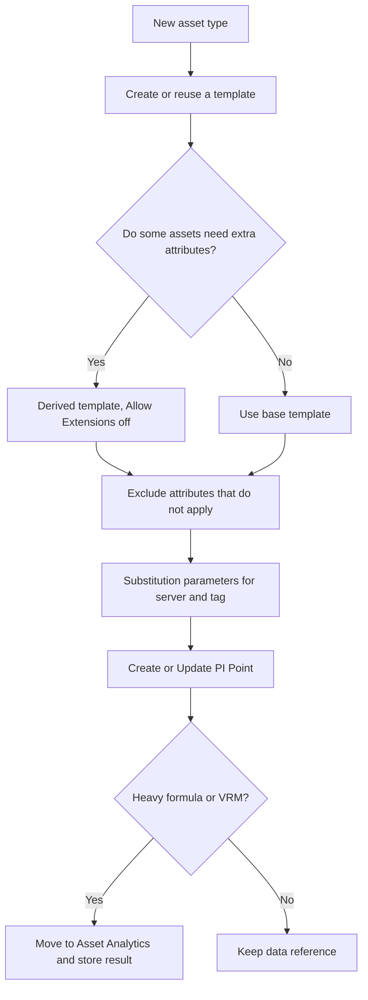

## Plain English

Asset Framework (AF) is the model of your plant: elements for equipment, attributes for their
measurements and properties, and templates that define each kind of asset. AF is flexible, and that
flexibility lets you build something that works for one pilot but fails at fleet scale.

OSIsoft's first AF commandment is **"Thou shalt use Templates"**: build every element from a
template, even an empty one. The second big idea is **"Defaults are not your friend"**: write units
of measure, formulas and servers explicitly. Most of the other rules follow from these two.

> [!TIP]
> OSIsoft's advice for getting started: "build AF for a single targeted project, using best
> practices", rather than modelling everything at once.

## Deep Dive

**Templates.**
- Elements built without a template are not recognised as that asset type in PI Vision and miss
  template changes. Fix by assigning the template and excluding attributes that do not apply.
- Use the **Excluded** property for attributes that do not apply to a given element.
- For a subset of assets that needs more attributes, use a **derived template** and disable
  **Allow Extensions** on base templates; extensions "will no longer guarantee all elements have the
  same set of attributes."
- Vistra Energy: "Strive to keep template count to a minimum."

**Portability with substitution parameters.** Set the server path as `%@\Data Archive|Name%` and the
tag name as `%@.|TagName%`. Editing one Data Archive Name attribute then repoints every linked
attribute during a migration. Do not rely on the default `%Server%`.

**Units.** Always assign a UOM and set Source UOM explicitly. Data Archive EngUnits is free text and
is not used for UOM conversion.

**Performance.**

| Pattern | Why |
|---|---|
| Run Create or Update PI Point | Locks in the resolved tag name; helps on large systems |
| Hide helper attributes (TagName) and missing instruments | Clients do not get errors |
| Move long Formula chains to Asset Analytics, store results in PI Points | Formula data references slow down with long dependency chains |
| Move Value Retrieval Methods (for example a 90-day average) to Asset Analytics | The Data Archive computes them on the fly each read |
| Prefer Rollup analyses over Formulas for aggregates | A formula with a hard-coded unit count fails when an element is deleted |
| Use expression variables | AVEVA's example went from 1.6 ms to 0.6 ms per evaluation |
| Schedule by need, offset daily runs from 12 AM | 6 months at a 1-minute trigger is 259,200 evaluations vs 180 daily |
| Disable analyses in Warning or Error | PI Analysis Service retries them every 15 minutes |

**AF tables.** Import no more than about 10,000 rows (rule of thumb), because non-external tables are
loaded entirely into client memory. Since PI 2014 the limit does not apply to external tables with
**parameterised queries**, because selection is done on the server.

**Controlled values.** Use enumeration sets instead of free text; since PI Server 2018 SP2 they can be
created from digital state sets.

**Hierarchy and databases.** Follow a standard such as S95 (Enterprise, Site, Area) and add views with
element references for other audiences. Design top-down, build bottom-up. Build fewer, larger AF
databases by business unit, because AF references only work within one database. Do not organise
assets in the Configuration database. Keep relational data in a relational database and link it with
AF tables. "Flat hierarchies are easier to maintain" (Vistra).

## Worked Example

AVEVA's "easy wins" review of a packaging plant AF database found:

1. **Copy-paste references.** "Sugar Grain Size" on three elements all pointed at FFS03's point.
   Fix: **Reset to Template** so each element resolves its own tag.
2. **Free-text typos.** "MF TECHNO" vs "MF TECNO" made a lookup return NoData. Fix: an enumeration
   set.
3. **Big table.** `select * from dbo.PackagingPlantMaint` loaded the whole table. Fix: a
   parameterised query `Where @Asset = Asset` with table parameter `@Asset = Value @Asset`.
4. **Over-eager schedule.** A 1-minute trigger for a result needed twice a week. Fix: a daily run
   at 1 AM, offset from the 12 AM default.
5. **Long formula chain** behind an OEE attribute. Fix: an Asset Analytics expression that writes to a
   PI Point.

## Diagram

## Common Mistakes

- **Elements without templates.** PI Vision does not treat them as the asset type.
- **Allow Extensions on base templates.** Elements drift apart.
- **Hard-coded server names** instead of a configuration attribute.
- **Copy-paste data references** pointing at another element's tag.
- **Free text instead of enumeration sets.**
- **Huge AF tables** loaded into client memory.
- **1-minute triggers for slow-changing results**, and leaving broken analyses enabled.
- **Expecting imports to delete objects.** Imports do not propagate deletions from master to sites.
- **Assuming check-in is harmless.** Checking in restarts running analytics for affected elements.
- **Modelling everything at once**, or beyond what is understood.

## Real-World Scenario

Vistra Energy reported an AF of 35 templates, 3,100 elements, 11,000 analyses and 250 PI Vision
screens over about 80,000 fleet tags (PI World 2019). Their advice was to keep template count to a
minimum and keep hierarchies flat. With few templates, a template change rolls out to every unit at
once, and one PI Vision display built on the template works for every similar asset.
