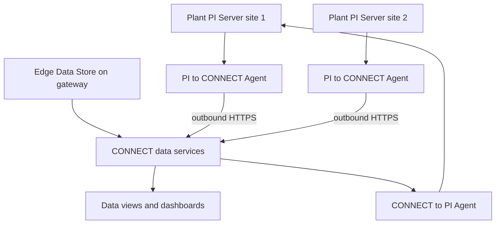

## Plain English

"PI in the cloud" can mean two different things:

1. **Lift and shift.** You run the normal PI Server software (Data Archive, AF, SQL, PI Vision) on
   virtual machines in Azure or AWS. OSIsoft's 2017 basics deck notes "VM and Cloud server hosting
   possible", and in 2019 OSIsoft showed AWS CloudFormation templates and Azure ARM scripts that build
   a whole PI environment.
2. **Cloud service.** You keep PI Server on site and send data to AVEVA's cloud platform,
   **CONNECT**, using an agent. CONNECT's data layer, **CONNECT data services**, was earlier called
   AVEVA Data Hub, and before that OSIsoft Cloud Services (OCS).

Many companies do both, or keep site servers and add a cloud copy for enterprise analytics.

## Deep Dive

**OSIsoft's Azure reference deployment (2019).** A "Self-contained PI environment in Microsoft Azure"
with VMs for the domain controller, PI AF, PI Data Archive, SQL, RDS, PI Vision, Analysis and
integrators. Internal load balancers front AF and SQL; external load balancers front RDS, PI Vision and
integrators. The deployment order is:

1. Network (vnet, subnets, network security groups)
2. Domain controller, then a DNS update
3. SQL and RDS
4. Integrator and PI Vision
5. AF and PI Data Archive
6. Analysis

A bootstrapper stores generated credentials in **Azure Key Vault** and uploads **DSC** configurations
and install kits. DSC's Local Configuration Manager defaults to ApplyAndMonitor at about 15-minute
intervals.

**CONNECT.** Unveiled at Hannover Messe in 2024, CONNECT is "an industrial intelligence platform" with
data, visualisation, modelling and analytics services, running on Microsoft Azure. On 11 July 2024 AVEVA
renamed AVEVA Data Hub to CONNECT data services.

**Agents.**

| Agent | Direction | Notes |
|---|---|---|
| PI to CONNECT Agent | PI Server to CONNECT | Runs on premises; transfers PI points and AF elements and attributes; reports tag usage; deletions replicate only if you opt in |
| CONNECT to PI Agent | CONNECT to PI | Writes data from CONNECT streams back to PI tags |

The 2024 course runs the PI to CONNECT Agent under a gMSA (`SVC-PICON$`). Bulletin AVEVA-2026-003
covers PI to CONNECT Agent v2.4.2520 and earlier when a proxy with credentials in the URI is used, so
keep agents patched.

**Edge Data Store (EDS).** IIoT software for Linux or Windows on small hardware such as gateways,
with built-in OPC UA and Modbus TCP, OMF and a REST API on port 5590. It "integrates natively with
AVEVA PI Server and AVEVA Data Hub".

**Network.** AVEVA notes cloud edge devices "require a single outbound port to be open and can be
routed via DMZ". Third-party gateways such as Waterfall push data to CONNECT using HTTPS-OMF.

**Licensing.** AVEVA stated in 2023 that PI Server 2023 requires AVEVA Flex, its subscription
program. Under the **Aggregate Tag** model the customer commits to a tag tier shared across all PI
Servers, overage is paid daily, and "Each PI Server in the aggregate tag model requires that the PI to
CONNECT Agent be installed and configured".

## Worked Example

A company with three plants wants enterprise dashboards without exposing the plant servers.

1. Keep a PI Server at each plant, as Vistra's design did with local servers.
2. Install a PI to CONNECT Agent at each site (the OCS-era enterprise pattern was one agent per site).
   It authenticates to the local PI Server with Windows accounts and pushes points and AF context out.
3. Allow one outbound HTTPS path from the DMZ; nothing in the cloud connects inward.
4. Analysts build CONNECT data views (JSON, CSV or Parquet output) over the combined data.
5. A forecast calculated in the cloud is written back to a plant tag with the CONNECT to PI Agent.
6. Because the company is on the Aggregate Tag model, the same agents also report tag usage.

## Diagram

## Common Mistakes

- **Assuming deletions in PI are mirrored to the cloud.** Replicating deletions is opt-in.
- **Opening inbound ports to the plant for a cloud service.** Agents push outbound.
- **Forgetting the agent on one server under the Aggregate Tag model.** Each PI Server needs it.
- **Treating cloud VM snapshots as portable backups.** They restore only to the same environment.
- **Leaving agents unpatched.** Agents have their own security bulletins.

## Real-World Scenario

Vistra Energy described a fleet of 58 sites and 68 PI servers. The initial build-out had 33 local PI
servers and 1 corporate cloud PI server, and Vistra piloted parallel data flows to both site and cloud
PI servers (PI World 2019). Sites keep running on their local servers if the wide-area link drops,
while the corporate cloud server gives fleet-wide analysis on one set of templates.
