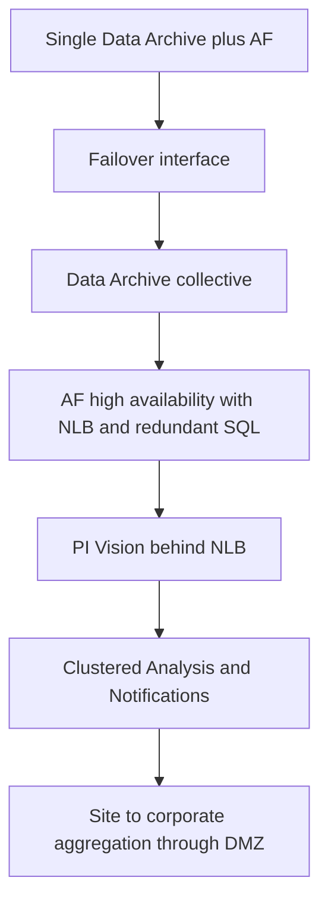

## Plain English

There is "No perfect architecture". OSIsoft's advice is to "Plan the desired architecture in advance"
and "Expand as needed". Most systems start small and add redundancy and security layers as they become
more important to the business.

OSIsoft's **growth path**:

1. A single Data Archive plus AF.
2. Add a **failover interface** so collection survives an interface node failure.
3. Make the Data Archive a **collective**.
4. Make AF highly available.
5. Put PI Vision behind a network load balancer (NLB).
6. Cluster Analysis and Notifications.

## Deep Dive

**By size** (a synthesis of AVEVA guidance, not an official tier table):

| Size | Typical pattern | Why |
|---|---|---|
| Small / lab | One server with Data Archive, AF and SQL Express | A 2012 OSIsoft rule put PI, AF and SQL on one node for under 10,000 assets and 25,000 tags; Express is limited to 1 CPU, 1 GB RAM, 10 GB |
| Mid-size | SQL Server on its own server; AF and Data Archive separate; buffered interfaces, ideally failover pairs | AVEVA recommends SQL on a different computer, and separate AF when it uses several PI Servers or is HA |
| Enterprise | Data Archive collectives, two AF Servers behind an NLB, redundant SQL, a DMZ, corporate aggregation | AVEVA's recommendation for large distributed systems |

**Security patterns (PI World 2019).**

| Pattern | Design |
|---|---|
| 1 | Web-facing PI Vision, Notifications and PI Web API in a DMZ |
| 2 | Pattern 1 with high availability |
| 3 | DMZ with PI to PI carrying data only; no user queries cross the boundary |
| 3 variant | PI Connector Relay in the DMZ |
| 3+ | One-way transfer "enforced by physics" (a data diode) |

See [DMZ, data diodes and PI to PI](#/learn/dmz-diodes-pi-to-pi) for detail.

**Site to corporate.** Sync site AF to corporate with AFExport/AFImport (or AF SDK for deletions),
with templates owned centrally and deployed to sites. PI Cloud Connect linked site Data Archives and
AF to a corporate site and partners. Waterfall supports many-to-one aggregation of industrial PI
servers into an enterprise replica, with complete or selective replication.

**Licensing notes.** Each PI to PI connection is one-way, so bidirectional transfer needs two
licences. A failover interface "only sends data if the primary interface or connector deployment
fails".

**Collection.** AVEVA has over 450 PI interfaces and over 20 PI Connectors, so most sources have an
off-the-shelf collector.

## Worked Example

An illustrative water utility starts with one treatment plant and grows over five years.

1. **Year 1 (small).** One server runs Data Archive, AF and SQL Express for a pilot of a few thousand
   tags, built "for a single targeted project, using best practices".
2. **Year 2 (mid-size).** The pilot becomes business-critical. SQL Server moves to its own server
   (and off Express), AF and Data Archive split, and interfaces become a failover pair with buffering.
3. **Year 4 (enterprise).** Three more plants join. Each plant keeps a local Data Archive; a corporate
   collective receives data by PI to PI from each site's DMZ (security Pattern 3). Two AF Servers sit
   behind an NLB with redundant SQL. Templates are owned centrally and deployed to sites with
   AFExport/AFImport.
4. **Year 5.** The regulator asks for stronger separation at one critical plant, so that plant moves to
   a one-way gateway (Pattern 3+).

## Diagram

## Common Mistakes

- **Building the enterprise design on day one** for a pilot that has not proven its value.
- **Staying on a single server with SQL Express** after the system becomes critical.
- **Letting users query across the control-network boundary** instead of using a DMZ replica.
- **Assuming one PI to PI licence covers both directions.**
- **Letting each site invent its own templates**, which breaks corporate roll-ups.

## Real-World Scenario

Vistra Energy ran 58 sites and 68 PI servers, with 33 local PI servers and 1 corporate cloud PI server
in the initial build-out (PI World 2019). Its AF used 35 templates and about 3,100 elements, so the
same templates and displays served the whole fleet. Waterfall describes the same many-to-one idea for
security-sensitive fleets: industrial PI servers replicate through unidirectional gateways into one
enterprise replica that business users query.
