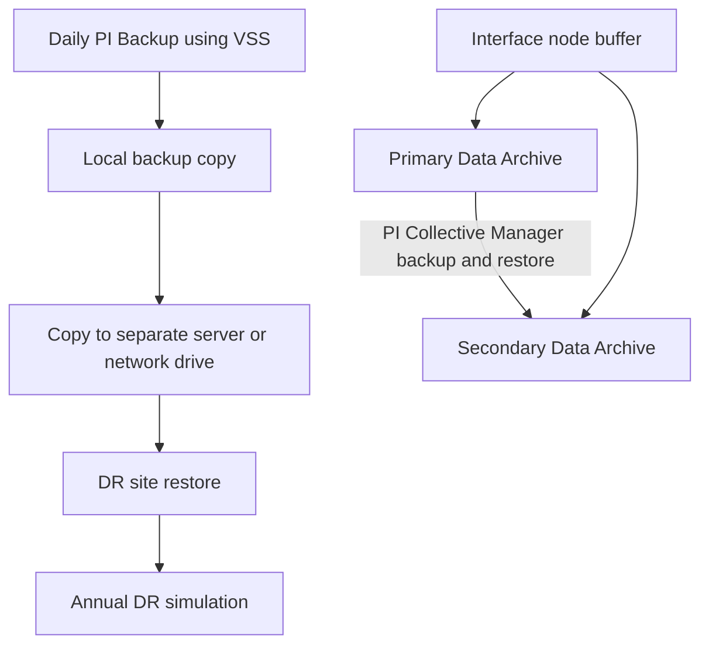

## Plain English

Three ideas are often mixed up:

- **Backup**: a copy of your data and configuration that you can restore.
- **High availability (HA)**: keeping the system running when one server fails, for example a
  second Data Archive in a **collective**.
- **Disaster recovery (DR)**: a planned, tested way to get the service back after losing a whole site
  or system, for example to ransomware.

OSIsoft is blunt: "PI Backups, Redundant Interfaces and High Availability are NOT stand-alone Disaster
Recovery solutions." You need all three, plus a DR simulation at least once a year.

> [!NOTE]
> 99.9% uptime still allows about 43.8 minutes of downtime per month, or 8.76 hours per year.

## Deep Dive

**Backups.** PI Backup uses Windows **VSS**, so it backs up files in use without downtime. AVEVA's
security deck recommends daily backups off-peak with Windows Task Scheduler, backing up locally and
then copying to a separate server or network drive. This two-phase approach helps ransomware recovery.

**Collectives.** A PI Data Archive collective has a primary and one or more secondaries.

- Members should be identical and can be in different data centres.
- Only some configuration replicates from primary to secondaries; archives are independent on each
  member.
- PI Collective Manager builds a secondary by taking a PI Backup of the primary, copying it and
  registering it.
- Interface nodes use the PI Buffer Subsystem to fan data out to every member.
- Point expensive clients at a secondary to protect the primary.
- Licence note: HA servers form a collective with the primary and "cannot be separated to operate as
  independent PI Servers", and backup copies may not be used "as a hot standby".

**AF HA.** AF behind a Network Load Balancer with SQL Server on separate redundant computers.

**Archive housekeeping.** The primary archive cannot be unregistered and has no end time. Keep at least
2 empty historic archive files. Each archive's `.ann` annotation file must stay in the same directory
as its `.arc` file. `piartool` changes archive registration only on the host it runs on.

**Moving to new hardware.** Moving a Data Archive currently means installing the same software
version on the new server and restoring from a backup of the old one.

**Moving AF between environments.** Use substitution parameters (`%@\Data Archive|Name%`) so one
attribute change repoints all data references. AFExport and AFImport copy databases, but imports do
not propagate deletions.

**Cloud VMs.** In OSIsoft's Azure deployment, restoring a VM from disk snapshots is much faster than
redeploying, but snapshots are large, not portable, and must restore to the same environment.

> [!VERIFY]
> Exact `piartool -backup` syntax and pibackup script options were not readable, and SQL AlwaysOn
> support per AF version was not confirmed.

## Worked Example

**Moving archive files to a new disk** (2017 R2 IT course):

1. Force an archive shift so the files you move are no longer the primary.
2. Unregister the archive with piartool, on the host that owns it.
3. Move both the `.arc` file and its `.ann` file to the new folder.
4. Re-register the archive in its new location.
5. On a collective, repeat on each member: archives are independent and `piartool` acts only on the
   local host.

## Diagram

## Common Mistakes

- **Treating HA or backups as the DR plan.**
- **Leaving backups only on the same server**, where ransomware or disk loss takes both.
- **Running piartool once and expecting every collective member to change.**
- **Moving `.arc` files without their `.ann` files.**
- **Running out of empty archives.** Keep at least two.
- **Using a backup copy as a running hot standby**, which the licence schedule does not allow.
- **Hard-coded server names in AF**, which turn an environment move into thousands of edits.

## Real-World Scenario

Consider an illustrative case (not a published customer story): a plant suffers ransomware on its
business network, which also encrypts the PI server's local backup folder. Because the team followed the two-phase approach, a copy of last night's PI Backup sits on a
separate server. They install the same PI Server version on a clean machine, restore the backup and
point the buffered interfaces at it; the interface buffers hold the data collected during the outage.
The annual DR simulation they ran six months earlier is why the restore steps were already written
down.
