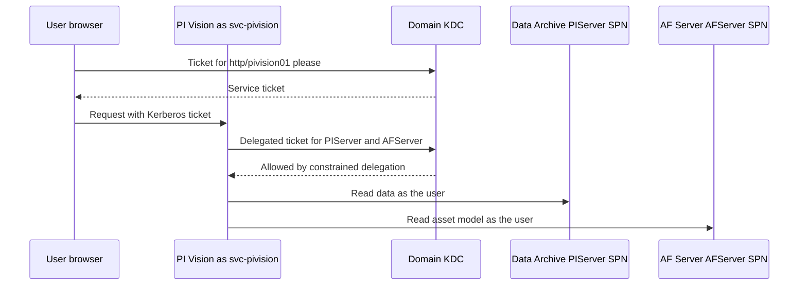

## Plain English

Hardening means removing the easy ways in. For a PI Server that comes down to four habits:

1. **Know who is connecting.** Use Windows accounts (ideally Kerberos) instead of shared logins or
   trusts based only on an IP address.
2. **Give the least access needed.** Map Active Directory groups to PI identities with only the rights
   each role needs.
3. **Shrink the server.** Install on Windows Server Core, allow-list applications and open only the
   ports the PI System uses.
4. **Patch.** AVEVA security bulletins name the minimum fixed versions.

AVEVA's preferred authentication order is: **OIDC** (PI Server 2023 and later), then **Windows
Integrated Security** (Kerberos, then NTLM), then **PI Trusts**, then **explicit logins**.

## Deep Dive

**Identities and mappings.** A **PI Identity** is a role that holds permissions. A **PI Mapping**
links an AD user or group to it. "Mappings are cumulative, not exclusive", whereas trusts give only
one "best fit" match. PI Users and PI Groups are kept only for backward compatibility. Windows
Integrated Security came with PI Server 3.4.380 (fall 2009).

**Trusts.** Avoid "open" trusts that name only the server. If a trust is unavoidable, apply the
**2+ rule**: pair the application name with an IP address, host name or FQDN. "It is not safe
practice to map trusts to the piadmin user." Upgrading to PI API for WIS (2.0.1.35 and later) turns
PI Trust authentication off by default, so convert trusts to mappings first.

**piadmin and explicit logins.** Do not use the default piadmin account: give it a password and use
the **piadmins** group. In PI SMT security settings, disable explicit login, disable explicit login
for piadmin and disable blank passwords, then restart the PI Base Subsystem. Once rules exist,
"Disable PI World (identity) and PI Demo (user)." The Data Archive logs the AD account of
administrators even when they connect as piadmin.

**Least privilege for collectors.** A PI interface needs Read on PIPoint, DBSecurity, PtSecurity and
DataSecurity; the PI Buffer Subsystem needs only Write on DataSecurity.

**Operating system.** Install on Server 2016-2022 Core. Use WDAC on Core and AppLocker (audit mode
first) on older or non-Core servers. Keep anti-virus exclusions to the archive, queue and log folders.

**Firewall ports (UC23 deck).**

| Server | Direction | Port | Purpose |
|---|---|---|---|
| Data Archive | Inbound | TCP 5450 | All PI clients |
| Data Archive | Outbound | TCP/UDP 135 | SPN registration |
| Data Archive | Outbound | TCP/UDP 88 | Kerberos |
| Data Archive | Outbound | UDP 53 | DNS |
| Data Archive | Outbound | TCP 5457 | MDB-to-AF sync |
| AF Server | Inbound | TCP 5457 / 5459 / 5463 / 5468 | AF SDK / PI SQL for AF / Analysis / Notifications clients |

Bulletins repeat: "Limit network access to port 5450 to trusted workstations and software."

**Kerberos.** Kerberos is preferred over NTLM, which has weaker encryption and is open to
pass-the-hash; Negotiate can silently fall back to NTLM. An **SPN** tells the domain which account runs
a service. Expected classes: `PIServer` (Data Archive), `AFServer` (AF) and `http` (PI Vision).
Keep clock drift under 5 minutes.

A **double hop** (PI Vision passing the user on to the Data Archive and AF) needs delegation. Use
constrained delegation to PIServer and AFServer; "Unconstrained Delegation is not recommended!" An
OSIsoft workbook calls **RBCD** the "highly recommended type of delegation".

**Auditing.** The Data Archive `EnableAudit` tuning parameter selects audited databases (-1 = all);
an admin can set it to 0, so monitor it. The AF Audit Trail is enabled with
`AFDiag /EnableAuditTrail:True` with SQL Server Agent running.

## Worked Example

PI Vision checklist from AVEVA's UC23 security deck, for service account `CORP\svc-pivision` on host
`pivision01` (names illustrative):

1. Create a custom service account and run PI Vision's application pools as it.
2. Set the site to use application-pool credentials
   (`system.webServer/security/authentication/windowsAuthentication`).
3. Create both SPNs:
   ```
   setspn -U -S http/pivision01 CORP\svc-pivision
   setspn -U -S http/pivision01.corp.example.com CORP\svc-pivision
   ```
4. Delegate `svc-pivision` to the PISERVER and AFSERVER services (constrained, or RBCD).
5. Verify: `setspn -l CORP\svc-pivision`, `setspn -q PIServer/pida01`, and
   `Get-ADUser 'svc-pivision' -Properties msDS-AllowedToDelegateTo`.
6. If logins still fall back to NTLM, set `LogLevel` (REG_DWORD 1) under
   `HKLM\SYSTEM\CurrentControlSet\Control\Lsa\Kerberos\Parameters`, run `klist purge`, and read the
   System event log and the Data Archive message log.

## Diagram



## Common Mistakes

- **Open trusts, or trusts mapped to piadmin.**
- **Upgrading PI API for WIS before converting trusts**, which breaks interfaces.
- **Only one SPN.** Without the FQDN SPN, only one of the two names works.
- **Unconstrained delegation**, or Network Service as the PI Vision pool identity in multi-server
  setups.
- **Clock drift over 5 minutes**, which breaks Kerberos.
- **Broad anti-virus scanning** of archive and queue folders, which can hurt performance or lose data.
- **Weakening PI Web API to make a tool work.** Some third-party guides enable Basic authentication
  and set `EnableCSRFDefense` to false; Basic exposes credentials on the network.

## Real-World Scenario

AVEVA-2024-001 (CVE-2023-34348, CVSS 7.5) let an unauthenticated user crash or exhaust the PI
Message Subsystem in PI Server 2023 and 2018 SP3 Patch 5 and earlier. Until a site could patch,
AVEVA advised restricting write access to the Message Log through the PIMSGSS entry in Database
Security, auto-restarting the PI Message Subsystem, monitoring its memory and limiting port 5450 to
trusted workstations. A site that already had least-privilege identities and a tight port 5450 rule
had a much smaller exposure while it scheduled the upgrade to 2023 Patch 1 or 2018 SP3 Patch 6.
