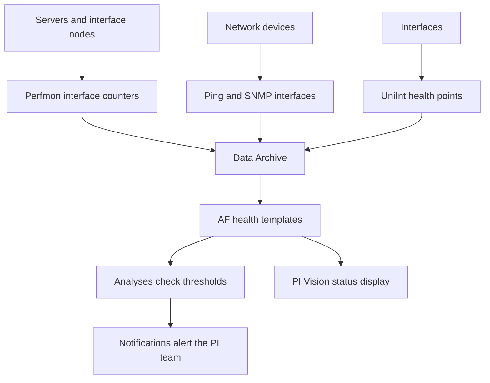

## Plain English

The PI System is good at collecting and alerting on time-series data, so the simplest way to monitor
it is to point it at itself. You collect counters (CPU, events per second, connections), network
latency and interface health into PI Points, then use AF, analyses, notifications and PI Vision to
watch them, just like process data.

Start by agreeing what "healthy" means. VELCO's definition is a good template:

- data flowing
- data stored
- no corruptions
- no significant errors
- capacity to continue
- users can access data

## Deep Dive

**PI IT Monitor** bundles the PI Performance Monitor (Perfmon), PI Ping, PI TCPResponse, PI SNMP and
PI NetFlow interfaces, PI PacketCapture, SYSLOG, SNMP Trap, PI ICU and the PI Interface Status
Utility. Basic versions of Ping, Perfmon and SNMP came with a PI server but were limited; full
versions on a dedicated interface node had no limits.

**Perfmon counters worth collecting** (Perfmon "Can read performance counters from a local or a
remote machine"):

| Object | Counters |
|---|---|
| PI Network Manager | Connections, Bytes Sent/sec, Bytes Received/sec |
| PI Update Manager | Pending Events |
| PI Archive Subsystem | Archived Events/sec, Out of Order Events/sec, Time to Archive Shift |
| PI Snapshot Subsystem | Snapshots/sec, OutOfOrderSnapshots/sec |
| PI Base Subsystem | Point Count |

A 2010 deck adds Total Unflushed Events, Events in Overflow Queues, Is Available, Is In Sync and RPC
Request in Queue.

**Network.** PI Ping "Measures the latency of network connections". OSIsoft recommends a Ping tag for
each data acquisition node, major network device, application server and external destination.

**Interface health points (UniInt).**

| Point | Healthy reading | Caution |
|---|---|---|
| Heartbeat | Cycles 1 to 15 | Shows the interface runs, not that it collects data |
| Device Status | GOOD | |
| IO Rate | Keeps updating | If it stops, collection has stopped |
| Scan Class Scans Skipped | Low | 8-hour reporting period by default |

The **PI Interface Status Utility** watched a watchdog tag per interface and set a bad digital state
when it went stale, but it has been removed from PI Server install kits.

**Data Archive statistics.** `piartool -ss`, `-qs` and `-as` show snapshot, event queue and archive
statistics, refreshing every 5 seconds. In `-qs`, Total Event Reads and Total Event Writes should rise
together and there should normally be 1 event queue file. In `-as`, the archiving flag is 0 none,
1 historic only, 2 future only, 3 both; 3 is healthy for Data Archive 2015 and later.

**Services.** Security bulletins advise monitoring that PI Network Manager and PI Archive Subsystem
(and all services in `\PI\adm\pisrvstart.bat`) are alive and set to restart automatically.

**Scripted checks.** A PI Square PowerShell health script checks archives, critical messages, Network
Manager statistics, tuning parameters, services, stale and bad points, AFLink, collective members,
license, archive gaps and backups. It needs PowerShell Tools for the PI System, uses
`Connect-PIDataArchive` and must run as local administrator on the Data Archive.

## Worked Example

Build a monitoring template, VELCO style:

1. Create an AF element template "PI Server Health" whose attributes create Perfmon tags
   automatically: CPU, memory, Archived Events/sec, Connections, Pending Events.
2. Add Ping attributes for each interface node.
3. Add references to each interface's IO Rate and Device Status points.
4. Add an analysis: "Archived Events/sec has been 0 for 10 minutes" sets a status attribute.
5. Add a notification rule on that status to e-mail the PI team.
6. Build one PI Vision display on the template, so every server gets the same view.

Thresholds here are illustrative; tune them to your own normal rates.

## Diagram

## Common Mistakes

- **Treating Heartbeat as proof of data collection.** IO Rate is the better indicator.
- **Watching only the server.** Interfaces and the network fail more often than the archive.
- **No automatic restart** for PI Network Manager and PI Archive Subsystem.
- **Relying on the Interface Status Utility** in new installs; it is no longer in the kit.
- **Monitoring without alerts.** A dashboard nobody watches finds problems late.

## Real-World Scenario

VELCO, a US transmission utility, presented its PI health monitoring at AVEVA World 2023. It collects
data with the PI PerfMon Interface and interface health points, evaluates it with PI Analyses, alerts
with PI Notifications and shows status in PI Vision. Everything is standardised with AF templates that
create the tags automatically, so a new server is monitored as soon as its element is created. In the
NERC CIP era, sites also used a Syslog PI interface to collect firewall logs and keep "electronic
access logs for 90 days" (Digital Bond, 2011).
