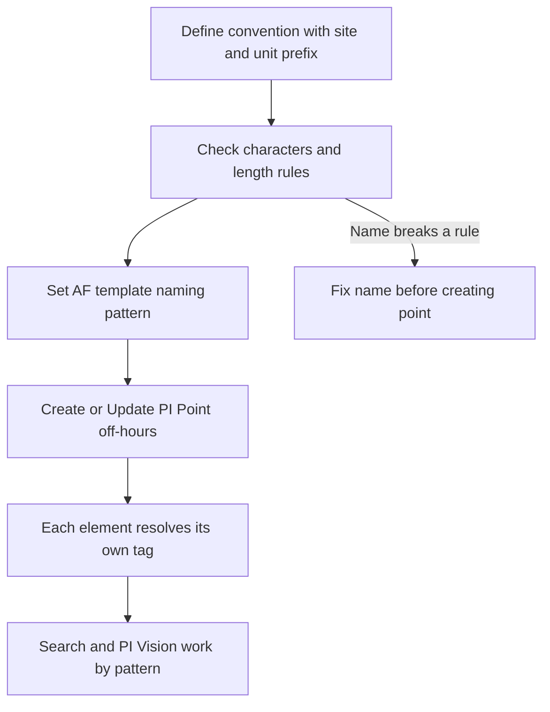

## Plain English

Every PI Point has a **tag name**, and every AF element has a name. People search, trend and report
on these names every day, so they should be predictable. The PI Server guide asks for "a consistent
tag-naming convention that is meaningful to people in your organization": for example, leading
characters for the unit or plant area, followed by the standard instrument tag.

A good convention also helps machines. AF templates build tag names from patterns like
`%Element%.%Attribute%`. That only works if the names follow a pattern.

## Deep Dive

**Character rules for tag names** (PI Server guide, quoted on PI Square):

- "The first character must be alphanumeric, an underscore (_), or a percent sign (%)."
- Control characters such as linefeeds and tabs are not allowed.
- Not allowed anywhere in a tag name: single quote `'`, double quote `"`, question mark `?`,
  semicolon `;`, curly braces `{ }`, square brackets `[ ]`, pipe `|`, backslash `\` and backtick.
  These are allowed in other attributes such as the descriptor.
- "SQL uses the underscore (_) and percent sign (%) as wild cards", so those characters may cause
  problems in some applications even where they are legal.

**Length.** The guide says tags "may be any length", but components impose limits: PI API
`pipt_tag` and `pipt_updates` truncate to 12 characters, `pipt_findpoint` reports only the first 80,
and the PI SQL Subsystem can only process tags of at most 1016 characters.

**Encoding.** A PI Square answer says PI Server does not support Unicode in tag names and stores the
raw bits, so readers must use the same non-Unicode encoding as the creator.

**AF naming.**

- Element names must be unique within their path. The course recommends unique names across the
  whole hierarchy, adding a location code for duplicate device names.
- Distinct element names are "less confusing for the users" and easier in tabular reports.
- Renaming an element is safe for AF relationships, which use GUIDs, but PI Vision and PI DataLink
  definitions use element names and need updating.
- The AF default PI Point naming pattern is `%Element%.%Attribute%.%ID%`. Templates that auto-create
  points help "Ensure PI Point naming consistency".
- Vistra Energy's lessons: "Limit and discourage the use of acronyms" and "Naming convention is
  important for PI Vision".

**Bulk changes.** Creating points takes a global lock, so create points in bulk during off-hours.

## Worked Example

A food plant has filler lines FFS01 to FFS03. Its current tags are `FFS01SealTemp` and `02ST3000`.

1. Because the names have no common pattern, an AF template cannot build them with substitution;
   you would need a manual TagName child attribute on every element, or PI Builder.
2. The team adopts `<Element>.<Attribute>` for new tags. A String Builder pattern
   `"%Element%";".";"%..|Attribute%";` builds names like `FFS01.OEE`.
3. A Tank template uses `%Element%.%Attribute%`, so each tank element resolves to its own point.
4. They run **Create or Update PI Point** off-hours (point creation needs a global lock).
5. Existing PI Vision displays that referenced old element names are checked after renames.

## Diagram

## Common Mistakes

- **Random names.** One PI Square user found their names "too random (not structured enough)" to
  use substitution parameters.
- **Using `_` or `%` heavily.** They are SQL wildcards and cause trouble in SQL-based tools.
- **Forbidden characters** such as `?`, `;`, `[ ]` or `|` in tag names.
- **Relying on long names with old PI API clients**, which truncate to 12 characters.
- **Renaming AF elements without updating PI Vision and DataLink**, which use element names.
- **Too many acronyms** that only one team understands.

## Real-World Scenario

Vistra Energy's fleet tags follow a pattern like `DCS_ML1_BM_1B_BOWL_MILL_MTR_IB_BRG_T`, about 80,000
fleet tags in all. Using AF to guide tag creation gave them an "Improved and consistent naming
convention." Their lessons for others were to limit acronyms and to treat naming as important for
PI Vision, because displays built on templates rely on predictable names (reported by Vistra Energy
at PI World 2019).
