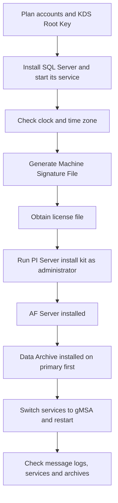

## Plain English

A PI Server is two main products: the **PI Data Archive** (stores time-series data) and the
**PI AF Server** (stores the asset model, in a SQL Server database). One installer, the
**PI Server install kit**, installs both.

The order matters. OSIsoft's implementation guidance says:

1. Install Microsoft SQL Server.
2. Install the AF server using the PI Server install kit.
3. Install any instances of Data Archive.

Before you start you also need a **license file**. The install kit creates a
**Machine Signature File (MSF)** on the target server. You use the MSF to get the license file,
and the license file must exist *before* the Data Archive is installed.

> [!TIP]
> Think "database, then model, then data": SQL Server first, AF next, Data Archive last.

## Deep Dive

**Pre-install checklist (2024 AVEVA Architecture course).**

| Check | Why |
|---|---|
| Installer account is an administrator with Write permission to SQL Server, and Windows is updated | Setup creates the AF database |
| SQL Server installed and its service running | "Ensure the MS SQL Server service is started before installation" |
| OS clock and time zone correct | "Changing the clock after installation will cause problems." All clocks should sync from a network time source |
| MSF generated and license file obtained | A license file must exist before Data Archive is installed |
| Run the installer as administrator | Needed for services and folders |

Setup copies the license file (`pilicense.dat`) to `%PISERVER%\dat`; the original file is then no
longer used.

**Where to put SQL Server.** AVEVA recommends installing SQL Server on a different computer from
PI Server. SQL Server Express is limited to a single physical CPU and 1 GB of RAM (OSIsoft also cites
a 10 GB database cap and no AF audit tables), so it suits labs, not production AF.

**Operating system.** The 2024 course lists Windows Server 2022 (recommended), 2019 and 2016, full
or Core, for production, and Windows 10 for test systems only. Server Core also reduces the attack
surface (see [Hardening and Kerberos](#/learn/hardening-and-kerberos)).

**Service accounts.** The course runs services under **group Managed Service Accounts (gMSAs)**, for
example `SVC-PIDA$` (PI Network Manager), `SVC-PIAF$` (AF Application Service), `SVC-PIANALYT$`
(PI Analysis Service) and `SVC-PICON$` (PI to CONNECT Agent). gMSA names must be fewer than
15 characters, and "By default, it takes 10 hours until the KDS Root Key is in effect", so create the
root key well before install day. After install you stop the Data Archive with `pisrvstop.bat`,
switch PI Network Manager to the gMSA and restart. The PI Buffer Subsystem accepts a gMSA from
version 4.9.0.37; older versions need the gMSA added to the local PI Buffering Administrators group.

**Unattended installs.** The install kit reads an answer file, `silent.ini`. OSIsoft's PowerShell
sample (`Install-PIServer.ps1`) uses the TYPICAL feature set (Data Archive, AF Server and supporting
products) and requires .NET Framework 4.8 to be installed first for PI Server 2018 SP3 (a restart is
usually needed).

**Disk planning figures from the course.** Data Archive and PI SDK need 160 MB plus 100 MB temporary
space; databases 11 MB per 1,000 points plus 1 MB; archive files 10 MB per 1,000 points; event queue
5 MB per 1,000 points. An upgrade rollback backup needs space equal to the databases plus the primary
archive.

**Upgrades and patches.** AVEVA security bulletins set minimum targets:

| Bulletin | Fixed in |
|---|---|
| AVEVA-2024-001 | PI Server 2023 Patch 1 or 2018 SP3 Patch 6 |
| AVEVA-2025-001 | PI Server 2024 or 2018 SP3 Patch 7 |
| AVEVA-2026-002 | PI Server 2024 R2 or 2018 SP3 Patch 8 |

Bulletins label the 2018 SP3 line "(Core)" and 2023 "(Hybrid)".

> [!VERIFY]
> The supported upgrade paths (for example the oldest version that can upgrade in place to 2024)
> and the supported SQL Server versions per release were not found in a readable source. Check
> docs.aveva.com before planning.

## Worked Example

A team builds the course lab: a two-member collective (PISRV01, PISRV02), two interface nodes
(PIINT01, PIINT02) and a domain controller (PIDC).

1. Day -1: create the KDS Root Key and the gMSAs (`SVC-PIDA$`, `SVC-PIAF$`, `SVC-PIANALYT$`),
   because the root key takes 10 hours to take effect by default.
2. Install SQL Server on its own server and confirm its service is running.
3. On PISRV01, run the install kit to generate the MSF, obtain the license file, then run the
   installer as administrator. Select features, directories (lab: archives `E:\PIArchives`, event
   queues `E:\PIEventQ`), the SQL instance and the gMSAs.
4. Stop the Data Archive with `pisrvstop.bat`, switch PI Network Manager to `SVC-PIDA$`, restart.
5. Do the collective primary first: "you must first perform the installation and post-installation
   tasks on the primary server."
6. Verify: search the message logs for errors, and check PI Services and Archives in PI SMT.

Do not expect default health points: a PI Server 2018 SP3 install creates none, even though an older
install guide said to check them.

## Diagram

## Common Mistakes

- **Wrong order.** Installing the Data Archive before SQL Server and AF breaks the recommended
  sequence.
- **Changing the server clock after install.** The course warns this causes problems.
- **Forgetting .NET Framework 4.8** (and its restart) before running the 2018 SP3 kit.
- **Creating the gMSA on install day.** The KDS Root Key needs 10 hours by default.
- **Running production AF on SQL Express.** It is capped at one CPU and 1 GB of RAM.
- **Expecting default points after a 2018 SP3 install.** None are created.
- **Thinking you can just copy a Data Archive to new hardware.** A 2025 AVEVA feedback idea notes
  that moving it means installing the same version and restoring from backup.

## Real-World Scenario

OSIsoft's implementation guidance says a medium-sized PI System installation "would be quoted at
under 5 days by OSIsoft field service". Most of that time goes into preparation: accounts, SQL
Server, licensing and verification, not the installer itself. A site that plans its gMSAs, license
file and SQL Server a week ahead can run the install kit, follow it with the post-install checks in
PI SMT, and then apply the latest patch named in AVEVA's security bulletins before connecting
interfaces.
