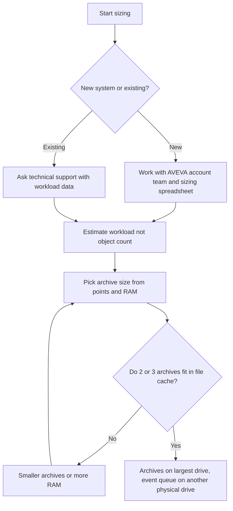

## Plain English

"How big a server do I need?" has no single published answer. AVEVA does not publish Data Archive
CPU and RAM figures in its course. New systems are sized with your Customer Success Manager and
Account Manager, and existing systems through technical support. OSIsoft said hardware sizing
"should be based upon workload, not AF object count, because they do not correlate", and pointed to
its Hardware and PI System Sizing Recommendations spreadsheet.

What you *can* size yourself is the **archive file**. The rule is simple: archives should be small
enough that recent ones fit in RAM (in the Windows file system cache), and big enough for your
point count.

> [!NOTE]
> There is no hardware sizing tool for interface machines, according to OSIsoft's implementation
> guidance.

## Deep Dive

**Archive size rules.** Two versions of AVEVA training give slightly different rules.

- *2017 R2 IT course:* take (physical memory MB) / 3, or 3 x (licensed points) / 1024 MB, whichever
  is smaller; round down to a power of 2; minimum 256 MB, maximum 10,240 MB.
- *2024 course:* archives get at least 2 KB per point; the default is 3 KB x total points rounded to a
  power of 2, capped at 10 GB; and "Select a size so that at least 2 archive files can fit in the
  Windows File System Cache."

2024 course table by licensed points:

| Licensed points | Archive size |
|---|---|
| 0 - 87,381 | 256 MB |
| 87,382 - 174,762 | 512 MB |
| 174,763 - 349,525 | 1,024 MB |
| 349,526 - 699,050 | 2,048 MB |
| 699,051 - 1,398,101 | 4,096 MB |
| 1,398,102 - 2,796,202 | 8,192 MB |
| 2,796,203 or more | 10,240 MB |

By physical memory: under 1,536 MB gives 256 MB, 6,144-12,287 MB gives 2,048 MB, and 30,720 MB or
more gives 10,240 MB. The UC23 performance deck goes further: enough RAM to hold three archives, with
each archive no larger than a third of system RAM. The OS caches files in 256 KB sections.

**Storage.** "Lower latency storage has a greater impact on performance queries than having more
IOPS." Put archives on the largest drive and the event queue on the second-largest; AVEVA recommends
the event queue be on a different physical drive from the archives. Archives are fixed size by
default; dynamic archives are only for troubleshooting and reprocessing. A new archive is created at
about 98% full. Future archives start at 1 MB, span one calendar month and grow. The PI Buffer
Subsystem queue file defaults to 32 MB.

**Server roles.** Separate AF and Data Archive computers are recommended when AF uses data from
several PI Servers or is highly available. SQL Server should be on a different computer from PI Server
(SQL Express is limited to one CPU and 1 GB RAM). For AF's SQL Server, give more RAM and fast disks.
"AF Server never talks to PI Data Archive", so optimise client-to-server latency.

**Historic capacity figures (use with care).**

| Source | Figure |
|---|---|
| 2012 sizing guide | RAM minimum 15 KB per point; recommended enough to fit 2 full archives in RAM; CPU cores 4 + active connections / 5 (min) or / 2 (recommended) |
| 2012 keynote tiers | XS 50K points / 10K write EPS / 1 GB RAM up to XL 20M+ points / 1M+ EPS / 256 GB (write EPS assumes 50% compression) |
| 2017 basics deck | 20M+ tags; snapshot in over 1M events/s; archive in over 500K events/s |
| 2010 optimisation deck | storage est. 5-20 bytes per event |
| 2012 AF topology | under 10,000 assets and 25,000 tags can put PI, AF and SQL on one node |

PI Server 2024 improves out-of-order writes by up to 40% for numbers and up to 90% for strings and
blobs ("Your mileage may vary").

> [!VERIFY]
> No readable source gave PI Vision or AF Server hardware sizing numbers. The 2010-2012 figures are
> historic and may not match current releases.

## Worked Example

A site has **600,000 licensed points** on a server with **32 GB RAM** (32,768 MB).

1. *2017 R2 rule.* Point rule: 3 x 600,000 / 1024 = about 1,758 MB, rounded down to a power of 2 gives
   1,024 MB. Memory rule: 32,768 / 3 = about 10,922 MB. Take the smaller: **1,024 MB**.
2. *2024 table.* 600,000 points falls in the 349,526-699,050 row: **2,048 MB**. 32 GB RAM sits in
   the 30,720 MB-or-more memory row (10,240 MB), so memory is not the limit.
3. *UC23 check.* Three 2,048 MB archives need 6 GB of cache, well under a third of RAM each.

The two course versions differ, so record which rule you used. The course exercise sets
`Archive_AutoArchiveFileSize` to 512 MB, which shows the parameter is how you apply your choice.

## Diagram

## Common Mistakes

- **Sizing AF by object count.** OSIsoft says workload and object count do not correlate.
- **Archives too big for the file cache.** Queries then hit disk instead of memory.
- **Event queue on the same physical drive as archives.** AVEVA recommends separating them.
- **Buying IOPS instead of low latency.** Latency matters more for query performance.
- **Running production AF on SQL Express.** 10 GB database, 1 GB RAM, no audit trail.
- **Treating 2012 tier tables as current specifications.** They are historic marketing figures.

## Real-World Scenario

OSIsoft's 2012 lab test ran PI Server 2010 and PI Server 2012 on identical 6 vCPU / 12 GB virtual
machines. PI Server 2010 sustained 150K events/s (10K points at 15 Hz) and PI Server 2012 sustained
600K events/s (10K points at 60 Hz). The same hardware gave four times the throughput after a software
upgrade, which is why AVEVA asks for workload and version details rather than quoting fixed hardware.
The same era's virtualisation advice still applies: "Treat virtual machines as if they were physical
machines" and "Test on the target platform".
