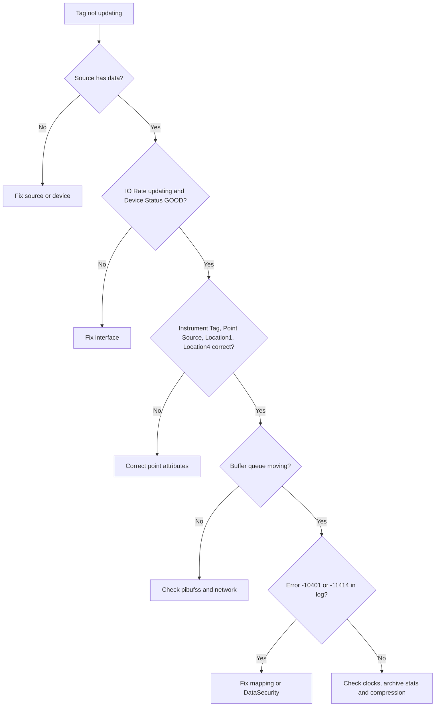

## Plain English

When something goes wrong, the PI System usually says so in its **message log**. Most problems fall
into a handful of patterns: the point is configured wrongly, the interface is not collecting, the
client is not allowed in, clocks disagree, or a client is asking for too much data.

Work from the source towards the user, one hop at a time, and check each hop with the right tool.
That is what the playbooks below do.

> [!TIP]
> "The most common cause of new PI Points not receiving data is an incorrect configuration of the
> PI Point attributes." Check the point first.

## Deep Dive

**Logs and tools.**

| Tool | Use |
|---|---|
| PI SMT, PI SDK Utility, `pigetmsg` | Read the PI Message Log; `pigetmsg -f` follows it |
| `piartool -ss / -qs / -as` | Snapshot, event queue and archive statistics |
| `piartool -thread piarchss -info` | Thread dump of the archive subsystem (run from `%piserver%adm`) |
| `pidiag -tz` | Check DST rules (`pidiag -tz -sys -dump` for full history) |
| `pidiag -archk <file>` | Check an archive file |
| `pidiag -tls --verify` | Check Data Archive TLS certificate registration |
| `apisnap <server>` | Test PI API connectivity |
| AboutPI-SDK (Connections) | Test PI SDK connectivity |
| `pibufss -cfg / -qs` | Buffering status and queue statistics |
| Network Manager Statistics (PI SMT) | Find a client by Connection ID |

**Heavy hitters.** Three messages point to expensive clients:

| Code | Meaning | Limit |
|---|---|---|
| -11091 | Event collection limit exceeded | `ArcMaxCollect`, default 1.5 million events |
| -11140 | Query exceeded maximum execution time | `Archive_MaxQueryExecutionSec`, default 260 s |
| -10767 | Client exceeded concurrent queries in the RPC thread pool | |

An RPC duration over 1000 ms is generally considered long. Message ID 2016 "Inserting overflow record"
indicates backfilling or out-of-order writes.

**Error code ranges** (from the `pistatus.h` header): -10400 to -10419 security; -10550 to -10595
point database; -10720 to -10768 network; -11001 to -11138 archive; -11200 to -11209 redirector;
-30000 and below are warnings. Examples: -5 tag does not exist; -10401 no write access; -10413 no
trust relation; -10722 network timeout; -11046 target date in future; -11059 no good data for this
time.

**Point attributes.** Instrument Tag must match the source exactly (often case-sensitive); Point
Source must match the interface; Location1 is the interface ID; Location4 is the scan class. An
interface startup message such as "Total Number of points matching pointsource 'OPC-PIINT01' is 0"
means no points match.

**Clocks.** Points with Future = 0 reject data more than 10 minutes ahead, and a PI Interface more
than 30 minutes off the server clock will not run.

**Tuning hints from UC23.** `piarchss_ThreadCount` "Number of cores - 1" for normal use;
`Archive_ReprocessThreadCount` = 1 for 2018 SP2 and later. The write cache flushes every 5 minutes by
default (`Archive_SecondsBetweenFlush`).

## Worked Example

**Playbook: tag not updating.**

1. Is the source providing data? Check with a source tool (for example the PI OPC Client Tool).
2. Is the interface healthy? IO Rate updating and Device Status GOOD (Heartbeat alone is not enough).
3. Do the point attributes match? Instrument Tag, Point Source, Location1 and Location4; read the
   startup message about matching points.
4. Is buffering stuck? `pibufss -cfg` and `pibufss -qs`.
5. Permissions? Look for -10401 or -11414 (a buffering service holds an exclusive lock on the point);
   check the identity in Network Manager Statistics and the point's DataSecurity.
6. Clocks? Data over 10 minutes in the future is discarded (-11046).
7. Data Archive side? `piartool -as` archiving flag 3; `-qs` reads and writes moving together.
8. Filtered? Values within exception or compression deviation are not stored.

**Playbook: cannot connect.** Ping both ways and test TCP 5450
(`(new-object net.sockets.tcpclient PISRV01, 5450).connected` or `Test-NetConnection`); test the client
stack with `apisnap` or AboutPI-SDK; check the message log for failed logins, then mappings (the usual
cause from interface nodes); check Kerberos with `setspn -q PIServer/<host>`; check TLS with
`pidiag -tls --verify` (message ID 748 means no certificate loaded).

## Diagram

## Common Mistakes

- **Starting at the display.** Work from the source forward.
- **Trusting Heartbeat.** Check IO Rate.
- **Editing `pisrvstop.bat`.** Use `pisrvsitestop.bat` for local changes.
- **Editing the SYSTEM digital state set.**
- **Deleting points to "reset" them.** There is no undelete and archived data becomes inaccessible;
  set SCAN off instead.
- **Raising ArcMaxCollect to hide a heavy query** instead of finding the client by Connection ID.
- **Creating points during the day.** Point creation needs a global lock.

## Real-World Scenario

A PI Vision display is slow every morning. Following AVEVA's UC23 approach, the admin searches the
message log and finds -11091 (event collection limit exceeded) and -10767 messages. The Connection ID
leads, through Network Manager Statistics, to the PI Vision service account. The PI Vision Admin site
(Reports > Calculation usage) shows a display running an on-demand calculation over a year of raw
data; PI Vision 2020 and later run simple calculations on the Data Archive. The fix is to move the
calculation to Asset Analytics and store the result, and to point other heavy clients at a collective
secondary.
