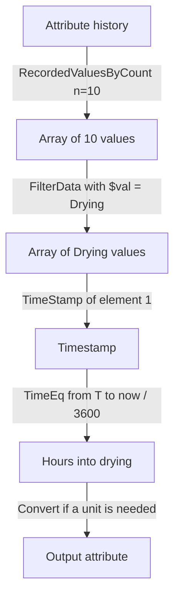

## Plain English

AF analyses accept the PE function set plus functions only AF has. AVEVA cites "150+ built in
functions". The AF-only ones fall into a few groups:

| Group | Functions |
|---|---|
| Arrays (AF 2018+) | RecordedValuesByCount, FilterData, TimeStamp, Total over arrays |
| Units | Convert |
| Event frames | EventFrame("StartTime" / "EndTime" / "Duration") |
| Flow control | NoOutput, Exit (AF 2018 SP2), HasChanged |
| Strings | Split (AF 2018 SP2) |

**Arrays** let one expression look at many values at once, for example "the last ten states", and
then filter them.

## Deep Dive

**Arrays.** `RecordedValuesByCount('attr', time, n)` returns the last n recorded values.
`FilterData(array, $val = "Drying")` keeps matching elements (`$val` is each element's value).
`TimeStamp(array[1])` returns an element's timestamp; arrays are 1-based in the lab example. Arrays
make moving averages and filtered calculations possible without intermediate attributes. AVEVA
Feedback participants also name RecordedValues, MapData, ArrayLength and Total
("You can already do Total(A1) to sum an array").

**Weighting options.** AF 2018 SP2 gave tag summaries (TagTot, TagAvg ...) an event-weighted option,
and the array summaries (Total, Avg ...), formerly event-weighted only, a time-weighted option.

**Convert.** `Convert(expr, "kW")` assigns or converts the result's UOM before it is written.

**EventFrame.** In Event Frame Generation analyses, `EventFrame("StartTime")`, `EventFrame("EndTime")`
and `EventFrame("Duration")` describe the current frame.

**Flow control.** `NoOutput()` writes nothing; `Exit()` stops all remaining rows;
`HasChanged(<Attribute>,<Time>)` throttles expensive work. `Split()` turns a string and delimiter into
a string array.

**Limits.**

- Functions that take an attribute name do not accept a nested expression in its place.
- There is no built-in "count occurrences" function.
- As of 2022: no sort, dot product, ForEach, index search, sequence/shuffle/sample or cubic spline.
- Indexing a result inline, as in `Split(s,"|")[2]`, was reported not to work.
- No client displays Array-type attributes meaningfully.
- In a scheduled analysis `Timestamp('attr')` returns the trigger time, because values are
  interpolated to it.

> [!VERIFY]
> Signatures for MapData, ArrayLength, Count and HasValueChanged, and the syntax of the SP2 weighting
> option, are not confirmed in readable sources.

## Worked Example

The PI World 2020 dryer lab computes hours into the current drying phase:

```text
PastTenStates    = RecordedValuesByCount('Best Operating State','*',10)
PastDryingStates = FilterData(PastTenStates, $val="Drying")
LastDryingEvent  = TimeStamp(PastDryingStates[1])
HrsIntoDrying    = TimeEq('Best Operating State', LastDryingEvent, '*', "Drying")/3600
```

Before arrays, the same kind of problem needed an intermediate analysis such as
`IF 'Tag' = "Value" THEN 1 ELSE NoOutput()` and an `EventCount(...)` over its output.

## Diagram



## Common Mistakes

- **Indexing a function result inline.** Assign it to a variable first.
- **Writing arrays to output attributes.** Clients cannot show them; reduce to a number or string.
- **Passing an expression where an attribute name is expected.**
- **Expecting Timestamp('attr') to give the last event time** in a scheduled analysis.
- **Waiting for sort or loop functions.** They did not exist as of 2022.

## Real-World Scenario

On PI Square, a user asked how to count how many times a tag took a given value in a period. The
answer: AF Analytics has no built-in count function, so write `1` to an intermediate output when the
condition is true and `NoOutput()` otherwise, then use `EventCount` on that output; KB01120
"Filtered calculations in Asset Analytics" documents the approaches. With AF 2018 array functions,
AVEVA Feedback participants note a count-if can be built from functions such as recordedvalues() and
count().
