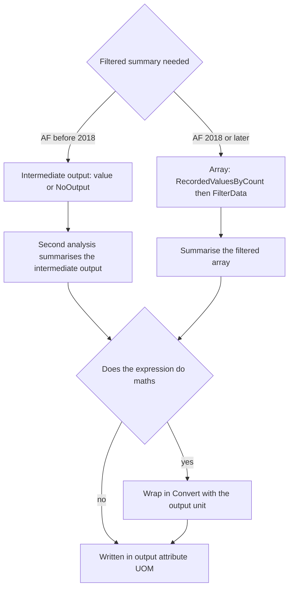

## Plain English

A **filtered calculation** summarises only some values: "average flow while the pump is running".

- **Before AF 2018** you made an **intermediate attribute** that holds the value only when the
  condition is true, then summarised that attribute.
- **From AF 2018** array functions such as `RecordedValuesByCount` and `FilterData` can filter inside
  one expression.

**Units** are the other trap. Analyses do not understand units. AF assumes the result is already in
the output attribute's unit, unless you tell it with `Convert()`.

## Deep Dive

**Intermediate attribute pattern.**

```text
If('BIT'=1) then 'Tag1' else NoOutput()
```

A second analysis then averages or totals that output. KB01120 "Filtered calculations in Asset
Analytics" documents filtered-calculation approaches.

**Why results can differ.** PI DataLink filtered summaries use AF SDK filtered summaries. In one test
a two-step AF calculation gave 55.689 against DataLink's 66.78 for the same period; the difference was
blamed on interpolation when the calculation is split in two.

**Units in analyses.**

- Analyses have no dimensional logic; AF assumes the output is already in the output attribute's UOM.
- A summary (non-PE) expression converts to the output's UOM only when it contains no mathematical
  operations. Otherwise wrap the result in `Convert(<expression>, "kW")`.
- AF converts between a PI Point and an attribute, or between two attributes, only within one UOM
  class.
- TagTot does not know its input's units and assumes per-day rates.

> [!VERIFY]
> Whether Convert() converts from the input's UOM or only labels the result is not settled by the
> sources, which show both uses. The AF SDK RecordedValues filter-expression syntax is named only.

## Worked Example

The PI World 2019 lab turns a power curve into an output in kW:

```text
Convert(Curve('Adjusted Wind Speed', (0,0) (3.99,0) (4,78) ...),"kW")
```

Without `Convert`, a calculation that adds values in kg and writes to an attribute in grams would be
stored as if the number were already grams, giving a result 1,000 times too small.

## Diagram



## Common Mistakes

- **Adding kg values into a gram attribute without Convert.**
- **Expecting TagTot to convert a per-hour rate.** Multiply by 24.
- **Expecting a split AF calculation to match a DataLink filtered summary exactly.**
- **Expecting conversion across UOM classes**, such as power to energy.

## Real-World Scenario

On PI Square, a user compared a PI DataLink filtered average with the same filter built in AF as two
steps (an intermediate attribute, then an average) and got 66.78 against 55.689. The thread explained
that DataLink calls AF SDK filtered summaries directly, while splitting the calculation adds
interpolation effects, and pointed to Asset Analytics 2018 array functions as a way to filter without
an intermediate attribute.
