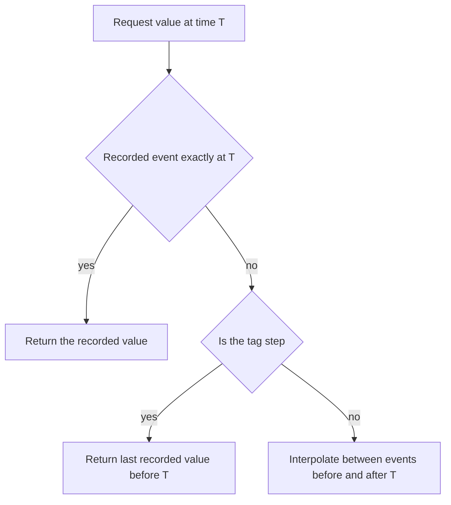

## Plain English

The archive stores **recorded values** only at certain moments. When you ask for a value at any other
time, PI has to work it out:

- **Continuous tag**: draw a straight line between the event before and the event after
  (**interpolation**).
- **Step tag**: the value holds until the next event, so PI returns the last recorded value.

Pick step for things that jump (setpoints, states, counters) and continuous for things that move
smoothly (temperatures, flows).

## Deep Dive

**Interpolation.** For a continuous tag PI uses the next archived event to interpolate, which is why
moving averages ramp. For a step tag interpolation always uses the last recorded value. A value
request at a time returns the archived event if one exists exactly then; otherwise it interpolates.

**PI DataLink retrieval.**

| Function | Returns |
|---|---|
| Compressed Data | All recorded values for a period |
| Sampled Data | Evenly spaced, interpolated values over a regular interval |
| Timed Data | Actual or interpolated values at given timestamps |

**Retrieval modes.** For a single time, data references offer After, At or Before, At or After,
Automatic, Before, Exact Time and Interpolated. `AFRetrievalMode`: Auto=0, AtOrBefore=1, AtOrAfter=2,
Exact=4, Before=6, After=7. Exact returns a "No Data" error when nothing exists at that time.

**Boundary types.** `AFBoundaryType`: **Inside** returns recorded values inside the range,
**Outside** returns those just outside, **Interpolated** creates interpolated end points (not
supported for sync times).

**Calculation basis and Step.** A TimeWeighted summary follows the attribute's Step setting;
TimeWeightedContinuous and TimeWeightedDiscrete override it.

**In analyses.** In scheduled analyses attribute values are interpolated to the trigger time, so
`Timestamp('attr')` returns the trigger time. `CalculateAtIntervals` returns interval timestamps, not
the underlying event times. Evaluate and Preview use compressed archive data, while the running
service uses snapshot data, so interpolated results can differ.

> [!VERIFY]
> Plot-values retrieval (first/last/min/max per interval) was not covered by readable sources.

## Worked Example

A setpoint changes from 50 to 60 at 10:00, and the next event is 70 at 11:00. What is the value at
10:30?

| Tag type | Value at 10:30 | Why |
|---|---|---|
| Step | 60 | Holds the last recorded value |
| Continuous | 65 | Straight line from 60 (10:00) to 70 (11:00) |

If this were a real setpoint, 65 would be a value that never existed, so the tag should be step.

## Diagram

## Common Mistakes

- **Continuous setting on stepped data**, creating values that never existed.
- **Expecting Timestamp('attr') to be the last event time** in a scheduled analysis.
- **Using Exact retrieval** where no value is guaranteed, and getting No Data.
- **Comparing Preview results with service output** without allowing for archive versus snapshot
  data.

## Real-World Scenario

A PI Square thread on moving averages explains why a moving average of a continuous tag ramps
between events: PI interpolates using the next archived event. For a step tag interpolation always
uses the last recorded value, so the same moving average changes in steps. Checking the tag's Step
setting (or choosing a calculation basis that overrides it, such as TimeWeightedDiscrete) is the
first thing to do when a moving average has an unexpected shape.
