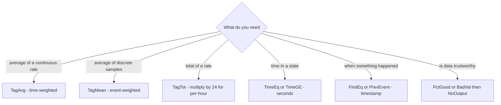

## Plain English

PE has a library of more than 100 built-in functions. OSIsoft's 2018 course sorts them into
categories:

| Category | Examples |
|---|---|
| Archive Value Statistics | TagAvg, PctGood |
| Date and Time | Bod, Hour |
| Logical | And, If |
| Math | Abs, Sqr |
| PI digital states | DigState, DigText |
| Point Attributes | TagSpan, TagType |
| Search and Retrieval | TimeEq, NextEvent |
| Statistical | Rand, Total |
| Status | NoOutput, TagBad |
| String | Len, Text |

Most functions that work on history take a tag (or attribute), a start time and an end time:
`TagAvg('CaseTemp','*-1h','*')`.

## Deep Dive

**Summaries.**

- `TagAvg(tag, st, et)`: time-weighted average.
- `TagMean(tag, st, et)`: event-weighted mean of recorded events (the exception among mostly
  time-weighted functions).
- `TagTot(tag, st, et)`: time integral that **assumes the rate is per day** and knows nothing of the
  tag's units. A per-hour rate needs `* 24`.
- `EventCount(tag, st, et)`: number of events. `TagMean * EventCount` gives an event-weighted sum.
- `PctGood(tag, st, et)`: percent of good data, ideal as a guard.
- The 2022 course also names TagMax, TagNum, NumOfChanges, TimeGE and TimeGT.

**Search and retrieval.**

- `TimeEq(tag, st, et, value)`: seconds the input equalled the value. It reads every event in the
  window, so cost grows with event count.
- `FindEq(tag, st, et, value)`: timestamp of an occurrence; start later than end searches backwards.
- `PrevEvent(tag, time)` / `PrevVal(tag, time)`: time / value of the previous recorded event.
  `PrevEvent('tag','*+1s')` includes an event at the current time.
- `TagVal(tag [, time])`: value at a time; with no time it uses the evaluation time.

**Math and time.** `Curve(x, (x1,y1) (x2,y2) ...)` interpolates linearly between points (spaces between
pairs). `Poly(x, c0, c1, ...)` evaluates a polynomial. `Avg(a, b, ...)` averages its arguments.
`DaySec(time)` gives seconds since midnight; `Bom(time)` the beginning of the month.

**Status.** `BadVal(x)` tests for a bad value; `NoOutput()` writes nothing.

**In PI DataLink.** `PIExpVal("<PE expression>", time, ...)` evaluates PE in Excel; inside the string,
double quotes are doubled. "Calculated Data" cannot return strings from IF logic; "Sampled Data" with
a PE expression can.

> [!VERIFY]
> Exact signatures beyond the examples shown, including optional percent-good arguments, are not
> confirmed: the official alphabetical PE reference was unreadable. A third-party 112-name catalogue
> is incomplete (it lacks Abs, Total and Rand), so do not treat it as the full list.

## Worked Example

From an OSIsoft regional seminar, for a pump with `PowerDraw` (a per-hour rate) and `CaseTemp`:

```text
// Cooling to power ratio
TagAvg('CaseTemp','*-1h','*') / (TagTot('PowerDraw','*-1h','*') * 24)
// Daily run hours above 20 A
TimeGE('PowerDraw','*-24h','*',20) / 3600
// Hourly power draw with a quality guard
IF PctGood('PowerDraw','*-1h','*') > 50 THEN TagTot('PowerDraw','*-1h','*') * 24 ELSE NoOutput()
```

Month-to-date sum of production events: `TagMean(prod,bom('*'),'*')*EventCount(prod,bom('*'),'*')`.

## Diagram



## Common Mistakes

- **Forgetting TagTot's per-day assumption.** Totals of per-hour rates come out 24 times too small.
- **TagAvg where TagMean is wanted** on sparse discrete data, or the reverse.
- **Averages hiding values.** `TagAvg = 0` can be true for -1 and +1; use `TimeEq` to test "was zero".
- **Comma-separated Curve points.**
- **Expecting PrevGoodVal in AF.** It does not exist; combine BadVal, PrevVal and PrevEvent.

## Real-World Scenario

Two PI Square threads show the TagTot trap in practice. In one, the working expression for a total
from a flow measured in t/h was `TagTot('filtredFlow', BOM('*'), '*') * 24`: the `* 24` is needed
because TagTot integrates as if the rate were per day. In the other, the answer explains that
TagTot "has no knowledge of the actual units of the input rate tag", and that AF will not convert
the result from a power class to an energy class for you.
