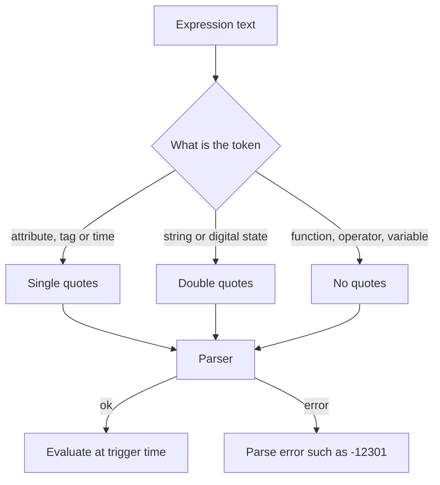

## Plain English

**Performance Equations (PE)** are the PI System's formula language. The same syntax is used in
legacy PE tags, PI DataLink expressions and AF Expression analyses (AVEVA set PE syntax as the AF
analytics language goal back in 2013).

Three quoting rules cover most of it:

| You write | Quotes | Example |
|---|---|---|
| Attribute, tag or time | Single | `'CDT158'`, `'*-1h'` |
| String or digital state | Double | `"Running"`, `"ON"` |
| Function, operator, variable | None | `TagTot(`, `+`, `Efficiency` |

Comments start with `//`.

## Deep Dive

**Operators.** Arithmetic `+ - * / ^`; comparison `= < > <= >=` and `<>` (not equal); logic `AND`,
`OR`, `NOT`. Lab expressions use a single `=` to compare (`'Status' = "Run"`).

**Conditionals.** `IF <condition> THEN <value> ELSE <value>`, chained with `ELSE IF`. Results can be
digital state names:

```text
IF 'tag' <= 680 THEN "Green" ELSE IF 'tag' > 700 THEN "Red" ELSE "White"
```

**Time expressions.** Reference times: `*` (now), `t` (today 00:00), `y` (yesterday 00:00), weekday
names such as `mon`. Offsets use s, m, h, d, w, mo and y. Examples: `*-1h`, `t+8h` (08:00 today),
`y-8h` (16:00 the day before yesterday), `mon+14.5h` (14:30 last Monday). Rules:

- Use only one offset; several "can lead to unpredictable results".
- Fractions only for seconds, minutes and hours.
- An absolute time without a time part means midnight; a missing day, month or year means the
  current one.

**Quoted time vs ParseTime.** `'*'` is evaluated when the expression is parsed; `ParseTime("*")`
evaluates its string. Subtracting two times gives a span; `Int()` of a timestamp gives UTC seconds.
Writing an integer to a DateTime attribute treats it as UTC seconds.

**Legacy PE tags.** Point source `C`, run by the PI Performance Equation Scheduler, with clock or
single-tag event scheduling. A conversion factor does not apply to a PE tag: put the multiplier in
the expression. Migrating PE tags to Analytics by changing the point source and clearing ExDesc can
leave a "Scan Off" value.

> [!VERIFY]
> Operator precedence and whether `==` is accepted are not documented in readable sources.

## Worked Example

An analysis flags poor turbine efficiency:

```text
// Efficiency and Target are variables from earlier rows; 'Status' is an attribute
Efficiency < Target AND 'Status' <> "Stop"
```

Another lab start trigger uses arithmetic and Abs():

```text
IF (AvgTemp-Abs(DeltaTemp/2))/AvgTemp > 0.2 THEN TRUE ELSE FALSE
```

And seconds since the last event:

```text
Int(ParseTime("*") - PrevEvent('Input Tag', ParseTime("*")))
```

## Diagram



## Common Mistakes

- **Smart quotes or backticks** around tag names. Use straight `'`.
- **Missing spaces before THEN or ELSE**, or stray doubled quotes.
- **Several offsets in one time**, such as `*-1d+2h`.
- **Fractional days**, such as `1.5d`.
- **Quoting a variable**: `'Efficiency'` is read as an attribute.

## Real-World Scenario

After a server migration, a PE tag on PI Square reported `[-12301] Performance Equation parsing
error`. The expression was fine; it referenced a tag that had not been migrated to the new server.
The PI message log showed the error position as "Offset x" characters into the expression, and the
`pipetest` utility can be used to test PE syntax before deploying.
