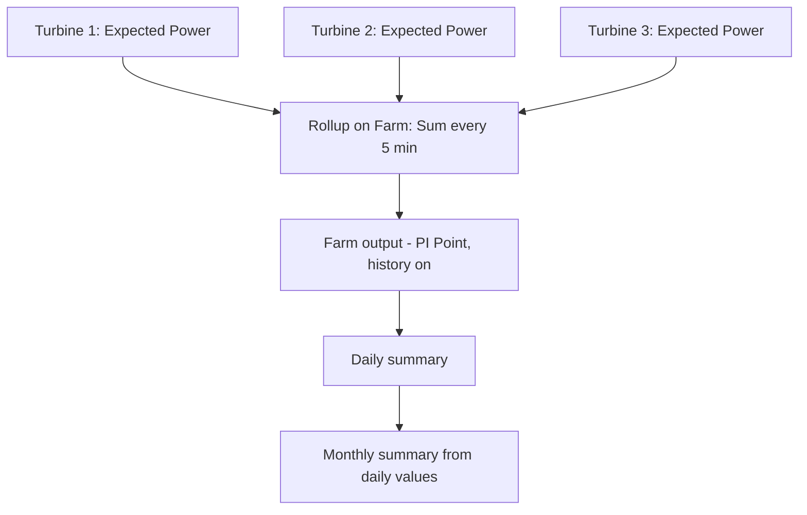

## Plain English

Two kinds of "adding up" happen in PI:

1. **Across assets**: a **Rollup analysis** combines the same attribute from many elements, for
   example the total expected power of every turbine on a farm.
2. **Across time**: a **summary** turns a time range into one number, such as the hourly average.

Rollup functions are **Sum, Average, Minimum, Maximum, Count and Median**.

## Deep Dive

**Rollup inputs.** Attributes from child elements or the element itself, chosen by Attribute Name,
Attribute Category, Element Category or Element Template masks. A child-element rollup on a template
needs an example element. Outputs must be PI Points, and output history cannot be turned off.

**Summary types over time.** The PI Data Archive supports Average, Count, Delta, Maximum/Minimum,
Population Standard Deviation, Range, Standard Deviation and Total, event- or time-weighted. PSE's
"By Time Range" retrieval options include Average, Count, Delta, Maximum, Minimum, Population Standard
Deviation, Standard Deviation, Start Time, End Time and Total.

**AFSummaryTypes flags.**

| Member | Value |
|---|---|
| Total | 1 |
| Average | 2 |
| Minimum | 4 |
| Maximum | 8 |
| Range | 16 |
| StdDev | 32 |
| PopulationStdDev | 64 |
| Count | 128 |
| PercentGood | 8192 |
| TotalWithUOM | 16384 |

Count is the event count when event-weighted and the sum of event durations when time-weighted.
PercentGood is time-based or count-based in the same way. TotalWithUOM equals Total when there is no
UOM and errors if no valid units can be found.

**Event frame rollups.** An event frame rollup custom data reference provides Sum, Average, Mean,
Minimum, Maximum, Range and Count.

**Cost.** Rollups can cause recalculation cascades with late data. Long summaries evaluated often
(a month of `TagAvg()`) should be replaced with shorter windows, less frequent schedules or
daily-to-monthly rollups.

> [!VERIFY]
> Rollup functions beyond the six listed (for example Range or StdDev) are training knowledge only.

## Worked Example

The PI World 2019 wind-farm lab adds a Rollup on the `Farm` template, every 5 minutes:

| Output | Function | Input (child attribute name) |
|---|---|---|
| Expected Power Production | Sum | Expected Power (Polynomial) |
| Net Production Delta | Sum | the turbines' production delta |
| Average Production Efficiency | Average | the turbines' efficiency |

The lab used a 1-second offset on the 5-minute schedule so the turbine analyses finish first.

> [!VERIFY]
> The exact child attribute names for the second and third rows are paraphrased; the lab names the
> outputs and functions.

## Diagram

## Common Mistakes

- **Trying to write rollup results to an Analysis data reference.** Outputs must be PI Points.
- **Selecting inputs by hand** instead of name, category or template masks.
- **Leaving automatic recalculation on for deep rollup chains fed by late data.**
- **Month-long summaries evaluated every few seconds.**

## Real-World Scenario

AVEVA's PI World 2020 "Optimizing Analytics" lab warns that late or out-of-order data can set off
cascades of recalculation through dependent analyses such as rollups. Its suggested mitigation is to
disable automatic recalculation for those analyses and run recalculations manually at low-load times,
avoiding midnight when many daily calculations already run.
