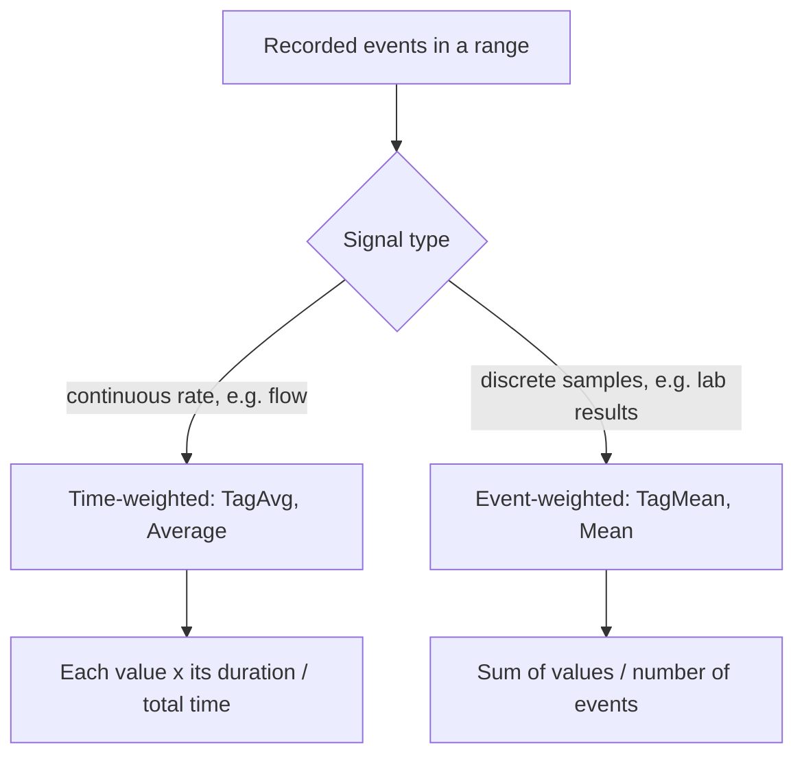

## Plain English

PI archives values only when they change meaningfully, so events are uneven in time. That makes
"average" ambiguous:

- **Time-weighted**: each value counts for as long as it was in effect.
- **Event-weighted**: each recorded event counts once, like `(v1+v2+v3)/3`.

In PI DataLink, "Average is time-weighted and mean is event-weighted". In PE, `TagAvg` is
time-weighted and `TagMean` is event-weighted.

Use **average** for continuous rates such as flow, and **mean** for discrete measurements such as lab
samples.

## Deep Dive

**Behaviour over time.** Re-evaluated every second with no new data, `TagAvg` returns new values
because time advances; `TagMean` does not change until a new event arrives.

**Where the work happens.** PI Data Archive summary calculations (Average, Count, Delta,
Maximum/Minimum, Population Standard Deviation, Range, Standard Deviation, Total) can be event- or
time-weighted. Running them on the Data Archive sends only results to Analytics: less Analytics load,
more Data Archive load.

**Options in AF.** AF 2018 SP2 gave tag summary functions an event-weighted option and array
summaries a time-weighted option. Before 2018 there was no clean way to get an event-weighted
standard deviation over an arbitrary range.

**AFCalculationBasis** (AF SDK and PI Web API):

| Member | Meaning |
|---|---|
| TimeWeighted (0) | Weight by time; interpolation follows the attribute's Step setting |
| EventWeighted (1) | Each event equal; needs at least one event (two for standard deviation) |
| TimeWeightedContinuous (2) | Interpolate as continuous regardless of Step |
| TimeWeightedDiscrete (3) | Stair step regardless of Step |
| EventWeightedExcludeMostRecentEvent (4) | Drop the event at the interval end |
| EventWeightedExcludeEarliestEvent (5) | Drop the event at the interval start |
| EventWeightedIncludeBothEnds (6) | Keep both boundary events |

With EventWeighted, a single interval includes events at both boundaries; with several intervals,
ascending ranges include the start-time event and descending ranges the end-time event.

## Worked Example

A step signal over a 20-second window:

| Value | Held for |
|---|---|
| 10 | 10 s |
| 20 | 5 s |
| 30 | 5 s |

- Event-weighted mean: (10 + 20 + 30) / 3 = **20**.
- Time-weighted average: (10x10 + 20x5 + 30x5) / 20 = 350 / 20 = **17.5**.

The low value lasted longest, so the time-weighted answer is lower.

> [!VERIFY]
> These numbers are constructed from the durations discussed in a PI Square thread; the arithmetic
> is ours.

## Diagram

## Common Mistakes

- **TagAvg on sparse discrete samples**, where long gaps dominate the answer.
- **TagMean on a compressed continuous signal**, where flat periods have few events and are
  under-weighted.
- **Forgetting boundary events** when summarising event-weighted data over many intervals; choose an
  Exclude option to avoid double counting.

## Real-World Scenario

A PI Square thread on PI DataLink asked why Average and Mean gave different numbers for the same tag.
The answer: Average is time-weighted and Mean is event-weighted; use Average for continuous rates
such as flow and Mean for discrete measurements. A blog on an event frame rollup data reference adds
a useful special case: when you roll up event frame durations, Average and Mean give the same result.
