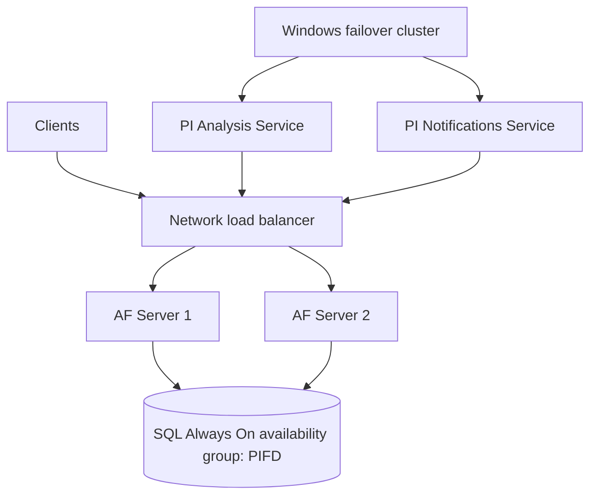

## Plain English

If the AF server stops, displays lose their context and analyses stop. **High availability (HA)**
keeps AF running when one machine fails.

AVEVA's 2022 recommendation uses a different tool for each layer:

| Layer | HA approach |
|---|---|
| PI AF Application Service | A load balancer in front of two or more AF servers |
| PI Analysis Service and PI Notifications Service | Windows Server failover clustering |
| PIFD SQL database | SQL Server Always On availability groups |

The older **AF collective** (primary plus read-only secondaries with SQL replication) is legacy:
AVEVA has "no plans to further update" it.

## Deep Dive

**Why not collectives.** The recommended designs give redundancy and read/write after failover,
"which was not supported with AF Collectives". An old thread notes AF SDK 2.5 had no collective
support at all.

**Load balancing.** A 2015 HA deck shows Network Load Balancing as "Fully Automatic" and "Seamless to
clients", supporting HA writes such as event frames, over a SQL cluster or Always On group. For large
distributed systems, the architecture course recommends two AF servers behind a network load
balancer, with SQL Server on separate redundant computers.

**Contrast with Data Archive.** PI Data Archive collective members are "completely independent data
stores". Load-balanced AF servers instead share one SQL database.

**SQL edition.** An AF HA set-up needs Standard, Business Intelligence, Enterprise or Datacenter on
the primary SQL member, not Express.

**Security.** Users connect with Windows Integrated Security. Effective permissions on AF objects are
based on the Windows identity and stored as Windows security descriptors. AF SDK 2.10 search can
filter by SecurityString and SecurityToken.

> [!VERIFY]
> AF identities and mappings (for example Administrators and World identities, and the list of
> access rights such as Read Data or Annotate) are training knowledge, not confirmed in a readable
> source.

## Worked Example

A mining company designs AF for 20 sites:

1. Two AF servers, each running the PI AF Application Service, behind a network load balancer.
2. PIFD on SQL Server Enterprise in an Always On availability group on separate machines.
3. PI Analysis Service and PI Notifications Service on a Windows Server failover cluster.
4. Analysis outputs to PI Points, buffered by the PI Buffer Subsystem.
5. Users authenticate with their Windows accounts; permissions follow their Windows groups.

No collectives are used, so writes such as new event frames keep working after a failover.

## Diagram

## Common Mistakes

- **Designing new systems on AF collectives.** No read/write after failover, and no further
  development.
- **Express on the primary SQL member** of an HA design.
- **Assuming Data Archive collective behaviour applies to AF.** AF HA shares one SQL database.

## Real-World Scenario

On an AVEVA Feedback idea page about high availability, AVEVA's official 2022 admin response set out the current recommendation: a load balancer
for the AF Application Service, Windows Server failover clustering for the Analysis and Notifications
services, and SQL Server Always On for the back end, adding that it had no plans to update AF
collectives.
