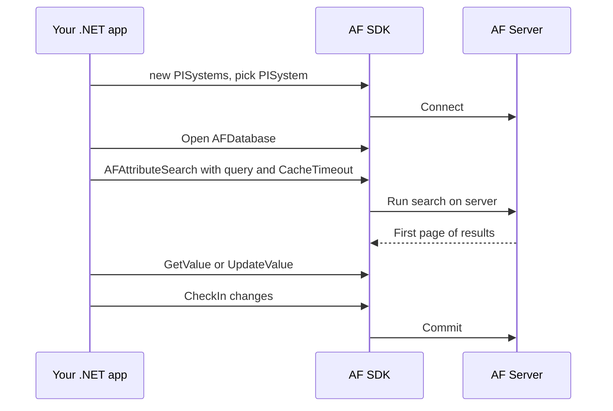

## Plain English

The **AF SDK** is "a Microsoft .NET based programmatic library" for Visual Basic .NET, C# and Managed
C++. It ships in the **PI AF Client** and lets your own programs do what PSE does: browse elements,
read and write values, create event frames and search.

The main objects follow the server layout:

| Class | Represents |
|---|---|
| `PISystems` | All AF servers known to this client |
| `PISystem` | One AF server ("a single logical data store") |
| `AFDatabase` | One database on that server |
| `PIServer` | One PI Data Archive (older product name kept) |

The SDK needs .NET Framework 3.5 at minimum; the .NET 4.5 assemblies are recommended for the full
feature set.

## Deep Dive

**Connecting.** Create `PISystems`, pick a server by name or `DefaultPISystem`, call
`piSystem.Connect()` and check `piSystem.ConnectionInfo.IsConnected`. Then open
`Databases[databaseName]` or `Databases.DefaultDatabase`.

**Data.** Find an attribute by path with `AFAttribute.FindAttribute(@"\Meters\" + meterName + @"|Energy Usage", database)`
(`|` separates element path from attribute). Read with `AFAttribute.GetValue()` and write with
`AFAttribute.Data.UpdateValue()`. The getting-started guide also uses `Data.RecordedValues`,
`Data.InterpolatedValues` and `Data.Summaries`. `AFCalculation.CalculateAtIntervals` evaluates a PE
expression at intervals and returns the interval timestamps.

**Changes.** `AFDatabase.CheckIn()` commits pending changes (guard with `IsDirty`).
`AFDatabase.FindChangedItems` is recommended for detecting changes. XML moves use
`PISystem.ExportXml(obj, PIExportMode.NoUniqueID | PIExportMode.Flat, ...)` and
`PISystem.ImportXml(db, PIImportMode.AutoCheckIn, ...)`. Analyses are reached with
`element.Analyses["name"]` in `OSIsoft.AF.Analysis`.

**AFSearch.** Server-side search classes arrived in AF 2016 (SDK 2.8.0); `AFAttributeSearch` and
nested queries in AF 2017 R2 (SDK 2.9.5). Query strings look like:

```text
Element:{Template:'FCC Pump Process' Category:'ProcessMonitoring'} Category:'Process Monitoring'
Element:<path> Template:<path> '|Tank Level':>=75
Name:'Davi*'
```

Inside braces filters the element; outside filters the attribute. Attribute value filters use a
leading pipe. Quote wildcard values. A nested query cannot contain its own nested query. In a C#
interpolated string, double the literal braces (`{{`, `}}`). Token-based search uses
`AFSearchToken(AFSearchFilter.X, AFSearchOperator.Y, value)`.

**Doing it efficiently.**

- Opt in to server caching with `search.CacheTimeout = TimeSpan.FromMinutes(10)`.
- Page results, for example `FindEventFrames(startIndex: 0, fullLoad: false, pageSize: 1000)`.
  pageSize = int.MaxValue: "Recommend: Never!".
- `First()`, `FirstOrDefault()` and `Skip()` are safe; `Count()`, `Select()` and `Where()` are not.
  Use `GetTotalCount()`.
- Dispose searches (`using` or `Close()`).

> [!VERIFY]
> The full enum lists and data-method overloads used here come partly from the getting-started guide
> samples; check the AF SDK reference for your version.

## Worked Example

Find attributes in category "Process Monitoring" on pump elements and read them:

```csharp
string query = "Element:{Template:'FCC Pump Process' Category:'ProcessMonitoring'} Category:'Process Monitoring'";
using (AFAttributeSearch search = new AFAttributeSearch(root.Database, "nested query string", query))
{
    search.CacheTimeout = TimeSpan.FromMinutes(10);
    foreach (AFAttribute item in search.FindAttributes()) { /* read item.GetValue() */ }
}
```

The `using` block disposes the search, CacheTimeout lets the server page results, and the loop
streams objects instead of loading them all at once.

## Diagram



## Common Mistakes

- **Calling `.Count()` or `.Where()` on a search enumeration.** It pulls everything; use
  `GetTotalCount()` or refine the query.
- **Not disposing the search.**
- **Forgetting `CheckIn()`**, so nobody else sees your changes.
- **Using `AFSearchFilter.Value` tokens for value searches.** Value searches need `AFSearchValueToken`.
- **Single braces in C# interpolated strings.**

## Real-World Scenario

A PI Square user's event frame search on an attribute value returned nothing. The verified answer
used the query `Template:ALARM_TEMPLATE |IS_ALARM:=TRUE ElementName:MPA` and pointed out that
token-based value searches need `AFSearchValueToken` rather than a plain `AFSearchFilter.Value`
token. The AFSearch deck adds that from AF 2018 attribute value conditions no longer need the data
reference to be defined at template level.
