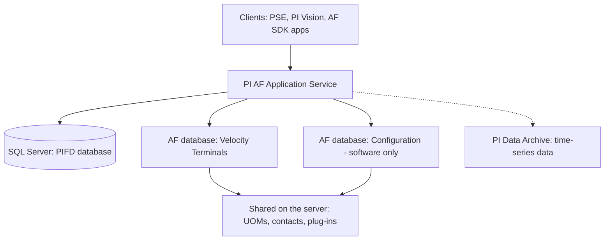

## Plain English

PI Asset Framework (AF) is the part of the PI System that describes your *assets*: pumps, tanks,
turbines, sites. The PI Data Archive stores the time-series numbers. AF stores the model that gives
those numbers meaning.

An **AF Server** has two layers:

1. The **PI AF Application Service** (AFService). This is the Windows service that clients such as
   PI System Explorer, PI Vision and the AF SDK talk to.
2. A **Microsoft SQL Server database**, named **PIFD** by default, where the service keeps every
   element, template and event frame.

Inside one AF server you create one or more **AF databases**. Each AF database is a separate model,
for example one per business unit or one per training lab.

> [!TIP]
> Think of the AF server as a library building and each AF database as a separate collection inside it.

## Deep Dive

**SQL Server.** PI AF supports all SQL Server editions. SQL Server Express is free but limited (the
architecture workbook says one physical CPU and 1 GB of RAM), so it suits small to medium systems.
For AF high availability, the primary SQL member needs Standard, Business Intelligence, Enterprise or
Datacenter edition, not Express. SQL Server can run on the AF Server machine or on another machine.
AVEVA recommends Windows authentication for the connection to the PIFD database.

**Inside PIFD.** The `AFSystemID` table holds exactly one row: the AF SQL schema version, the data
store name and its ID. Several AF Application Service instances can connect to the same PIFD
database, which some customers use for load balancing. The service finds SQL through the
`connectString` key in the `<appSettings>` section of `AFService.exe.config`.

**Installation.** AF files install under `%PIHOME64%\PIPC\AF`. The installer runs the AF SQL scripts
if that option stays checked; the scripts are also available separately on the download page. The
**PI AF Services** setup kit (first released in 2016 R2) bundles PI AF Server, PI Analysis Service
and PI Notifications Service. From 2017 R2 only "PI AF Services" appears in Add/Remove Programs.
The kit's name and version are unrelated to component versions (in 2017 R2, AF Server was
2.9.5.8368). Services such as PI AF Server and PI Analysis Service can run under a gMSA.

**AF databases.** References work only within one AF database, so you cannot link or compare
elements across databases. The built-in **Configuration** database holds PI System software
configuration: do not build asset models in it.

**What is shared server-wide.** Units of measure, contacts, plug-ins and libraries are shared by
every AF database on the server. A UOM change made "for one database" changes all of them.

**Placement.** Put AF Server and PI Data Archive on separate computers when AF uses data from several
PI Servers or when AF is highly available. AF Server is no longer a prerequisite for installing PI
Data Archive. In the AF SDK the AF server is a `PISystem` and the Data Archive is a `PIServer`.

> [!VERIFY]
> Port numbers: a third-party guide says port 5457 must be open from the AF server to AF clients, and
> an AVEVA course requires 5463 for PI Analysis Service. Check AVEVA's official port list.

## Worked Example

A small training site sets up AF:

| Step | Choice | Why |
|---|---|---|
| 1 | Install SQL Server Express on the AF machine | Small system, free edition is acceptable |
| 2 | Run PI AF Services setup with the SQL scripts option checked | Creates the PIFD database |
| 3 | Run the AF service under a gMSA, for example `PISCHOOL\SVC-PIAF$` | Managed service account, as in AVEVA labs |
| 4 | Create AF database `Velocity Terminals` | Keeps the lab model out of `Configuration` |
| 5 | Add custom UOM `decimeter` | Note: this unit now exists for every database on the server |

Later the site grows and needs high availability. It moves PIFD to a separate SQL Server Standard
or Enterprise instance, because Express is not allowed on the primary SQL member of an HA setup.

## Diagram

## Common Mistakes

- **Modelling assets in the Configuration database.** It is for PI System software configuration.
- **Expecting a UOM change to stay local.** The UOM database is shared by all AF databases.
- **Splitting related assets across databases.** References cannot cross databases.
- **Looking for separate Analysis or Notifications entries in Programs and Features** on 2017 R2 or
  later. Only "PI AF Services" is listed.
- **Using SQL Express for an HA design.** The primary SQL member needs a higher edition.

## Real-World Scenario

A PI Square thread describes a site where several AF Application Service instances pointed at the
same PIFD database, a pattern some customers use for load balancing. When troubleshooting such a
system, the admin checked `connectString` in each server's `AFService.exe.config` to see which SQL
database each service used, and read the single row of the `AFSystemID` table to confirm the data
store name and schema version.
