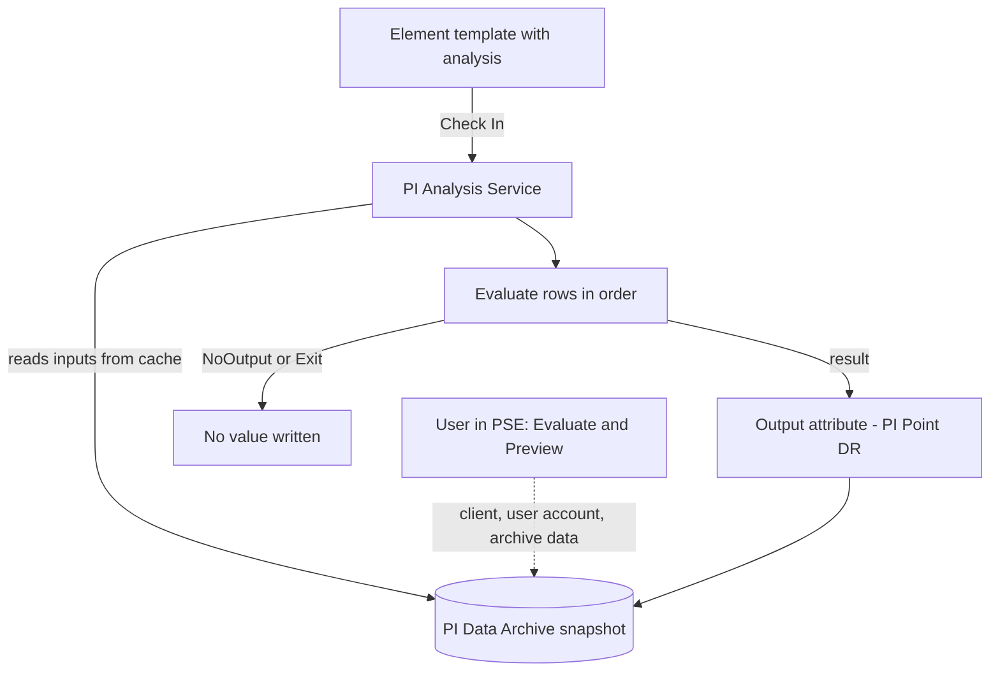

## Plain English

**Asset Analytics** is AF's calculation engine. You attach an **analysis** to an element, or better
to an element template, and the **PI Analysis Service** runs it for every matching element.

There are four analysis types:

| Type | What it does |
|---|---|
| Expression | Multi-row calculation in Performance Equation syntax |
| Rollup | Sum, Average, Minimum, Maximum, Count or Median across matching attributes |
| Event Frame Generation | Opens and closes event frames from trigger expressions |
| SQC | Checks values against set boundaries with Statistical Quality Control |

Results go to **output attributes**. If an output uses a PI Point data reference, the results are
stored in the Data Archive like any other tag.

## Deep Dive

**Expression analyses.** Each row is a variable that later rows can use. Comments start with `//`.
You can create a variable by highlighting text, right-clicking and assigning it. Asset Analytics has
"150+ built in functions". `NoOutput()` writes nothing for this evaluation, and `Exit()` (AF 2018 SP2)
stops evaluating all remaining rows. AF 2018 added array functions such as `RecordedValuesByCount` and
`FilterData`; AF 2018 SP2 added `Split()`.

**Rollups.** Sources are attributes of child elements or the element itself, chosen by Attribute
Name, Attribute Category, Element Category or Element Template masks. A child-element rollup on a
template needs an example element. Outputs must be PI Points and output history cannot be turned off.

**Outputs.** Map > New Attribute Template, "Save Output History" and the "Tag Creation" checkbox.
The default point name is `%Element%.%Attribute%.%ID%`; one lab used
`%Database%_%Element%.%Attribute%` with point source `AFAnalysis`. A forecast analysis can write
future values with Tag Creation's future flag and output time "Relative to Trigger Time" (`*+1h`).

**Testing.** **Evaluate** runs against values now; **Preview Results** (then Generate Results) runs
over archived history. On a template, pick an **example element**. Both run on the client with your
account and compressed archive data, while the service uses its own account and snapshot data, so
results can differ. Test before Check In: check-in starts the analysis on every element.

**The service.** It reads inputs from its local cache. It retries analyses in error every 15 minutes
by default. For HA it supports Windows Server Failover Clustering, and PI Point outputs are buffered.
It is built for streaming calculations, not ad-hoc queries or bulk extraction.

**In code.** The Expression plug-in is `AnalysisRulePlugIns["PerformanceEquation"]`; its ConfigString
holds lines like `Avg2d := TagAvg('Temperature','*-2d','*');`. `MapVariable`, `SetStatus(AFStatus.Enabled)`
and `CheckIn()` finish the job. `AFAnalysisRuleState.Outputs` holds evaluated values in variable order.

> [!VERIFY]
> SQC settings (control limit attributes, rule sets) and any rollup functions beyond the six listed
> were not in readable sources.

## Worked Example

The PI World 2019 wind-farm lab builds production efficiency on the `Turbine` template:

```text
ExpectedPowerVar  = TagVal('Expected Power (Polynomial)','*')
ActivePowerVar    = TagVal('Active Power','*')
ProductionDelta   = ExpectedPowerVar-ActivePowerVar
Running           = If 'Status' = "Run" or 'Status' = "Partial Run" then true else false
Efficiency        = IF ExpectedPowerVar = 0 or Not Running then NoOutput() else ActivePowerVar/ExpectedPowerVar*100
```

1. Choose an example turbine and press Evaluate to see each variable's value now.
2. Preview Results over the last day to check the trend.
3. Map `Efficiency` to a new output attribute with Tag Creation on.
4. Check In. The analysis now runs on every turbine.
5. On the `Farm` template, a Rollup sums the child turbines' `Expected Power (Polynomial)`.

> [!VERIFY]
> The exact keywords of the `Running` and `Efficiency` rows were reconstructed from the lab summary.

## Diagram



## Common Mistakes

- **Checking in an untested template analysis.** It starts on all elements at once.
- **Trusting Preview to match the service exactly.** Data source and account differ.
- **Leaving many analyses in error.** The 15-minute retries cost performance.
- **Calling the same expensive function repeatedly.** Store it in a variable once.
- **Expecting a PSE write to an upstream output to re-trigger a dependent analysis.** One thread saw
  it did not, because analyses read from the service cache.

## Real-World Scenario

AVEVA's PI World 2020 "Optimizing Analytics" lab warns that analyses left in error are not harmless:
the Analysis Service retries them every 15 minutes by default, and a large number of failing
analyses costs performance. The lab's advice is to find and fix (or disable) analyses in error, guard
bad inputs with functions such as `BadVal()` and `NoOutput()`, and use `Exit()` to stop evaluating
rows that are not needed. AVEVA's 2019 session adds the design principle behind this: Asset Analytics
is a streaming engine, so keep it for continuous calculations and use other tools for ad-hoc queries
or bulk extraction.

> [!VERIFY]
> The lab sources the 15-minute retry and the use of Exit(); the BadVal/NoOutput guard is general
> practice drawn from the course examples rather than a specific lab step.
