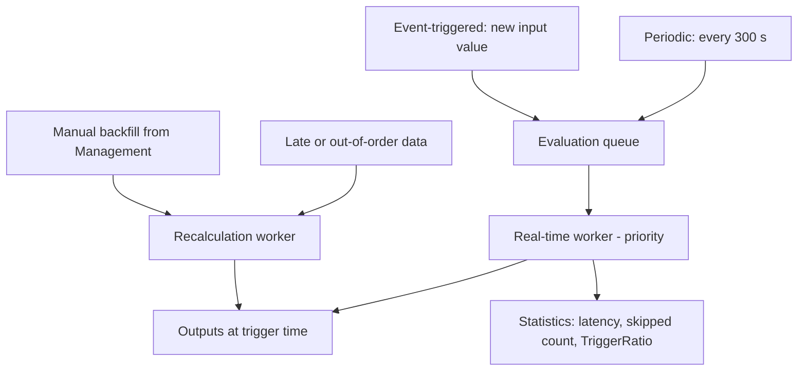

## Plain English

Every analysis needs to know **when** to run.

- **Periodic**: on the clock, for example every 5 minutes.
- **Event-triggered**: whenever its inputs get a new value.

Each run is stamped with a **trigger time**: the scheduled time (periodic) or the input event's time
(event-triggered). By default the result is written at that time.

**Backfilling** runs an analysis over the past, for example after you create it or fix a bug.
**Recalculation** deletes existing results and computes them again.

## Deep Dive

**Periodic.** Set a period and optionally an offset from midnight ("Specify Offset"). One lab used a
5-minute period with a 1-second offset for rollups. In the AF SDK the time rule is `Periodic` with
ConfigString `Frequency=300` (seconds).

**Event-triggered.** "Any Input" or a list of triggering inputs. In the AF SDK the ConfigString is
empty for any input, otherwise a semicolon-separated attribute list. Older AF versions called this
"Natural". Any Input on several fast inputs can trigger many times per second. (Legacy PE tags allow
event scheduling on only one trigger tag.)

**Output timestamps.** Trigger Time (default), Execution Time, or Relative to Trigger Time for
future-stamped outputs.

**Backfill and recalculation.** Modes: "Leave existing data and fill gaps" or "Permanently delete
existing data and recalculate". Outputs must be mapped to PI Points. Requests from the Management tab
account for dependencies; requests from a single element's Analyses tab ignore them unless you tick
the dependent-analyses option. AF 2018 SP2 can cancel bulk jobs.

**Automatic behaviour.** Auto-recalculation handles late or out-of-order data: enable it when the past
must be corrected, avoid it when past results must not change. Auto-backfilling fills gaps between
service restarts. Real-time and recalculation work run as separate workers, and real-time wins.
Late data can cascade recalculation through dependents; a mitigation is to disable automatic
recalculation and recalculate manually at low-load times (not midnight).

**Health statistics.**

| Measure | Healthy |
|---|---|
| TriggerRatio = AverageElapsed / AverageTrigger | Below 0.15; about 2.5 means permanent lag |
| Maximum Latency | Steady around 5 s, or below your tolerance |
| Evaluation Skipped Count | 0; a rising value is bad |

"The Elapsed time should always be less than the triggering interval." Counters include Analyses in
Error/Running/Suspended, Cache Hit/Miss, Evaluation Count, OOO Ignored Count and Recalculation
Requests Completed/Queued. From 2018 SP2 run-time statistics are in the AF SDK, for example
`status:'Running' averageLag>'60000' sortBy:'averageLag' sortOrder:'Desc'`. The PSE statistics view
shows only the worst five instances per template and resets on service restart. Analysis groups end in
"LoadSheddingSupported" or "LoadSheddingNotSupported".

**Cheaper analyses.** Avoid frequent long-range summaries such as a month of `TagAvg()`: use shorter
windows, less frequent schedules or daily-to-monthly rollups. `HasChanged(<Attribute>,<Time>)` can
gate expensive work.

> [!VERIFY]
> Any wait time for event-triggered inputs and other Analysis Service configuration defaults were not
> in readable sources.

## Worked Example

The PI World 2019 lab backfills new wind-farm analyses for a week:

1. PSE > Management > Analysis Searches > Add Criteria: Template = `Turbine`.
2. Select the analyses, then Operations > Backfill/Recalculate.
3. Start `*-1w`; mode "Permanently delete existing data and recalculate".
4. Queue, and watch the Backfilling column.

Because this was started from Management, dependent Farm rollups are recalculated too.

## Diagram

## Common Mistakes

- **Any Input on many fast inputs.** Choose the triggering inputs or go periodic.
- **Backfilling outputs that are not PI Points.** Not allowed.
- **Recalculating from one element's tab and forgetting dependents.**
- **Recalculating at midnight**, when daily calculations already run.
- **Month-long summaries evaluated every second.**

## Real-World Scenario

In AVEVA's PI World 2020 performance lab, a 30-day average that was event-scheduled was moved to
hourly periodic scheduling to cut the load it placed on the Analysis Service. The PI World 2020 tips
deck gives the targets to check afterwards: TriggerRatio below 0.15, Maximum Latency steady around
5 s, and Evaluation Skipped Count at 0.
