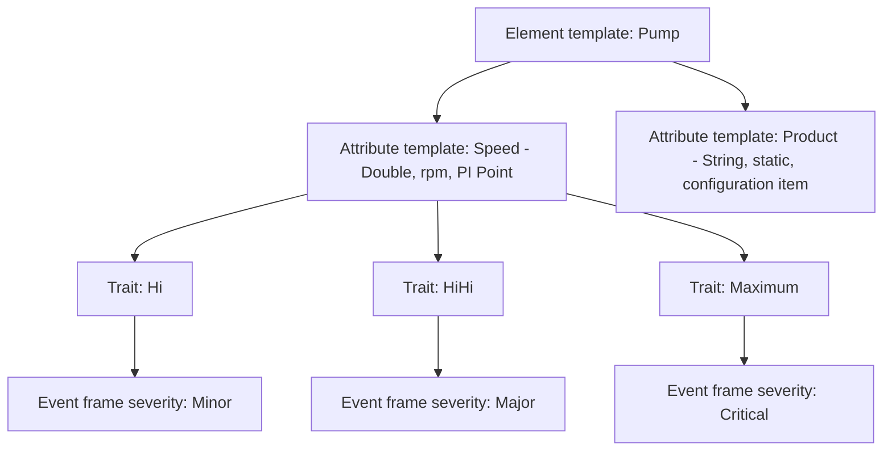

## Plain English

An **attribute** is one piece of information about an element: its temperature, its rated power,
its product code. An element template holds **attribute templates**, the definitions that every
element built from it receives.

Each attribute has:

- a **value type** (Double for most numbers, String for text, Boolean for 0/1),
- a **Default UOM** (the unit its values are in),
- and either a **static value** (data reference `<None>`) or a **data reference** that fetches the
  value, for example from a PI tag.

**Traits** are special child attributes with a known meaning, such as a high limit or a target.

## Deep Dive

**Display Digits.** Zero or a positive number sets decimal places; a negative number sets
significant digits.

| Display Digits | 23.45 shows as |
|---|---|
| 3 | 23.450 |
| 1 | 23.5 |
| -1 | 2E+001 |
| -5 (default) | 23.45 |

**Default UOM.** AVEVA training is blunt: "Always assign a unit of measurement! Do not leave this
undefined." Without it AF cannot convert the value to other units.

**Configuration items.** The Configuration Item property marks an attribute as set-up data rather
than process data, for example a `Product` attribute with default `HC1500`. A Read Only flag can be
removed on an element attribute.

**Child attributes.** Attributes can nest. Analyses reference a child with the pipe syntax:
`'Production Efficiency|Efficiency Target'`. In one lab, `Efficiency Target` uses UOM Percent, value
type Int16 and default value 85.

**Traits.** Trait types are Limit, Forecast, Location, Reason, Analysis start-trigger and Health.
The Limit traits are Minimum, Maximum, LoLo, HiHi, Lo, Hi and Target, configured from the attribute's
"Limits..." menu.

**Searching and indexing.** Indexing an attribute speeds up event frame searches on stored attribute
values; index the ones users search often. AF SDK 2.10 (AF 2018) added search fields such as
ConfigString, DisplayDigits, IsManualDataEntry, Trait and UOM.

**Digital tags.** From AF 2018 SP2, mapping a digital tag prompts you to import the needed digital
state set, and sets can be bulk-imported from a Data Archive.

> [!VERIFY]
> The full value-type list and the Hidden, Excluded and Indexed property details were not in a
> readable source. Check the AF documentation before relying on them.

## Worked Example

A pump template needs a speed measurement with alarm bands:

1. Add attribute template `Speed`, value type Double, Default UOM revolutions per minute (pick the
   unit from the UOM database), data reference PI Point.
2. Right-click `Speed` and choose **Limits...**. Add Hi, HiHi and Maximum traits.
3. Set static defaults on the template, and override them on elements whose pumps differ.
4. An Event Frame Generation analysis can now use the traits: Minor above Hi, Major above HiHi,
   Critical above Maximum, as in AVEVA's 2019 event frames session.

## Diagram

## Common Mistakes

- **Leaving Default UOM undefined.** This disables UOM conversion.
- **Misreading negative Display Digits.** -1 means one significant digit (2E+001), not "hide one
  decimal".
- **Typing child attribute paths without the pipe.** Use `'Parent|Child'`.
- **Not indexing attributes that people search all day.** Event frame searches slow down.

## Real-World Scenario

In AVEVA's 2019 event frames session, a pump-speed attribute's limit traits drive a single Event
Frame Generation analysis with three start triggers: Minor above Hi, Major above HiHi and Critical
above Maximum. Because the limits are traits on the template, each pump can have its own limit values
while sharing one analysis definition.
