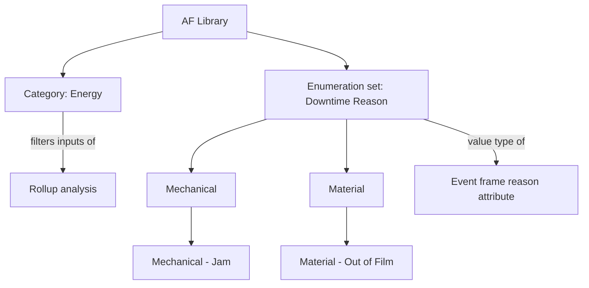

## Plain English

**Categories** are labels. You tag elements, attributes or analyses with a category such as
"Energy" or "Process Monitoring", and then filter or search by that label.

**Enumeration sets** are pick-lists. Each entry maps an integer to a name:

| Value | Name |
|---|---|
| 0 | AQ4500 |
| 1 | HC1500 |
| 2 | WX1200 |

An attribute can use an enumeration set as its value type, so users pick a name instead of typing a
code.

## Deep Dive

**Categories.** They live in the Library. Rollup inputs can be filtered by Attribute Category or
Element Category masks. Labs suggest analysis categories such as "Calculated Data" and
"Aggregation". AFSearch supports `Category:` filters; in a nested query the filter inside braces
applies to the element and the one outside applies to the attribute:

```text
Element:{Template:'FCC Pump Process' Category:'ProcessMonitoring'} Category:'Process Monitoring'
```

Third-party integrations use categories too: one simulation integration filters elements by a
semicolon-separated list of Element Categories.

**Enumeration sets.** "An ordinal list of sequential integer values, which are mapped to names."
**Hierarchical** enumeration sets (AF 2017 R2) add levels with `|`, for example
`WX1200|Old Recipe` (3) and `WX1200|New Recipe` (4).

**Reason codes.** Operators can annotate event frames after the fact by choosing from a multi-tiered
enumeration set, which gives consistent, reportable reasons.

> [!VERIFY]
> The list of category types (element, attribute, analysis, notification rule, table, reference type)
> and whether categories are per database were not confirmed in readable sources.

## Worked Example

A packaging line wants downtime reasons:

1. In Library, create enumeration set `Downtime Reason` with top-level values `Mechanical`,
   `Electrical` and `Material`, and second-level values such as `Mechanical|Jam` and
   `Material|Out of Film`.
2. On the event frame template for downtime, add a reason attribute that uses this set.
3. Operators choose a value in the client after each stop.
4. Tag the template's key attributes with category `Downtime KPI` so reports can search for them.

## Diagram



## Common Mistakes

- **Typing free-text reasons.** A shared enumeration set keeps reasons consistent and countable.
- **Hand-picking rollup inputs by name.** A category mask picks up new assets automatically.
- **Getting nested AFSearch scope backwards.** Inside braces filters the element; outside filters the
  attribute.

## Real-World Scenario

AVEVA's 2019 event frames session shows operators writing reason codes back to event frames after the
event, choosing from a multi-tiered enumeration set. Combined with event frame searches, this lets a
plant count downtime by reason across every line without asking operators to type comments.
