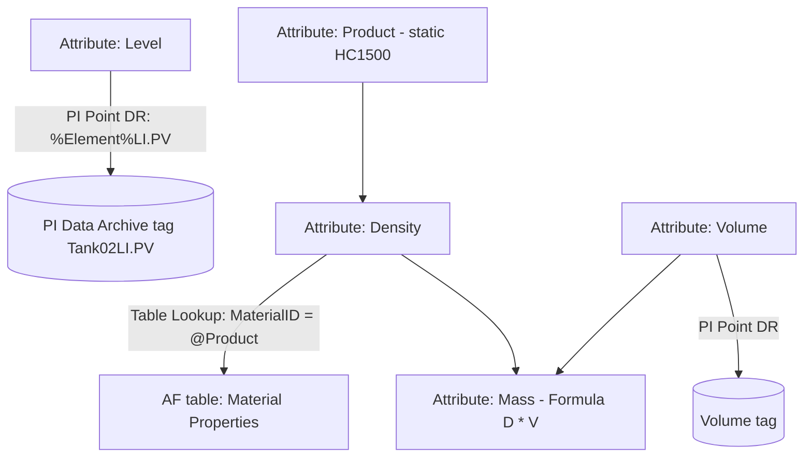

## Plain English

An attribute needs to get its value from somewhere. A **data reference** (DR) is the plug-in that
fetches it. The built-in types are:

| Data reference | Gets the value from |
|---|---|
| `<None>` | A static value stored on the attribute |
| PI Point (and PI Point Array) | A PI tag in the Data Archive |
| Formula | A calculation on other attributes |
| Table Lookup | A row in an AF table |
| String Builder | Text built from pieces and substitution parameters |
| URI Builder | Listed as built-in; not described in readable sources |
| Analysis | An analysis output computed when a client asks for it |

The magic ingredient is the **substitution parameter**: a `%...%` token replaced at run time. With
`%Element%LI.PV`, element `Tank02` reads tag `Tank02LI.PV`, and `Tank03` reads `Tank03LI.PV`, from one
template definition.

## Deep Dive

**PI Point.** Settings include Data Server (for example `PISRV01`), Tag and Source Units. The default
naming rule for created tags is `%Element%.%Attribute%.%ID%`, giving a full path like
`\\%Server%\%Element%.%Attribute%.%ID%`. Create the tags by right-clicking the Elements root and
choosing **Create or Update Data Reference**; the attributes then show "Pt Created". In code,
`AFDataReference.CreateConfig(instantiatedElements, false, null)` does the same in bulk. AF 2018 SP2
lets you set the default Data Archive at AF Server or AF database level. "By Time Range" retrieval
options include "Average (time-weighted)".

**Using other attributes.** `%@AttributeName%` substitutes another attribute's value.
`%@|Transformer ID%` reads an attribute on the containing element; `%@..\Site ID%` reads one on the
parent. In relative paths `..\` goes up to the parent element and `.|` goes down to an attribute;
without `.|` the name is read as a child element. With Parent-Child references, parameters resolve
by the path the element was reached through.

**Formula.** Letters are bound to attributes with UOMs (`D` = Density in kg/L, `V` = Volume in L),
with an equation such as `D * V` and a result UOM. Formula DRs are not time-weighted and are computed
on demand, which can slow analyses that read them.

**Table Lookup.** Configure a Table, Result Column and Where clause, for example
`MaterialID = @Product`, where `@` means an attribute value. The ConfigString looks like SQL:

```text
SELECT NetGen FROM GenInfo WHERE SiteName = @[..\..\|SiteAbbr] AND UnitAbbr = @[..\|UnitAbbr]
```

`;RWM=<value>` sets a replacement value when no row matches. A Where-builder can use the
`INTERPOLATE` operator, for example interpolating a `PowerCurve` table on `@Adjusted Wind Speed`. In
AF 2.5+, "Table provided time series data" with a timestamp column makes each value carry its row's
time.

**String Builder.** "Add New String", then insert parameters such as `%Element%`. AF 2018 SP2 added
`NewLine()` for multi-line strings.

**Analysis DR.** Computed only when a client requests the data, and not stored.

**Event frame attributes.** `.\Elements[.]|Outlet Temperature;TimeRangeMethod=Average` aggregates a
value from the referenced element over the frame. Other methods seen are `Maximum` and `StartTime`.

**Units.** AF converts between a PI Point and an attribute, or between two attributes, only within
one UOM class (psi to bar works).

> [!VERIFY]
> The full substitution parameter list, PI Point value-retrieval options and the exact meaning of
> `RWN` (seen once as `;RWN=No Data`) were not confirmed in readable sources.

## Worked Example

A tank template needs level, density and mass:

1. `Level`: PI Point DR, tag `%Element%LI.PV`, Source Units chosen to match the instrument. On
   `Tank02` it resolves to `Tank02LI.PV`.
2. `Product`: static String attribute, for example `HC1500`.
3. `Density`: Table Lookup on table `Material Properties` (MaterialID, Density in kg/m3), Result
   Column `Density`, Where `MaterialID = @Product`.
4. `Volume`: PI Point DR.
5. `Mass`: Formula DR, `D` = Density, `V` = Volume, equation `D * V`, with the result UOM set.

Because every reference is relative to the element, the same template works for every tank.

## Diagram



## Common Mistakes

- **Relative paths that assume a fixed depth.** `..\..\` breaks where hierarchy depth differs
  between sites.
- **Table Lookup timestamps of 1/1/1970.** Enable "Table provided time series data".
- **Time-zone shift on a replacement value.** One thread saw a DateTime replacement value come back
  7 hours ahead (logged as WI 166420).
- **Feeding Formula DRs into analyses.** They are computed on demand each time.
- **Trending an Analysis DR and expecting its schedule.** It was seen to evaluate at every input
  event; use a PI Point output to store results.
- **Using event-frame relative syntax in a Table Lookup.** It is not supported; a String Builder
  attribute holding the path is a workaround.

## Real-World Scenario

A PI Square user needed a Table Lookup on event frame attributes that picked the generator's net
generation by site and unit abbreviation. The working query used relative attribute references,
`SELECT NetGen FROM GenInfo WHERE SiteName = @[..\..\|SiteAbbr] AND UnitAbbr = @[..\|UnitAbbr]`, after
learning that Table Lookups do not accept the same relative syntax as event frame attributes. For
lookups on large external tables, another thread notes that since PI 2014 linked tables resolve
parameterised queries on the server, so the 10,000-row guideline no longer applies.
