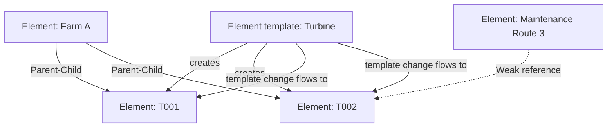

## Plain English

An **element** is AF's picture of one asset: a pump, a tank, a wind turbine, a whole site. Elements
sit in a tree, so a site contains areas, and areas contain equipment.

An element has no value of its own. Its data lives in **attributes** such as Temperature or Speed.

An **element template** is a blueprint. You define the attributes once on a template (for example
`Turbine`), then create hundreds of turbines from it. Change the template and every turbine changes
too.

> [!TIP]
> If you will have more than one of something, make a template first.

## Deep Dive

**Names.** An element name must be unique along its path: two siblings cannot both be called
`Transformer`. Names cannot contain control characters or symbols such as `;`, `?`, backtick, `"`,
`\`, `|`, braces or square brackets.

**Creating elements.** You can create an element with `<None>` as its template, or from a template.
"Convert to Template" makes a template from an existing element without deleting or changing it, and
sets the element to use the new template. Templates live under Library > Templates > Element
Templates.

**How templates flow.** When a template's default values, attribute definitions or structure change,
elements built from it update automatically. Overrides you make on an element's attribute survive
template changes; "Reset to Template" removes them. A checkbox on the template's General tab can allow
extra element-level attributes, but then elements of that template no longer have identical
attributes.

**Template hierarchies.** Templates can be derived from base templates, inheriting their attributes.
AF 2018 SP2 added a "base template only" setting that stops a template being used to create elements.
In the AF SDK, `AFElementTemplate.FindInstantiatedElements` returns the elements built from a template.

**References.** Elements connect through reference types:

| Reference type | Behaviour |
|---|---|
| Composition | Deleting the parent deletes the child |
| Parent-Child (default) | A child can have several parents |
| Weak | Removed when the child's last strong parent reference goes |

In PSE, Shift-drag moves an element, Ctrl-drag copies it, and a plain drag creates a reference.
With Parent-Child references, substitution parameters resolve according to the path the element is
accessed through.

**Bulk work.** PI Builder (Excel add-in) publishes elements in bulk, for example with Edit Mode
"Create Only".

## Worked Example

An AVEVA PI World 2019 lab models a wind farm with three templates: `Region`, `Farm` and `Turbine`.
One way to build such a model:

1. Build one turbine element with attributes such as `Active Power` and `Expected Power (Polynomial)`.
2. Convert it to the `Turbine` template.
3. Create the other turbines from the template under each farm.
4. On the `Farm` template, a rollup analysis sums the child turbines' `Expected Power (Polynomial)`.

Because every turbine shares one template, one rollup definition on `Farm` works for every farm.

A second lab shows a trap. Converting an element whose PI Point attribute points at `Tank02LI.PV`
sets the template's Substituted path to the default `%Element%.%Attribute%.%ID%`, even though the
real pattern is `%Element%LI.PV`. Fix the template path before creating more tanks.

## Diagram

## Common Mistakes

- **Expecting an element to have a value.** Values are on attributes.
- **Overriding values on elements, then wondering why template changes do not show.** Use Reset to
  Template.
- **Allowing extensions by default.** Elements stop being identical, which works against template-wide
  analyses and displays.
- **Trusting the Substituted path after Convert to Template.** It defaults to
  `%Element%.%Attribute%.%ID%`.
- **Plain-dragging to move.** A plain drag creates a reference; use Shift to move.

## Real-World Scenario

AVEVA's 2019 event frames session recommends deriving event frame templates from base templates so
searches can target the base type and all its variants. The same idea applies to element templates:
a `Pump` base template with `Centrifugal Pump` and `Dosing Pump` derived templates keeps common
attributes in one place, and the AF 2018 SP2 "base template only" setting stops anyone creating a
vague "Pump" element by mistake.
