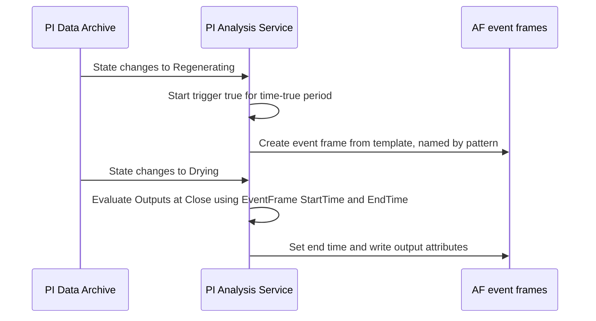

## Plain English

An **event frame** is a bookmark on time. AVEVA describes them as "Bookmarks for time-series data".
It has a **name**, a **start time**, an **end time** and **context**, usually the element it is
about. Examples: a pump trip, a batch, a regeneration cycle, a period of poor efficiency.

Once events are bookmarked you can ask questions like "show me every trip this month, with the peak
temperature during each one" without digging through trends.

An event that has started but not finished is **active**: it has a start time but no end time yet.

## Deep Dive

**What creates them.** Batch Framework interfaces, Asset Analytics (Event Frame Generation analyses)
or AF SDK code. AVEVA's deck also mentions PI EFGen.

**Templates.** An event frame template defines the event type, the attributes captured and the
**naming pattern** (set on its General tab), for example
`OSIDemo_%TEMPLATE% - %ELEMENT% - %STARTTIME:yyyy-MM-dd HH:mm:ss%`.

**Event Frame Generation analysis.** Configured with an event frame template, start triggers,
additional variables and Outputs at Close. Useful options:

- **Start trigger**: a Boolean expression, for example
  `Efficiency < Target AND 'Status' <> "Stop"` (variables unquoted, attributes in single quotes) or
  `'Best Operating State'="Regenerating"`. In that second lab the frame ends when the state stops
  being "Regenerating".
- **Time true**: a minimum period the trigger must stay true before a frame is created.
- **Root cause**: an optional child frame covering a window before the start (default five minutes).
- **Severities**: one start trigger per severity, for example Minor above Hi, Major above HiHi,
  Critical above Maximum. With multiple severities, Asset Analytics creates only direct children and
  a single start trigger must be true.
- **Outputs at Close**: expressions computed when the frame closes, stored as event frame attributes
  or PI tags. Each must be mapped to an attribute, and the mapping order is not the expression order.
  `EventFrame("StartTime")`, `EventFrame("EndTime")` and `EventFrame("Duration")` give the frame's
  own times.

A lab used Generation Mode `Variable`. Event frame output analyses need AF 2017 R2 or later.

**Using them.** Searches filter by type, start/end, "Include descendants", name (wildcards),
element, template and attribute criteria. Indexed attributes speed up value searches, and AF 2019
improved simple queries (time range plus one attribute). In PI Vision's Events pane, the colour to
the left of each event shows its severity. Operators can add **reason codes** from a multi-tier
enumeration set. Bulk deletion uses the **AFDiag** utility.

> [!VERIFY]
> The full AFSeverity list, the acknowledgement API and template "can be acknowledged" setting, and
> end-trigger behaviour when no explicit end trigger is set were not confirmed in readable sources.
> Requiring a reason or e-signature before acknowledging is only an open feedback idea.

## Worked Example

The PI World 2020 dryer lab tracks regeneration cycles:

1. Start trigger: `'Best Operating State'="Regenerating"`. The frame ends when the state changes.
2. Variable: `PreviousRegenEvent = FindEq('Best Operating State','*','-7d', "Regenerating")`.
3. Output at Close:
   `TagTot('Regenerant Vapor Flow', EventFrame("StartTime"), EventFrame("EndTime"))`, mapped to an
   event frame attribute.
4. Another output, `TimeEq('Best Operating State', PreviousDryingEvent,'*',"Drying") /3600`, gives
   drying hours.
5. A notification rule is then created from this analysis (see the notifications lesson).

## Diagram

## Common Mistakes

- **Mapping Outputs at Close in expression order.** The mapping order differs; check each one.
- **Capturing every attribute.** AVEVA's advice: "Capture meaningful data - not all data".
- **No time-true period on noisy triggers**, giving floods of tiny frames.
- **Searching on unindexed attributes** and then blaming event frames for slowness.
- **Expecting acknowledgement to require a reason.** That is not a product feature.

## Real-World Scenario

AVEVA's 2019 event frames session shows severity-driven event frames for pump speed: one analysis,
three start triggers on the Hi, HiHi and Maximum limit traits, giving Minor, Major and Critical
frames. Operators then write reason codes back to the frames, and analysts use event frame searches
with indexed attributes to compare events across many pumps.
