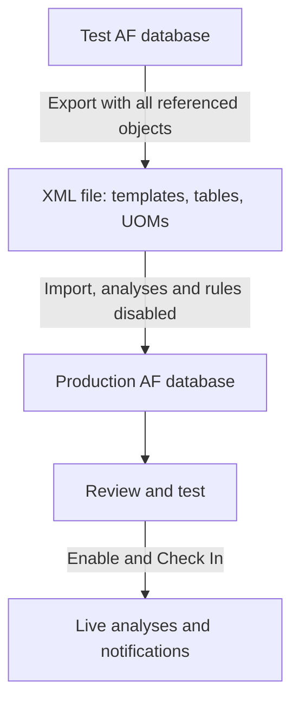

## Plain English

The **Library** is the reusable part of an AF database: the blueprints and reference lists that
elements and event frames are built from. It holds:

- element templates (Library > Templates > Element Templates),
- event frame templates,
- categories,
- enumeration sets,
- tables.

Libraries also automatically include the UOM database.

To move a model from a test server to production, you **export** it to XML and **import** it on the
other side.

## Deep Dive

**PSE export/import.** File > Export to File (or right-click > Export) and File > Import from File.
Tick **Include All Referenced Objects** so the templates, tables and UOMs the objects depend on go
with them; the export then includes the UOM database.

**AF SDK.** Automate the same moves:

```csharp
PISystem.ExportXml(obj, PIExportMode.NoUniqueID | PIExportMode.Flat, ...);
PISystem.ImportXml(db, PIImportMode.AutoCheckIn, ...);
```

**Safe promotion.** From AF 2018 SP2, analyses and notification rules can be imported **disabled**,
so you can review them before they start running and sending messages.

**Samples.** The AF SDK getting-started sample ships its database as
`AF Database - Green Power Company.xml`, imported in PSE.

> [!VERIFY]
> AFExport.exe / AFImport.exe command-line utilities and element versioning (effective-dated versions
> and a Version tab) are training knowledge only. Check whether your AF version provides them.

## Worked Example

Promoting a new `Compressor` template from test to production:

1. On test, export the template with Include All Referenced Objects.
2. On production, import the XML with analyses and notification rules disabled (AF 2018 SP2+).
3. Create one compressor element and test its analyses with Evaluate and Preview Results.
4. Enable the analyses and rules, then Check In.

This order is a suggested practice built from the sourced features, not an AVEVA procedure.

## Diagram



## Common Mistakes

- **Exporting without referenced objects.** The import fails or creates incomplete objects.
- **Importing analyses enabled straight into production.** They start writing outputs at once.
- **Forgetting that UOMs travel with the library.** They land in the target server's shared UOM
  database.

## Real-World Scenario

AVEVA's own AF SDK getting-started guide relies on this mechanism: learners import the
"Green Power Company" database from XML (creating PI points and enabling analyses on import) and then
run the exercises against it. Teams use the same export/import path to keep test and production
libraries in step.
