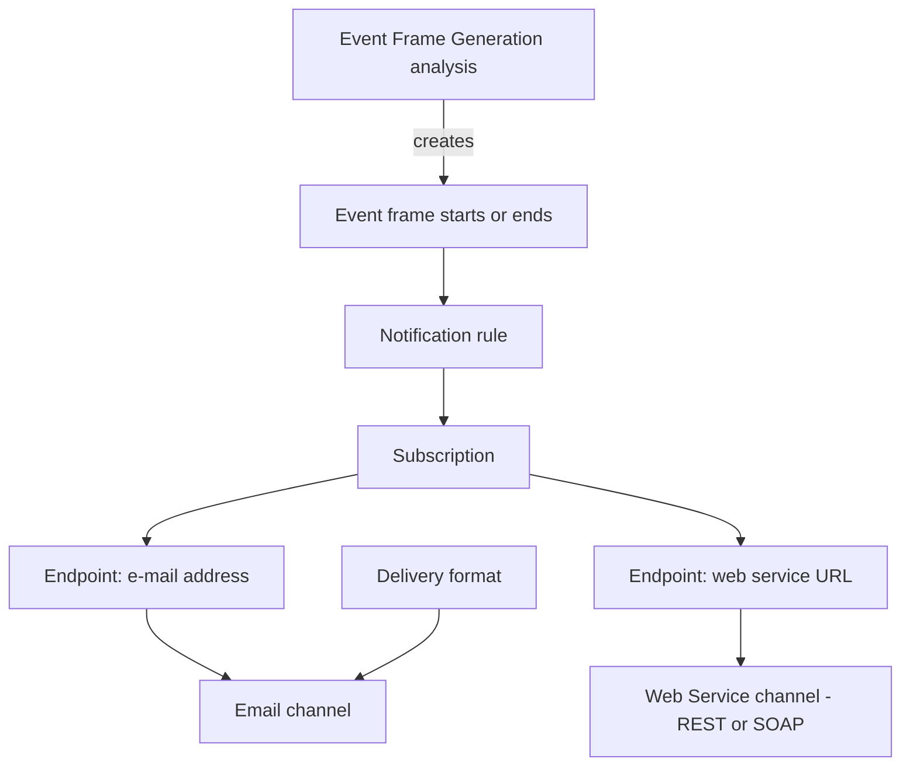

## Plain English

A **notification rule** sends a message when something important happens. In modern AF, "something
important" is always an **event frame**: when an event frame that matches the rule starts, ends, or
both, the rule notifies its subscribers.

To deliver a message you need:

- a **delivery channel** (how: Email or Web Service),
- a **delivery endpoint** (where: a contact's e-mail address or a web service URL),
- a **subscription** (which contacts get which rule),
- a **delivery format** (what the message says).

## Deep Dive

**History.** Legacy PI Notifications 1.0 (January 2008) was built on AF 2.0 with plug-ins for
analysis rules, time rules and delivery channels (Pager, Phone, Email, Web Services, BizTalk, SAP,
custom). AF 2016 R2 introduced notification rules, and an AF Server 2.8.5 (2016 R2) no longer
supports the legacy 2012 notifications. Legacy notifications used 7 PI tags each; notification rules
do not.

**Migration.** The PI Notifications Migration Tool in `%pihome%\Notifications` converts 2012
notifications; it is needed only if 2012 was in use. Some legacy features are not supported and must
be changed or left behind. AVEVA declined (August 2022) to provide a migration path for custom
delivery channels.

**Channels.** Since 2016 R2 only Email and Web Service are supported; custom endpoints are not. The
web service channel can push to REST or SOAP services, and AF 2017 R2 added authentication to
external web services. Dynamic notification endpoints need AF 2017 R2 or later.

**Configuring in PSE.** Create a rule from an Event Frame Generation analysis with "Create a new
notification rule template for <analysis>" in Analysis Details. Use View/Edit Subscriptions, drag a
contact's endpoint in, then Check In. "Manage Formats" edits message formats; "Insert Link" adds a
link; "Test Send" sends a test message.

**Tools and code.** PI Builder cannot manage notification rules. AF 2018 SP2 can import analyses and
notification rules disabled. AF SDK 2.9.5 added `AFNotificationContactTemplateSearch`, for example
`Name:'Davi*'`.

**Service.** PI Notifications Service runs as `NT SERVICE\PINotificationsService` and logs to
`%programdata%\osisoft\pinotifications\logs\pinotifications-log.txt`. For HA, AVEVA recommends Windows
Server Failover Clustering.

> [!VERIFY]
> Rule fields such as non-repetition interval, resend, escalation and contact groups, and the
> contact types, were not in readable sources.

## Worked Example

The PI World 2020 lab builds "My Dryer Notification":

1. The Event Frame Generation analysis triggers on
   `'My Dryer Regeneration Cycle Time Forecast' >= 11`.
2. In Analysis Details, choose "Create a new notification rule template for <analysis>".
3. View/Edit Subscriptions: drag `student01@pischool.int`'s E-mail endpoint in, then Check In.
4. Manage Formats: duplicate "Global Default Email", rename it "My Dryer Notification Email", remove
   Server, Database and Severity, and Insert Link to a PI Vision display (`starttime=*-7d`,
   `endtime=*`).
5. Test Send to confirm.

## Diagram

## Common Mistakes

- **Upgrading AF to 2016 R2 without migrating 2012 notifications.** They stop working.
- **Planning SMS through a custom channel.** Not supported; use an email-to-SMS gateway or a web
  service.
- **Trying to bulk-edit rules in PI Builder.** It cannot manage them.
- **Ignoring -109 errors from legacy notification tags.** Migrate to notification rules.

## Real-World Scenario

On PI Square, an admin found PI Notifications Service not running after upgrading to 2016 R2. The
answer explained that AF Server 2.8.5 no longer supports 2012 notifications, that the Migration Tool
is only needed if 2012 notifications were in use, and where to read the service log. Another user
asking for SMS alerts was told custom delivery channels are no longer supported and to use email or a
web service instead.
