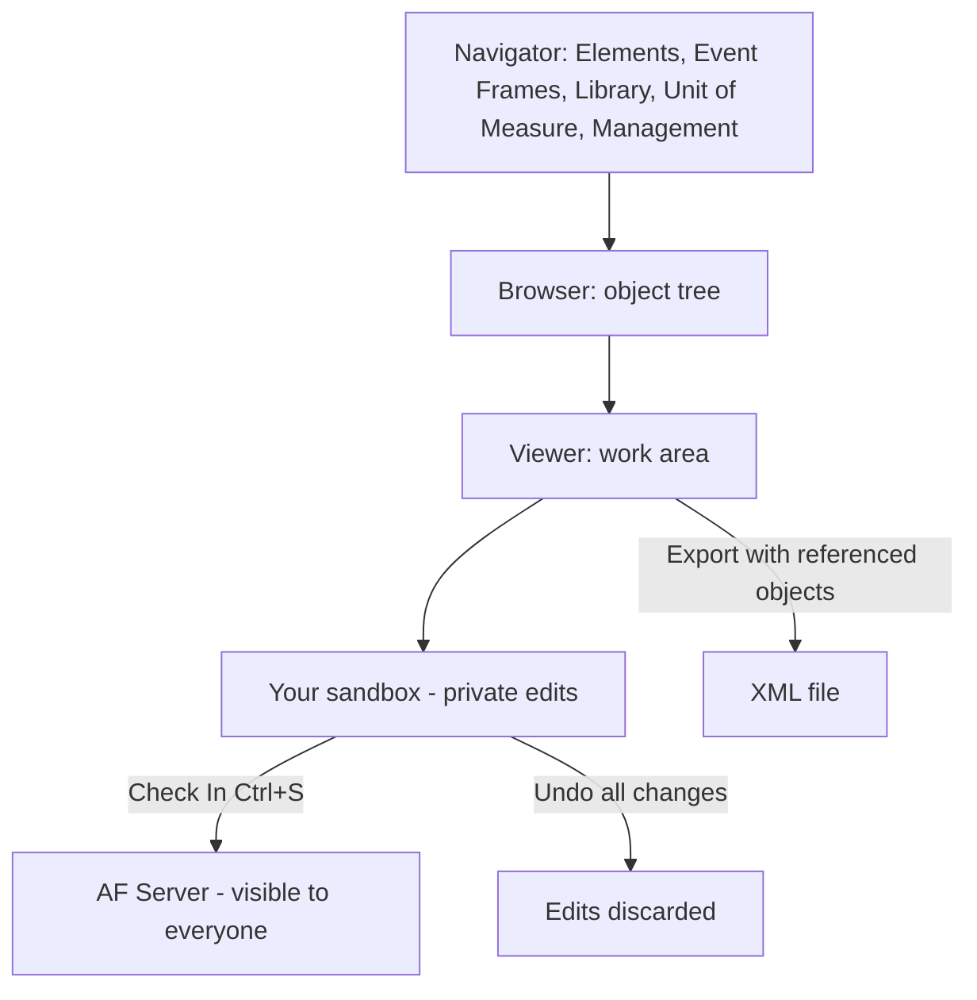

## Plain English

**PI System Explorer (PSE)** is the desktop tool for building and running AF. You use it to create
elements and templates, look at event frames, manage the Library and units, and control analyses.

The screen has three main panes:

- **Navigator** (lower left): the sections Elements, Event Frames, Library, Unit of Measure and
  Management.
- **Browser**: the objects in the selected section, usually as a tree.
- **Viewer**: the main work area for the selected object.

Other parts are the Configuration Panel (attribute properties), Palette, Status Bar and Menu
Bar/Toolbar.

## Deep Dive

**The sandbox.** "The AF Server uses a sandbox concept for modifications." Your edits are private
until you **Check In** (Ctrl+S). While you have an object checked out, others cannot edit it.
"Undo all changes to the Database" throws away your sandbox.

**Shortcuts.** Elements Ctrl+1, Event Frames Ctrl+2, Library Ctrl+3, Check In Ctrl+S.

**Export and import.** File > Export to File (or right-click an object > Export) and File > Import
from File. Tick **Include All Referenced Objects** so templates, tables and UOMs needed to rebuild the
structure go with it.

**Analyses.** The **Management** plug-in searches, enables, disables, backfills and recalculates
analyses in bulk.

**Event frames.** Event Frame Searches: right-click > New Search, choose a template, rename the
search.

**Notifications.** View/Edit Subscriptions, Manage Formats, Insert Link and Test Send. The legacy
(2012) Notifications Navigator section was removed; notification rules live with elements and
templates.

**Options and security.** Display UOM Group is set in Tools > Options. A reader comment on the AF 2018
SP2 release blog mentions an Effective Access tab in the Security Configuration dialog.

> [!VERIFY]
> Element Viewer tabs beyond General, Child Elements, Attributes, Analyses and notification rules
> (for example Ports and Version) were not confirmed in readable sources.

## Worked Example

Copying a lab model to another server:

1. In PSE, connect to the source database (`Velocity Terminals`).
2. File > Export to File, tick Include All Referenced Objects, save as
   `C:\Class\Exercises\01_Velocity Terminals\My Velocity Terminals.xml`.
3. Connect to the target server and database, then File > Import from File.
4. Check the elements, templates and tables arrived, then Check In any edits (Ctrl+S).

## Diagram

## Common Mistakes

- **Forgetting to Check In.** Colleagues and services do not see your changes.
- **Exporting without Include All Referenced Objects**, then failing to import elsewhere.
- **Looking for the old Notifications section.** Rules are now on elements and templates.
- **Editing analyses one by one** when Management can do it in bulk.

## Real-World Scenario

In AVEVA's PI World 2019 analytics lab, students build analyses on templates, then switch to the
Management section to search for all analyses of a template and backfill them in one operation,
watching progress in the Backfilling column. The same lab uses Ctrl+1, Ctrl+2 and Ctrl+3 to move
between Elements, Event Frames and Library while checking results.
