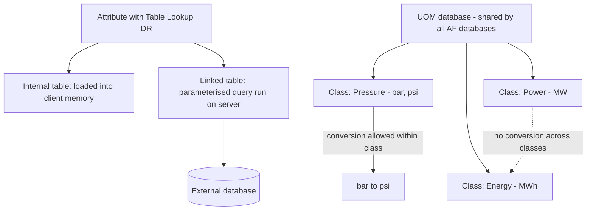

## Plain English

**AF tables** hold reference data that does not come from sensors: material densities, pump curves,
shift calendars. A Table Lookup data reference reads a value from a table row.

**Units of measure (UOMs)** let AF show and convert values. Units belong to **classes** (Volume,
Density, Length). AF converts only within a class: bar to psi yes, MW to MWh no.

## Deep Dive

**Table kinds.** Tables can be **internal**, **imported** or **linked**. A linked table gets its rows
from an external database. Example internal table "Material Properties": MaterialID (String) and
Density (Double, kg/m3).

**Size and speed.** Internal tables are loaded into each client's memory, so keep them under 10,000
rows. Since PI 2014 that guideline no longer applies to linked tables, because a parameterised query
is resolved on the server. AVEVA's PI World 2020 tips deck recommends parameterised queries to
reduce table size.

**Time zones.** Time-zone handling for table data is set on the table (PSE > Library > Tables).

**UOM classes and groups.** Classes are families of convertible units; groups (Metric, US Customary)
are display preferences. The Display UOM Group is set in PSE under Tools > Options. You can add custom
units such as "ratio" or "decimeter" (0.1 m in class Length).

**Server-wide scope.** The UOM database is one repository shared by all AF databases on a server.
UOM names and abbreviations are case-insensitive, and uniqueness is enforced across the whole UOM
database, not per class. Exporting a database with "All Referenced Objects" includes the UOM
database.

> [!VERIFY]
> Canonical units per class, the conversion formula format, and linked-table connection types and
> refresh settings were not in readable sources.

## Worked Example

A water utility stores pump curves:

1. Create an internal table `PumpCurve` with columns Flow and Head, a few dozen rows.
2. Give the pump template a Table Lookup attribute that interpolates Head from the current Flow.
3. The plant's asset register (50,000 rows) is too big for an internal table, so it becomes a
   linked table queried with parameters on the server.
4. A tag in psi is mapped to an attribute whose default UOM is bar. Both are pressure units, so AF
   converts, and users with the US Customary display group can still see psi.

## Diagram

## Common Mistakes

- **Big internal tables.** Every client loads them into memory; keep them under 10,000 rows or link
  them.
- **Expecting conversion across classes**, for example power to energy.
- **Case-only differences in abbreviations** such as `MW` and `mW`: AF treats them as the same.
- **Assuming a custom UOM stays in one database.** It is server-wide.

## Real-World Scenario

On PI Square, an AF team developer explained to a user that units, contacts, plug-ins and libraries
are shared across every AF database on a server, and that unit names are case-insensitive and unique
across the whole UOM database. The user had planned separate unit definitions per site database; the
fix was to agree one set of units for the whole server.
