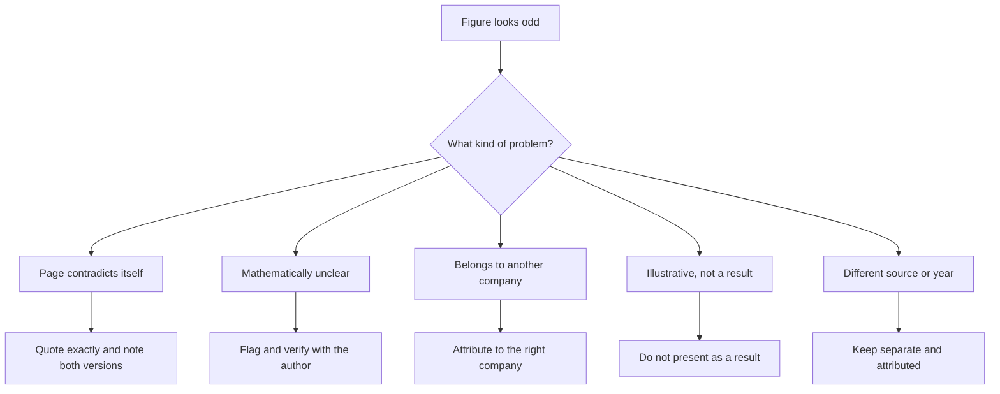

## Plain English

Even honest case studies contain mistakes. A page may give one number in the headline and a different
one in the body. A unit may be garbled. A figure from another customer may appear on the wrong page.

Your job is not to fix the number. Your job is to **quote it exactly, say who reported it, and point out
the problem**. Never round, convert or combine figures to make them agree.

## Deep Dive

**1. The page contradicts itself.**

| Case | Version A | Version B |
|---|---|---|
| Tyson Foods | 0.1% yield improvement (body) | ".01%" (page metadata) |
| Ence | "1,500 MWh saved per pulp mill" | "1,500 MWs per hour per year" (body; not a valid unit) |
| University of Maryland | savings of 30% of HVAC energy expenses (results) | "up to 30%" of energy expenses (headline) |
| PayPal | reporting "in seconds instead of weeks" | "instead of 40 days later" (a quote elsewhere on the page) |
| Abbott Nutrition | "Increased filling speed by ten percent" | an "opportunity to increase the speed of the filler by more than ten percent" (body) |

Give both versions, or quote the clearest one and note the other.

**2. The figure is mathematically unclear.** AMMC stated concentrator slowdowns from low crusher feed
were reduced by "300%". A reduction cannot exceed 100%. Verify with the author before teaching it.

**3. The figure belongs to someone else.** The Eni success-story page also shows a DCP Midstream "$25M"
figure. It belongs to DCP ("$25M saved in fiscal year 2017 from improved plant operations").

**4. The number is illustrative, not a result.** The Rio Tinto page's "100% availability / 80%
utilization" numbers are illustrative quotes, not results.

**5. Two sources, two claims.** MOL's "EBITDA improvement: $500M-550M" (OSIsoft 2015 deck) and "$1
billion in EBITA since 2010" (OSIsoft 2023 overview) are different figures from different sources and
years. Keep both, attributed, and never merge them.

**A sixth, subtler case: credit.** Bruce Power's outcomes (for example 1000 employee hours saved) are
mostly attributable to AIM and engineering tools rather than PI alone. Say so when you use them.

## Worked Example

**Halifax Water: one programme, several numbers.**

- Halifax Water's GM (OSIsoft UC 2013): system inputs fell from 168 MLD (2000) to 131 MLD (2012), with
  "$600,000" direct annual savings.
- OSIsoft's 2023 company overview: "38 million litres of water a day saved".

168 minus 131 is 37 MLD, not 38. The two figures come from different sources, years and possibly
baselines. Do not "correct" either one, and do not average them. Write:

"Halifax Water reported system inputs falling from 168 MLD (2000) to 131 MLD (2012) (Halifax Water GM,
OSIsoft UC 2013). OSIsoft's 2023 overview separately cites 38 million litres a day saved."

## Diagram

## Common Mistakes

- **Silently picking the bigger number.**
- **"Fixing" a figure** by converting units or recalculating.
- **Merging claims** from different sources or years into one.
- **Copying a figure from a page without checking whose it is.**

## Real-World Scenario

You are preparing a board slide on PI value in oil and gas. You find "$25M" on the Eni page, MOL's
"$500M-550M" in a 2015 deck and "$1 billion in EBITA since 2010" in a 2023 overview.

The honest slide credits $25M to DCP Midstream (fiscal 2017, reported by AVEVA), lists MOL's two
claims separately with their sources and years, and gives Eni no figure, because its story has none.
See [DCP Midstream](#/cases/dcp-midstream), [MOL Downstream](#/cases/mol-downstream) and
[Eni](#/cases/eni-oil-field).
