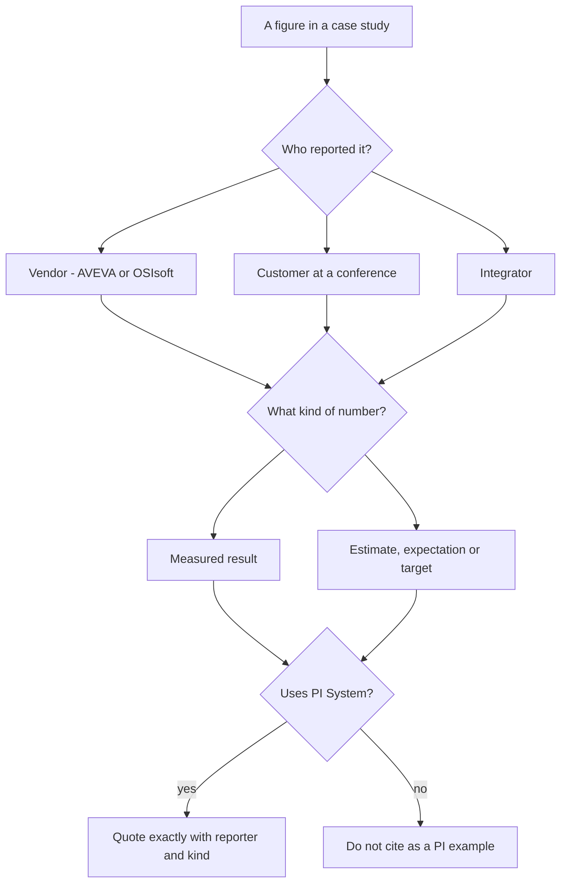

## Plain English

PI Academy's [case-study library](#/cases) holds 83 real PI System stories. They are useful: they show
what real companies built and what they say it achieved. But they are not science papers. Most are
written to sell, and almost none are independently audited.

So read every figure with three questions:

1. **Who reported it?** The vendor (AVEVA or OSIsoft), the customer, or an integrator?
2. **What kind of number is it?** A measured result, an estimate, an expectation or a target?
3. **Does the story really use the PI System?** AVEVA sells other historians and platforms too.

> [!IMPORTANT]
> In this app every case-study outcome says who reported it, for example "reported by AVEVA". Keep that
> attribution whenever you reuse a figure.

## Deep Dive

**Three kinds of source.**

| Source | Who reports the figure | Example |
|---|---|---|
| AVEVA success story (aveva.com) | AVEVA, the vendor | Covestro, Illovo, CSL Group |
| User conference talk (OSIsoft UC, PI World, AVEVA World) | The presenting company or integrator, or OSIsoft itself | Luminant (company), Longannet (Capula), Pertamina 2014 (OSIsoft) |
| Integrator article | The integrator | Ok Tedi (Mipac), E Tech biotech |

A **success story** is a vendor-published customer case; its outcomes are as reported by AVEVA, not
independently audited. **PI World / AVEVA World** is the user conference where customers present their own
deployments.

**Results, estimates, expectations, targets.** Watch the verbs:

- Xcel Energy: "Savings and efficiencies are roughly estimated over the last six years at $46 million"
  (an estimate).
- DONG Energy: could "cut OPEX by up to about €20M per year (NPV)" (an expectation, not a measured
  result).
- Detroit Water & Sewerage: "Expected $2,000,000" savings over the next 5 years (an expectation).
- UC Davis: "Projected savings of $197M over 60 years" (a projection).
- Covestro: "on track for a 50% reduction by 2030" (a target).

**Dates.** AVEVA success-story pages show only a 2026 "last published" date, which is not the project
year. Treat the year as "not stated" unless the text gives one.

**Not every AVEVA story is a PI story.** Nestlé Waverly (AVEVA Historian, CONNECT), General Mills
(System Platform), Henkel (MES, System Platform), P&G (System Platform), Barghest (System Platform) and
City of Bremen (InTouch, Historian) were all checked and found not to use PI System.

## Worked Example

**Turning a slide claim into an honest sentence.** A colleague's slide says: "PI saved Xcel $46M."

1. Find the source: an AVEVA success story quoting Kasen Huwa of Xcel Energy.
2. Read the exact words: "Savings and efficiencies are roughly estimated over the last six years at
   $46 million".
3. Note the kind of figure: a rough estimate, over six years, of savings *and efficiencies*.
4. Write it honestly: "Xcel Energy estimates savings and efficiencies of roughly $46 million over six
   years from PI-based wind forecasting (Kasen Huwa, Xcel Energy, in an AVEVA success story)."

Do not round it to $50M, convert it to a yearly figure, or drop "roughly estimated".

## Diagram

## Common Mistakes

- **Dropping the reporter.** "Covestro cut energy 30%" hides that AVEVA reported it.
- **Treating estimates as results.** "Estimated", "expected", "projected", "up to" and "on track" all
  change the meaning.
- **Rounding or converting.** Never round, convert currencies or units, or annualise.
- **Citing non-PI AVEVA stories** as PI examples.
- **Reading the publish date as the project year.**

## Real-World Scenario

**Noble Energy, read carefully.** Noble Energy reported that using PI during the Aseng FPSO startup
helped engineers increase production by "an estimated 10,000 barrels of oil per day". That is the
company's own estimate, given in its own OSIsoft seminar presentation. It is a strong, specific claim,
but it is still an estimate. Quote it with both qualifiers: "estimated" and "reported by Noble Energy".
See [Noble Energy](#/cases/noble-energy).

**CSL Group, a rare exception.** CSL's "8,233 mt CO2e avoided across 11 vessels in a year" is described as
third-party verified. When a source says that, mention it: it makes the figure stronger. See
[CSL Group](#/cases/csl-group).
