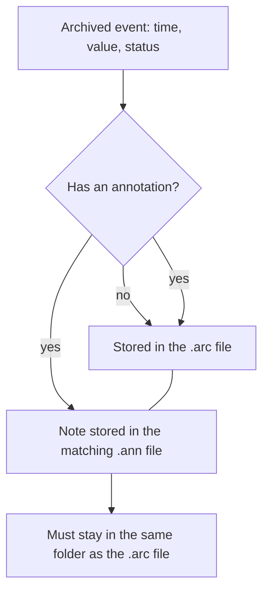

## Plain English

An **annotation** is a note attached to one stored event. For example, a lab technician might attach
"sample taken after cleaning" to a quality reading. The value and timestamp stay the same; the note
travels with that event.

The Data Archive keeps annotations in a separate file next to each archive. Every archive file
(`.arc`) has a matching annotation file (`.ann`).

## Deep Dive

**Where annotations live.** OSIsoft's 2010 material described archive storage as "Archive and
Annotation Files". Each `.arc` file has a matching `.ann` file, and the `.ann` file must stay in the
same directory as its archive.

**What an event can carry.** The PI Server stores events with optional annotations, alongside
quality, substitution and change flags.

**Performance.** AVEVA's 2023 performance session lists heavy use of annotations among the things to
avoid or limit, together with excessive string and BLOB tags, Float64 and sub-second timestamps,
especially where out-of-order writes are involved.

| Do | Don't |
|---|---|
| Use annotations for occasional human notes on important events | Use annotations as a bulk data channel |
| Move `.arc` and `.ann` together | Copy only the `.arc` file |
| Keep the `.ann` in the archive's folder | Store annotation files elsewhere |

## Worked Example

An admin moves old archives to a bigger volume. The documented sequence is:

1. Force an archive shift so the archive being moved is not the primary.
2. Unregister the archive.
3. Move **both** `piarch.012.arc` and its `.ann` file to the new folder (the file name is
   illustrative).
4. Re-register the archive from its new location.

Because the `.ann` file moved with the `.arc` file into the same folder, the annotations on those
events are still there.

## Diagram

## Common Mistakes

- **Moving or restoring only the .arc file.** The annotations are in the .ann file.
- **Annotating thousands of events automatically.** Heavy annotation use hurts archive performance.
- **Expecting annotations to change the value.** They are notes attached to an event, not edits.

## Real-World Scenario

A pharmaceutical site wants every manual lab entry annotated with the analyst's comment. The PI team
agrees to annotations for genuine exceptions only, and keeps routine context, such as batch IDs, in
AF and event frames, following AVEVA's advice to limit annotation use for performance.

> [!VERIFY]
> Check AVEVA documentation for annotation size limits and how PI Vision, PI DataLink and the AF SDK
> create and read annotations.
