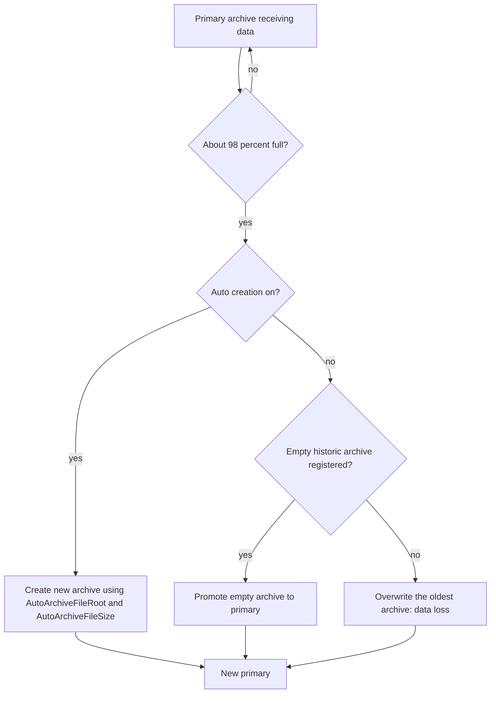

## Plain English

The Data Archive keeps history in **archive files** (`.arc`), each with a matching annotation file
(`.ann`). One archive at a time is the **primary archive**: it receives current data and has no end
time. Older archives sit behind it in time order and never overlap.

When the primary is about 98% full, the server starts a new primary. This is called an **archive
shift**. Normally the server creates the new file automatically.

There are two families of archives that are never mixed: **historic** archives for normal points and
**future** archives for points that store forecasts.

## Deep Dive

**Fixed and dynamic.** Historic archives are **fixed-size** by default: all their space is allocated
at creation. Fixed-size archives are required for automatic archive creation. **Dynamic** archives
grow as they fill and are meant for troubleshooting, reprocessing and backfilling, not normal
operation.

**Future archives.** Only future archives accept data more than 10 minutes ahead. They are created on
demand by calendar month: a new one is a 1 MB file spanning one month that grows dynamically.

**Registered archives.** The Data Archive can only read **registered** archives. They can be on any
drive it can reach. The primary cannot be unregistered.

**What happens at a shift.** With automatic creation on, a new archive is created. If automatic
creation is disabled, a shift promotes an empty historic archive, or **overwrites the oldest archive**
if none is empty. OSIsoft recommends keeping 2 empty historic archive files.

**Automatic creation parameters.**

| Tuning parameter | Purpose |
|---|---|
| Archive_AutoArchiveFileRoot | Location and name root of auto-created historic archives; clearing it disables auto-creation |
| Archive_FutureAutoArchiveFileRoot | The same for future archives |
| Archive_AutoArchiveFileSize | Size of the next auto-created primary archive |
| Archive_AutoArchiveFileExt, Archive_AutoArchiveFileFormat | Naming of auto-created archives |

**Sizing.** The 2017 R2 course rule: take (physical memory in MB) / 3 or 3 x (licensed points) / 1024
MB, whichever is smaller, then round down to a power of 2, with a minimum of 256 MB and a maximum of
10,240 MB. The architecture course gives a table by licensed points:

| Licensed points | Default archive size |
|---|---|
| 0 - 87,381 | 256 MB |
| 87,382 - 174,762 | 512 MB |
| 174,763 - 349,525 | 1,024 MB |
| 349,526 - 699,050 | 2,048 MB |
| 699,051 - 1,398,101 | 4,096 MB |
| 1,398,102 - 2,796,202 | 8,192 MB |
| 2,796,203 or more | 10,240 MB (cap) |

AVEVA's 2023 guidance: no archive larger than one third of system RAM, so three archives fit in
memory. A 2012 OSIsoft sizing slide recommended enough RAM "to fit 2 full archives".

**Disks.** Put archives and the event queue on separate local volumes so reads and writes run in
parallel: archives on the largest drive, event queues on the second largest. Disk estimates per
1,000 points: archives 10 MB, event queue 5 MB, databases 11 MB (+1 MB); message logs 10 MB.

**Tools.** SMT Operation > Archives (Historic and Future tabs) views properties, registers and
unregisters, creates archives and forces a shift. `piartool -al` lists archives and shift progress.
`pidiag -archk <file>` checks a file and shows its storage map, including the PointIDs in it.
Reprocessing (piarchss offline, or the Offline Archive Utility) repairs errors, rearranges records for
faster reads and makes space for new tags; for 2018 SP2 and later set Archive_ReprocessThreadCount
to 1.

## Worked Example

A server has 16 GB RAM (16,384 MB) and 200,000 licensed points.

1. Memory rule: 16,384 / 3 = 5,461 MB.
2. Point rule: 3 x 200,000 / 1024 = 586 MB.
3. Take the smaller: 586 MB. Round down to a power of 2: **512 MB**.
4. Check the table: 200,000 points falls in 174,763 - 349,525, which gives **1,024 MB**.

The two course versions do not always agree, so note which rule you used. Either way, both sizes are
far below one third of RAM.

## Diagram

## Common Mistakes

- **Clearing Archive_AutoArchiveFileRoot without empty archives.** The next shift overwrites the
  oldest archive.
- **Using dynamic archives for normal operation.** Keep them for backfill and reprocessing jobs.
- **Reading .arc files directly.** That is unsupported; restore a backup on a licensed server or
  export the data.
- **Archives too big for the file cache.** Keep each archive at or below a third of RAM.

## Real-World Scenario

In Dell's 2012 benchmark, 8 GB archives for about 14K points shifted about every 45 minutes, and each
shift took 10 s on average (reported by Dell and OSIsoft). A very high event rate means frequent
shifts, so the archive volume needs space for many files and automatic creation must stay healthy.
