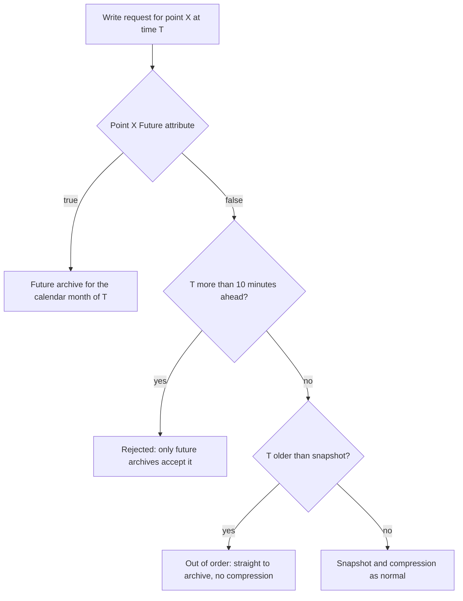

## Plain English

**Backfilling** means writing older data into PI after the fact: for example recovering a week of
history from another system, or recalculating an analysis. Because those events are older than the
point's current snapshot, they go straight into the archive. They do **not** pass through
compression.

**Future data** is the opposite: values with timestamps ahead of now, such as forecasts or plans.
Since PI Data Archive 2015, a point marked **Future = true** stores these in separate **future
archives**. Normal points cannot take timestamps more than 10 minutes ahead.

## Deep Dive

**Why backfill is expensive.** Backfill sources include analysis recalculation and history recovery
through PI to PI, RDBMS and UFL. Heavy out-of-order writes cause overflow records (message 2016), high
CPU and slow archive operations. To limit the cost, reduce OOO writes, shorten archive duration and
order the writes within each archive file.

**Dynamic archives for backfill.** Dynamic archives should be kept for backfilling jobs only
(OSIsoft KB 2998OSI8, cited in 2010 tuning guidance).

**Compression still helps.** In one AVEVA case, even 11% compression cut an analysis backfill of
about one month by about 20%. Less archived data means less to recalculate.

**Buffer ownership.** PI to PI writing through pibufss locks points. Non-buffered writes to buffered
points can return error -11414 (KB00093 covers clearing buffer ownership).

**Future data in detail.**

| Feature | Detail |
|---|---|
| Introduced | PI Data Archive 2015 |
| Time range | January 1970 through January 2038 |
| Selected by | The point's Future attribute (true = Future Archive Set, false = Historical Archive Set) |
| Archive files | Created on demand by calendar month; start at 1 MB and grow dynamically |
| Why separate | Suits sparse data and allows different retention policies |

Before 2015, users stored future data through workarounds. Future timestamps use the normal time
syntax, for example `*+1h`.

## Worked Example

A planning team wants 48-hour load forecasts in PI.

1. Create `GRID.LOAD.FORECAST` with **Future = true** (the PI Web API create body accepts `Future`).
2. Each hour, write forecasts timestamped `*+1h` to `*+48h`.
3. The Data Archive puts them in the future archive for each calendar month, created on demand.
4. A trend can now show actual load (a normal historic point) next to the forecast (the future
   point).

If the team had written those values to an ordinary point, anything more than 10 minutes ahead would
have been rejected, because only future archives accept such timestamps.

## Diagram

## Common Mistakes

- **Writing forecasts to a normal point.** Timestamps more than 10 minutes ahead are rejected.
- **Forgetting the Future attribute at creation.** Set it when you create the point (whether it can
  be changed later was not confirmed).
- **Unordered mass backfills during production.** They create overflow records and slow everyone.
- **Using dynamic archives for normal running.** Keep them for backfill jobs.

## Real-World Scenario

In Dell's 2012 benchmark, after a simulated outage, buffered data recovery raised rates more than 32%
above nominal, with a snapshot peak of 799K events/s (reported by Dell and OSIsoft). Recovery traffic
is bursty; leave headroom in CPU, disk and queue sizing so a backfill after an outage does not slow
real-time users.

> [!VERIFY]
> Whether the Future attribute can be changed after a point is created, and the exact error returned
> when future data is written to a historic point, were not confirmed in a readable source.
