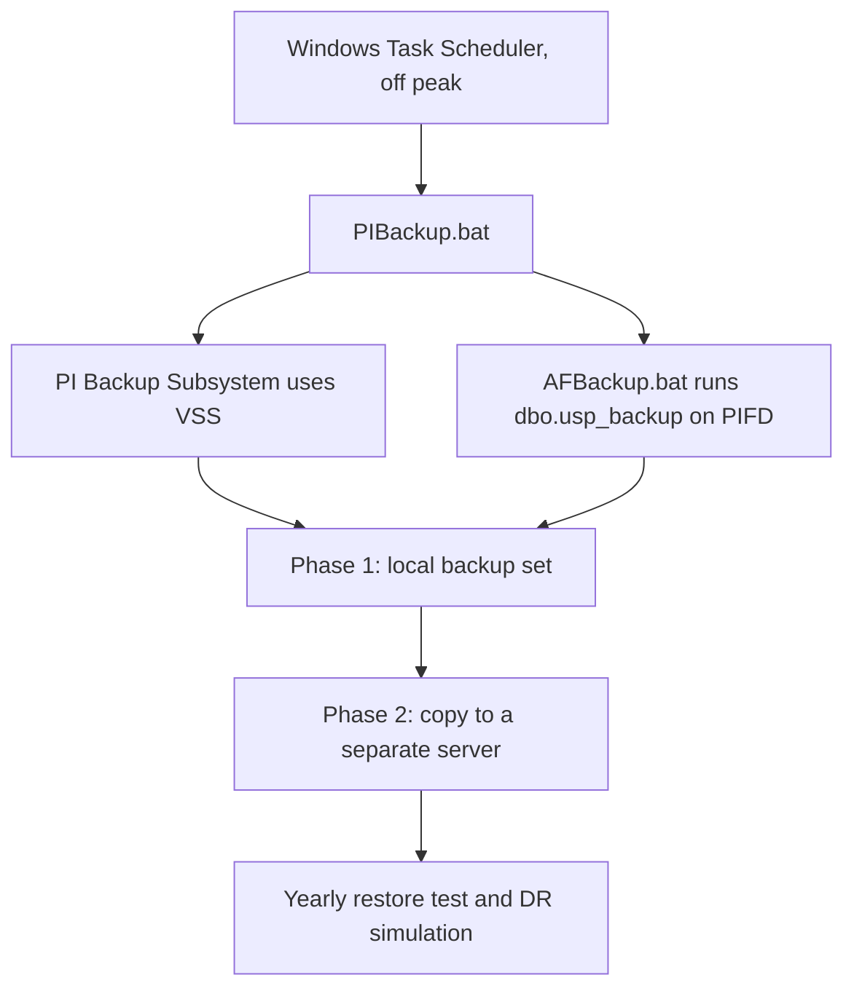

## Plain English

A Data Archive backup has to capture more than the archive files. You need the **data files**
(snapshot, event queues, archives), the **configuration** (points, tuning parameters and the other
databases) and enough knowledge of the **services and hardware** to rebuild the server.

The **PI Backup Subsystem** coordinates backups. It uses Windows **Volume Shadow Copy Service
(VSS)**, so it can copy files that are in use without stopping the server.

Keep backups somewhere other than the PI server itself. A backup that sits on the same box is lost
with the box.

## Deep Dive

**What to back up (training).**

| Category | Examples |
|---|---|
| Subsystems | The Windows services |
| Data files | Snapshot, event queues, archives |
| Configuration | PI point configuration, tuning parameters |
| Platform | The hardware underneath |

**Archive selection.** `piartool -backup` can back up the latest n archives (`-numarch <n>`) or a list
of archive numbers (`-archives <list>`). It cannot take a range of older archives.

**AF alongside.** `PIBackup.bat` calls `AFBackup.bat`. The AF SQL backup runs the stored procedure
`dbo.usp_backup` on the PIFD database, for example:

```
sqlcmd -S <instance> -d PIFD -Q "EXEC dbo.usp_backup @outpath = N'<path>';" -E
```

AF backup naming cannot be changed without editing the scripts.

**Schedule (AVEVA 2023).** Run daily incremental backups off-peak with Windows Task Scheduler, using a
**two-phase** strategy: back up locally first, then copy to a separate server.

**Upgrades.** A rollback backup during an upgrade needs free space equal to the databases plus the
primary archive.

**Collectives.** PI Collective Manager uses a PI Backup of the primary to initialise a secondary.

**PowerShell.** OSIsoft.PowerShell has a `Start-PIBackup` cmdlet (its help page was not readable).

**Backups are not DR on their own.** AVEVA's 2019 architecture talk: "PI Backups, Redundant
Interfaces and High Availability are NOT stand-alone Disaster Recovery solutions." Run a DR simulation
at least once a year.

## Worked Example

A mid-size site's routine:

1. 01:00 daily (off-peak): Windows Task Scheduler runs the PI backup to `D:\PIBackup` on the server.
2. 02:00: a second task copies the backup set to a file server in another building.
3. AF is included because PIBackup.bat calls AFBackup.bat.
4. Before an upgrade, the admin checks free space at least equal to the databases plus the primary
   archive for the rollback backup.
5. Once a year the team restores the set on a test machine to prove it works.

(Times and paths are illustrative.)

## Diagram



## Common Mistakes

- **Keeping backups only on the PI server.** Copy them to a separate server.
- **Treating a backup copy as a standby server.** The licence schedule forbids running a backup copy
  as a hot standby, and backups alone are not a DR plan.
- **Forgetting AF.** The Data Archive backup is only half the PI Server.
- **No space for the rollback backup before an upgrade.**

## Real-World Scenario

To copy older archives to another server when `piartool -backup` cannot select them, the AVEVA
feedback portal describes a workaround: unregister them, copy, register the copies on the target,
then re-register the originals. A team building a test system uses this to give testers three-year-old
data without touching production backups.

> [!NOTE]
> The exact pibackup.bat syntax, the default backup folder and the precise full versus incremental
> semantics were not confirmed in a readable source.
