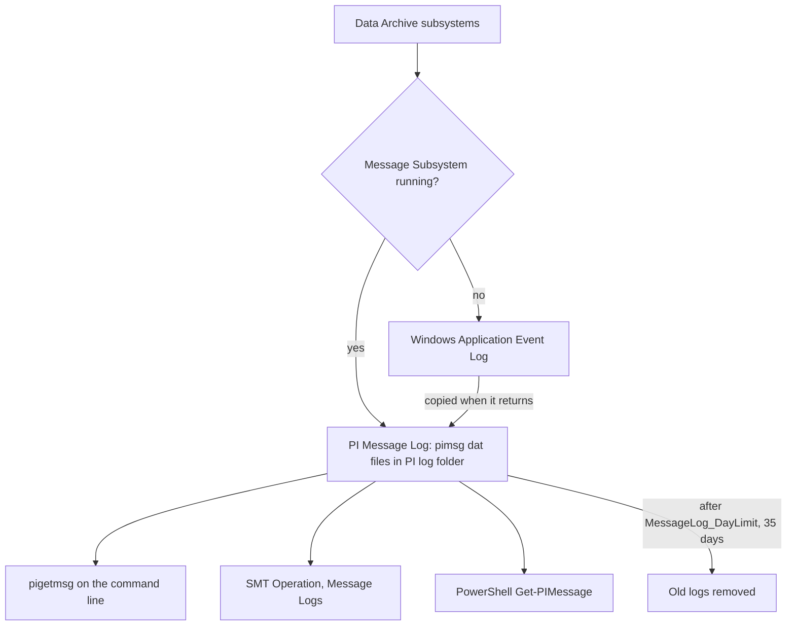

## Plain English

**PI Batch** is the old way the Data Archive stored batch records (which batch ran on which unit,
when). Older PI Servers had a PI BatchDB and a PI ModuleDB. From PI Server 2015, batch data could be
migrated to **Event Frames** in Asset Framework, which is where batch-style data lives today.

The **PI Message Log** is the Data Archive's diary. The **PI Message Subsystem** writes status and
error messages to it, and you read it with **pigetmsg** on the command line or with SMT. When
something goes wrong, the message log is the first place to look.

## Deep Dive

**Batch history.** PI Server 2015 added migration of the batch database to Event Frames, and
RtReports 4.0 added its own batch-to-Event-Frames migration process.

**Message log files.**

- Binary files named by date, for example `pimsg_1120731.dat` for 31 July 2012.
- Stored in `PI\log` on servers (`PIPC\log` on clients) and locked by the Message Subsystem.
- If the Message Subsystem is down, messages go to the Windows Application Event Log and are copied
  into the PI log when it comes back.
- Kept for 35 days by default, set by the **MessageLog_DayLimit** tuning parameter.
- The old plain-text `pipc.log` was used by older PI API apps; `Migratelog=1` in `pipc.ini` forwards it
  to the PI Message Log.

**pigetmsg options.**

| Option | Meaning |
|---|---|
| `-f` | Follow (continuous view) |
| `-st *-2h -et *` | Time window |
| `-of <file>` | Write to a file |
| `-si`, `-sw`, `-se`, `-sc` | Minimum severity: information, warning, error, critical (default minimum is Debug) |
| `-fc`, `-ft`, `-fw`, `-fx` | CSV, two-line, one-line, XML |
| `-oa` | All fields |
| `-src`, `-pr` | Filter by source or program |
| `-msg "*text*"` | Message text filter with `*` and `?` wildcards |
| `-top pr`, `-top pid` | Summary counts |

Default output fields: MessageSeverity, MessageTime, ProcessHost, ProcessName, Source1-3, Message,
MessageID.

**Other readers.** SMT Operation > Message Logs filters by time, severity, source and text and exports
to CSV, XML, text or RTF. PowerShell: `Get-PIMessage -Connection $con -SeverityType Error -StartTime
... -EndTime ...`. `pidiag -e <code>` translates an error code, for example `pidiag -e -11057`.

**Messages worth knowing.**

| ID | Meaning |
|---|---|
| [-11091] | Event collection exceeded the maximum allowed (ArcMaxCollect) |
| [-11140] | Archive query exceeded maximum execution time |
| [-10767] | Client exceeded maximum concurrent queries |
| 2016 | Inserting overflow record |
| 6079 | Point creation (pibasess) |

## Worked Example

Users complain that year-long raw-data queries fail. Look for ArcMaxCollect hits in the last two
hours, warnings and above, and save them:

```
pigetmsg -sw -st *-2h -et * -msg *[-11091]* -of C:\Temp\arcmax.txt
```

If the file fills with -11091 messages, queries are returning more than ArcMaxCollect events. Options
are to page the queries, or raise ArcMaxCollect (default 1.5 million) with care.

## Diagram



## Common Mistakes

- **Treating the message log as an audit trail.** It only keeps 35 days by default.
- **Opening pimsg files in a text editor.** They are binary and locked; use pigetmsg or SMT.
- **Users without read permission on the message log.** They cannot troubleshoot their own write
  failures.
- **Looking for batches in the Data Archive.** Modern systems hold them as AF Event Frames.

## Real-World Scenario

A site upgrading from an old PI Server still has years of PI Batch records feeding RtReports. Using
the batch-to-Event-Frames migration (PI Server 2015 and RtReports 4.0), the team moves the history to
Event Frames so new tools such as PI Vision can use it, then checks pigetmsg output for errors after
each migration run.
