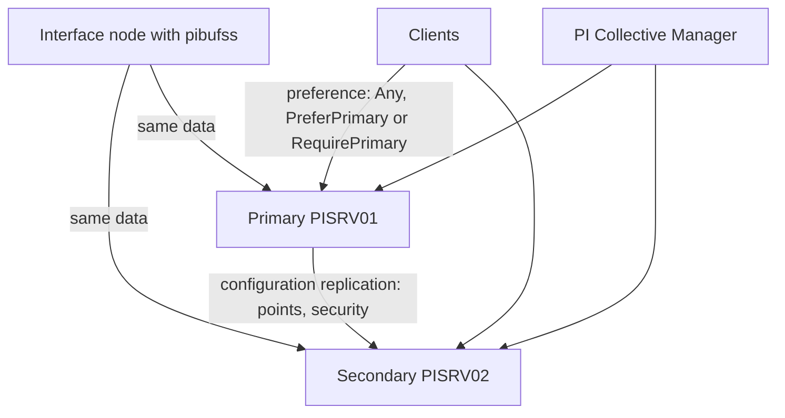

## Plain English

A **collective** is a group of PI Data Archive servers that act as one. One member is the
**primary** and the others are **secondaries**. Each member holds the same time-series data, so if
one is down for patching or a fault, users carry on with another.

The trick is how the data gets there. **Configuration** (points, point settings, security) is
**replicated** from the primary to the secondaries. **Time-series data is not replicated**: the PI
Buffer Subsystem on each interface node sends every value to every member.

## Deep Dive

**Benefits.** Rolling upgrades, no single point of failure, geographic distribution, availability
during maintenance and removing the "fear of a bad backup".

**How members stay in step.**

| What | How it reaches secondaries |
|---|---|
| Points, point configuration, security | Replicated from the primary |
| Time-series values | Sent by interfaces (through pibufss) to every member: n-way buffering |
| A new secondary's history | PI Collective Manager takes a PI Backup of the primary, copies it and registers it |
| Archive registration | Per member: run piartool on the host you want to change |

During a member's downtime, data waits in the PI Buffer Subsystem and configuration resynchronises
when the member returns.

**Tools.** **PI Collective Manager** creates collectives, shows the status of collectives and
members and edits their properties.

**Clients.** PI SDK connection preferences are **PreferPrimary**, **RequirePrimary** and **Any**
(the default). Since AF Client 2018, connections are balanced across all available members, and
failback returns connections to the original member after a failover. Point expensive clients at a
secondary.

**Building a good collective.** Keep members identical in hardware and installed PI software. With
virtualisation, run each member on a different host. Members can be in different data centres.

**Licensing.** The 2026 PI System Software Schedule says HA PI Servers form a collective with the
primary and cannot be separated to run as independent PI Servers.

**AF is separate.** AF high availability uses its own options (SQL Server clustering or mirroring,
or AF collectives in older releases).

## Worked Example

The architecture course lab builds a two-member collective:

1. PISRV01 is the primary and PISRV02 the secondary, created with PI Collective Manager.
2. Collective Manager backs up PISRV01, copies the backup to PISRV02 and registers it there.
3. On interface nodes PIINT01 and PIINT02, the PI Buffer Subsystem is set to buffer to both members.
4. A reporting team's heavy queries are pointed at PISRV02, keeping PISRV01 responsive for
   operators.

## Diagram

## Common Mistakes

- **Putting a network load balancer in front of the Data Archive.** Use collective connection
  preferences instead.
- **Expecting secondaries to get data by replication.** They only get configuration; interfaces must
  buffer to every member.
- **Running piartool once and expecting every member to change.** Archive registration is per host.
- **Mismatched members or members on one VM host.** Keep them identical and on different hosts.

## Real-World Scenario

In Dell's 2012 benchmark, nine interface nodes fed a two-node PI Server 2012 collective, which
archived more than 500K events/s and served up to 20M events/s of historical reads (reported by Dell
and OSIsoft). Because every interface node sent data to both members, either member could serve
clients while the other was being maintained.

> [!NOTE]
> Exactly which tables are replicated (for example tuning parameters or the message log) and whether
> secondaries accept configuration edits were not confirmed in a readable source.
