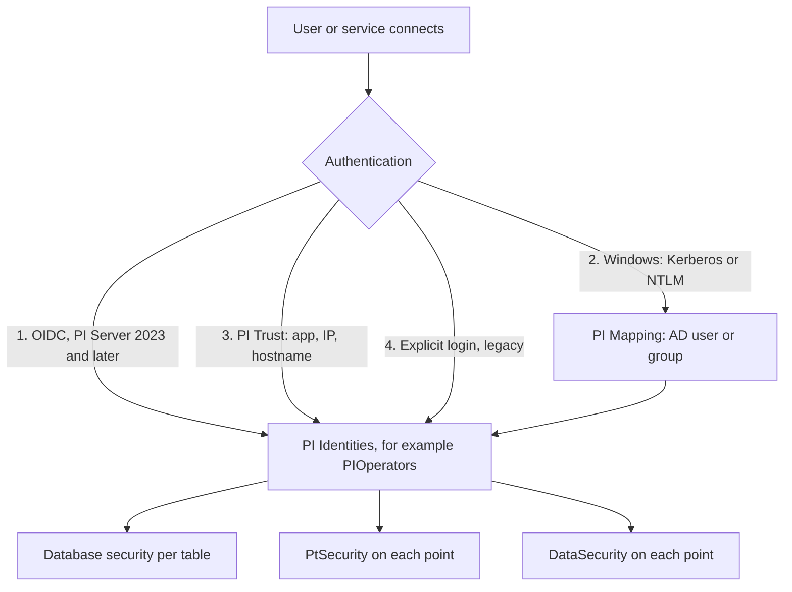

## Plain English

Security on the Data Archive answers two questions:

1. **Who are you?** (authentication). The best option today is your Windows account (Windows
   Integrated Security), or OpenID Connect on PI Server 2023 and later.
2. **What may you do?** (authorisation). Your Windows user or AD group is **mapped** to one or more
   **PI Identities**. Each identity is granted read or write access on tables and on individual
   points.

So in practice you put people in AD groups, map those groups to identities such as PIOperators or
PIEngineers, and give the identities the access they need.

## Deep Dive

**Authentication, in order of preference (2023).**

1. OpenID Connect (PI Server 2023 and later), through AVEVA Identity Manager (AIM). TLS certificates
   are required for OIDC.
2. Windows Integrated Security (Kerberos or NTLM). The recommended model; PI Connectors must use it.
3. PI Trusts.
4. Explicit logins (PI Users). Least secure and disabled by default.

**Identities and mappings.** PI Identities define permission sets. They have no password, cannot be
used for explicit login and cannot contain PI Users. PI Mappings link Windows users or AD groups to
identities. PI Users and PI Groups are legacy and not recommended. Built-ins to know: **piadmin** (the
superuser account: do not use it day to day, and make sure it has a password), **piadmins** (the
administrators identity to map admin groups to) and **PIWorld** (all users, often read access).

**Trusts.** A trust matches on application name, client IP and netmask, FQDN and short hostname. A
trust that specifies only the server name is "open" and a major vulnerability: use at least two
identifiers. Never map trusts to piadmin. Older PI API connections identify themselves by the first
four letters of the interface name plus "E", for example `OPCpE`.

**Kerberos notes.** Kerberos needs the PI Server to be a domain member. One-way domain trusts work
when the server domain trusts the client domain. NTLM with local accounts needs matching passwords.

**Authorisation.**

| Level | Where | Example |
|---|---|---|
| Database security | SMT Security > Database Security, per table | Interface identity: Read/Write on PIPOINT |
| PtSecurity | On each point | Who may view and edit its configuration |
| DataSecurity | On each point | Who may read or write its values |

Access levels are read-only, write-only (special cases), read-write and no access. A security string
looks like `piadmins: A(r,w) | PIOperators: A(r) | PIWorld: A(r)`.

**Interface plus buffer, no outputs.**

| Identity | Permissions |
|---|---|
| Interface | Read on PIPoint, DBSecurity, PtSecurity, DataSecurity |
| PI Buffer | Write on DataSecurity |

PI Buffer Subsystem supports WIS natively from 3.4.380.79. PI API for WIS 2.0.1.35+ extends WIS to
interfaces, but PI Trust authentication is disabled by default after the upgrade, so create mappings
first. gMSAs are the preferred service account type.

**Hardening.** Disable explicit logins once mappings replace them (settings to disable explicit login,
disable it for piadmin and disable blank passwords, then restart the PI Base Subsystem). The 2010
checklist adds: use the Security Tool, force login for piconfig, retire SDK-based trusts, configure the
firewall and disable PIWorld. Exclude archive, queue and log folders from anti-virus; on Server Core
use WDAC, elsewhere AppLocker tested in audit mode first.

## Worked Example

The course lab secures its interfaces with mappings rather than trusts:

| PI Identity | Mapped to |
|---|---|
| PI Interfaces | gMSA `PISCHOOL\SVC-PIINT$` |
| PI Buffer | gMSA `PISCHOOL\SVC-PIBUFFER$` |
| piadmins | AD group of PI administrators (group name illustrative) |

Then, in Database Security, PI Interfaces gets read on PIPOINT, and on each point DataSecurity grants
PI Buffer write. A message-log line such as "Identity List: PIOperators | PIWorld" shows which
identities a user was given on connection.

## Diagram

## Common Mistakes

- **Open trusts** that name only the server.
- **Mapping or trusting to piadmin.** Use piadmins and named groups.
- **Upgrading to PI API for WIS before creating mappings.** Trusts are disabled after the upgrade and
  interfaces stop.
- **Leaving explicit logins and blank passwords enabled** after moving to Windows security.

## Real-World Scenario

AVEVA's Kerberos troubleshooting steps for a client that keeps falling back to NTLM: set LogLevel=1
under `HKLM\SYSTEM\CurrentControlSet\Control\Lsa\Kerberos\Parameters`, run `klist purge`, and check
the service principal names with `setspn -l` and `setspn -q PIServer/<hostname>`.
