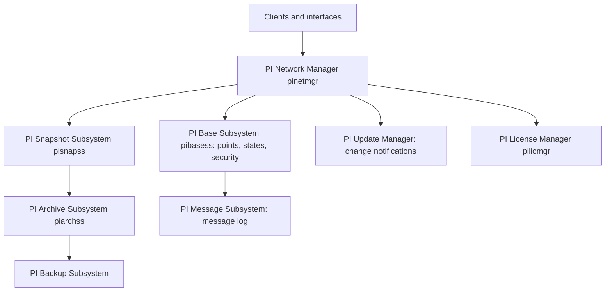

## Plain English

The PI Data Archive is not one program. It is a set of cooperating Windows services called
**subsystems**. Each has one job: one handles network connections, one keeps point definitions, one
holds current values, one writes history, one logs messages, and so on.

You can see them in SMT under Operation > PI Services, or in `services.msc` as services whose names
start with "PI".

## Deep Dive

**The core subsystems (OSIsoft training).**

| Subsystem | Process | Job |
|---|---|---|
| PI Network Manager | pinetmgr | Communication between subsystems, interfaces and clients; validates clients on connection |
| PI Message Subsystem | not confirmed | Writes status and error messages to the message log |
| PI License Manager | pilicmgr | Maintains licence information for the Data Archive and connected applications |
| PI Update Manager | not confirmed | Queues notifications of changes to values, point attributes and modules for subscribed clients |
| PI Base Subsystem | pibasess | Maintains the Point Database, Digital State Table, authentication databases and Module Database |
| PI Snapshot Subsystem | pisnapss | Keeps the latest event per point, applies compression and feeds the event queue |
| PI Archive Subsystem | piarchss | Stores and serves data after the snapshot |
| PI Backup Subsystem | not confirmed | Manages Data Archive backups |

**Starting and stopping.** As administrator, stop everything with `pisrvstop.bat` and start with
`pisrvstart.bat`. Never edit `pisrvstop.bat`; put site-specific commands in `pisrvsitestop.bat`.

**Archive threads.** `piarchss_ThreadCount` sets how many RPC requests the Archive Subsystem runs at
once. AVEVA's 2023 suggestion: number of cores minus 1 for standard use, or 2x cores for systems with
large queries and no real-time users. `pisnapss_ThreadCount` is the snapshot writer equivalent; Dell's
2012 test used 64 and 16. To see what the archive threads are doing:

```
piartool -thread piarchss -info
```

It lists RPC threads with their duration and client connection ID; durations over 1000 ms are long.

**Counters.** Subsystem performance counters include RPC Request in Queue, RPC Thread Active,
Transaction Completed/sec and Messages Sent/Received per second.

**Analytics heritage.** In 2010, the PI Totalizer, PI ACE and Performance Equations were part of the
analytics set around the Data Archive.

## Worked Example

Users report slow trends every morning.

1. In SMT Operation > PI Services, all eight subsystems show Running.
2. `piartool -thread piarchss -info` shows several threads over 1000 ms from one client connection
   ID: a reporting tool pulling a year of raw data.
3. The server has 8 cores and piarchss_ThreadCount is set low. Raising it towards 7 (cores - 1) helps
   only if clients can use the extra threads; the long-term fix is to point the reporting tool at a
   collective secondary or page its queries.

## Diagram



## Common Mistakes

- **Editing pisrvstop.bat.** Put custom steps in pisrvsitestop.bat instead.
- **Raising piarchss_ThreadCount with nothing to use the threads.** It adds overhead, not speed.
- **Restarting one service at random.** Use the scripts so the subsystems stop and start cleanly.

## Real-World Scenario

The message log shows source names such as pibasess, pinetmgr, pilicmgr, piarchss and pisnapss. When
a point-creation storm hits, messages 6079 come from pibasess; when a heavy recovery runs, overflow
messages relate to the archive. Knowing which subsystem owns which job tells you where to look.

> [!NOTE]
> Executable names for the Update Manager, Message and Backup subsystems, optional subsystems such as
> totaliser, PE scheduler, alarm, AF link, SQL and recalculation, and the start/stop order were not
> confirmed in a readable source.
