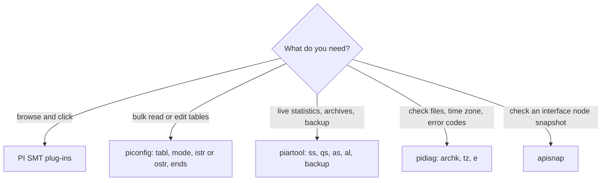

## Plain English

Four tools do most Data Archive admin work:

- **PI SMT** (System Management Tools): a console with plug-ins for points, services, archives,
  tuning, messages and security. Start here.
- **piconfig**: a scriptable command-line tool to read and edit Data Archive tables, great for bulk
  changes and exports.
- **piartool**: command-line operations on archives, the snapshot, the event queue and backups.
- **pidiag**: diagnostics, such as checking an archive file, the time-zone file or an error code.

The command-line tools live in the Data Archive's `adm` folder.

## Deep Dive

**SMT plug-ins used in training.**

| Task | Plug-in |
|---|---|
| Create and edit points | Points > Point Builder |
| Check services | Operation > PI Services |
| Connections | Operation > Network Manager Statistics |
| Data flow | Operation > Snapshot and Archive Statistics |
| Archives | Operation > Archives |
| Tuning | Operation > Tuning Parameters (Archive tab) |
| Messages | Operation > Message Logs |
| Security | Security > Database Security, Mappings & Trusts, Identities, Users, & Groups |
| Current values | Data > Current Values |

SMT's **Archive Editor** can view and edit archived values.

**piconfig basics.** Commands start with `@`, comments with `*`, and the default field delimiter is a
comma. Useful commands include `?`, `?atr` (attributes of the current table), `?tbl` (tables),
`@echo`, `@ends` (end section), `@exit`, `@istr` (input structure) and `@line`. The standard pattern
is:

```
@tabl <table>
@mode <mode>
@istr or @ostr <attribute list>
<data lines>
@ends
```

Read two hours of archive values for a tag:

```
@table piarc
@ostr tag,value,timestamp
@istr tag,starttime,endtime
sinusoid,*-2h,*
```

**piartool.**

| Command | Purpose |
|---|---|
| `-ss`, `-qs`, `-as` | Snapshot, event-queue, archive statistics (refresh every 5 s) |
| `-al` | List archives and shift progress |
| `-thread piarchss -info` | Dump archive RPC threads |
| `-backup` with `-numarch <n>` or `-archives <list>` | Back up the latest n archives or listed archive numbers |

`piartool -backup` cannot take a range of older archives.

**pidiag.**

| Command | Purpose |
|---|---|
| `pidiag -archk <file>` | Check an archive file and show its storage map, including PointIDs |
| `pidiag -tz` | Verify localhost.tz |
| `pidiag -e <code>` | Translate an error code |

**Others.** `apisnap` checks snapshots from interface nodes using the PI API. PI PowerShell
(OSIsoft.PowerShell) offers Connect-PIDataArchive, Get-PIDataArchiveConnectionConfiguration and
Get-PIMessage. History buffs: the 2002 SMT kit installed PI-SDK 1.1, alongside tools such as
PI-Tag Configurator and PI-HealthCheck.

## Worked Example

Export a tag-to-PointID list, then check one archive:

```
piconfig
@tabl pipoint
@ostr tag,pointid
@ends
```

```
pidiag -archk E:\PIArchives\piarch.005.arc
```

The archive check's storage map lists the PointIDs in that file; the piconfig export turns them back
into tag names. (The archive path is illustrative.)

> [!VERIFY]
> A create-point script such as `@mode create,t` followed by `@istr tag,pointsource,pointtype,...`
> follows the standard pattern, but the exact `@mode` values and the `,t` flag were not confirmed in
> a readable source.

## Diagram



## Common Mistakes

- **Ignoring piconfig errors after bulk imports.** In non-interactive mode it stops after a number of
  errors set by `@line`; always check the output.
- **Reading archive files with your own code.** Use piconfig on the server, or restore a backup.
- **Expecting piartool -backup to take an old date range.** It takes the latest n archives or a list
  of archive numbers.

## Real-World Scenario

An admin needs a copy of archives 5 to 8 on a test server, but `piartool -backup` cannot back up a
range of older archives. The workaround from the AVEVA feedback portal: unregister them, copy them,
register the copies on the test server, then re-register the originals.
