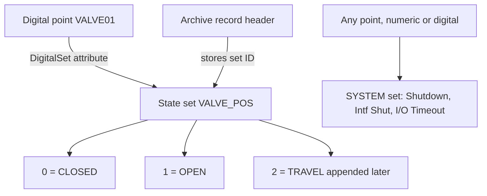

## Plain English

Some measurements are not numbers on a scale: a valve is OPEN or CLOSED, a pump is RUNNING or
STOPPED. PI stores these in **digital points**. Underneath, a digital point stores a small integer.
A **digital state set** is the list that turns each integer into a name, for example 0 = CLOSED and
1 = OPEN.

There is also one special, global set called **SYSTEM**. Its states, such as **Shutdown**, **Intf
Shut** and **I/O Timeout**, can be written into *any* point, even a numeric one, to say "there is no
good value here, and this is why".

## Deep Dive

**How it fits together.** Each digital point references a state set through its **DigitalSet**
attribute. The **PI Base Subsystem** maintains the **Digital State Table** that holds the sets.
Default database security restricts write access to PIDS (the digital state table).

**System states.** The system digital state set is global and applies to all points. Its factory
defaults include "Shutdown", "Intf Shut" and "I/O Timeout". Clients can show values "as a number,
time stamp, string, or digital state", which is how a numeric trend can show I/O Timeout.

**History depends on the set ID.** Each archive record header stores the digital state set ID, and
reprocessing uses the set in the archive file's header. So:

- Changing a point's DigitalSet does not change how existing archived values read until the
  archives are reprocessed.
- Renumbering states changes the meaning of history. Only ever **append** new states.

**Design guidance (OSIsoft).** Create dedicated state sets, include placeholders for sets that change
often, and standardise sets across the enterprise, especially with PI to PI.

**Relation to AF.** AF enumeration sets are the AF equivalent of digital state sets. PI Builder can
convert Data Archive digital states to AF enumeration sets by changing ObjectType `DigitalStateSet` to
`EnumerationSet` and `DigitalState` to `EnumerationValue`.

**Filtering digital points.** CompDev and ExcDev have no effect on digital points; many users turn
compression off and adjust only ExcMax. For status (0/1) tags, AVEVA's 2023 talk used no exception, a
1-second scan and CompMax 8 hours: over 48 hours that stored 15 events instead of 172,800.

## Worked Example

A valve set `VALVE_POS` has 0 = CLOSED, 1 = OPEN. The plant adds a travelling state.

| Approach | Result |
|---|---|
| Append TRAVEL as 2 | Old 0s and 1s still read CLOSED and OPEN. New 2s read TRAVEL. Safe. |
| Insert TRAVEL as 1 and move OPEN to 2 | Every old 1 now reads TRAVEL. History is corrupted. |

(The valve values are illustrative; the "append only" rule comes from AVEVA feedback-portal guidance.)

## Diagram

## Common Mistakes

- **Renumbering states.** Reassigning 1 from OPEN to CLOSED rewrites the meaning of history.
- **Assigning the wrong set and expecting the fix to apply backwards.** Offline reprocessing is
  needed; an option to honour archived digital states came in PI Server 2018 SP3 Patch 3.
- **Tuning CompDev on a digital point.** It has no effect; use Compressing and ExcMax.
- **Different state sets for the same thing at different sites.** It breaks PI to PI and enterprise
  reporting.

## Real-World Scenario

A company consolidating ten sites with PI to PI finds that "RUNNING" is state 1 at some sites and
state 2 at others. Following OSIsoft guidance, it standardises the sets enterprise-wide before moving
data, builds new sets by appending only, and uses PI Builder to create matching AF enumeration sets.

> [!NOTE]
> The full SYSTEM set membership and state codes, and limits on set size and state string length,
> were not confirmed in a readable source.
