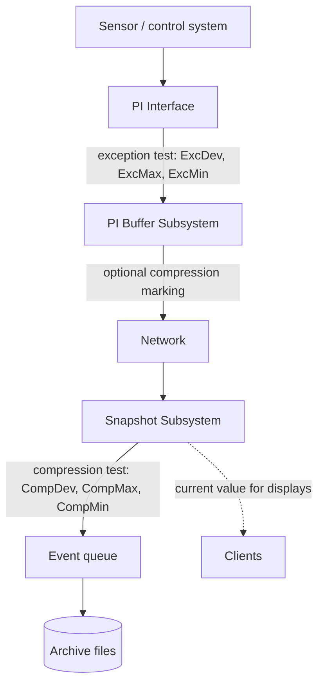

## Plain English

A sensor can produce a new reading every second, but most of those readings say almost nothing new.
The PI System filters data twice so it keeps the meaningful changes without storing the noise.

1. **Exception** happens at the data source. The PI Interface compares each new reading with the
   last value it sent. If the change is smaller than a deadband (**ExcDev**), the reading is not sent.
   This saves network bandwidth and load on the server.
2. **Compression** happens on the PI Data Archive. The Snapshot Subsystem uses the **swinging door**
   algorithm to decide which of the values that arrived are worth writing to disk. It keeps just
   enough points that a straight line drawn between them stays within **CompDev** of every value that
   was dropped.

Both filters also have time limits. **ExcMax** and **CompMax** force a value through after a set
time even if nothing changed, so a quiet signal still shows it is alive.

> [!TIP]
> Think of exception as "is this worth sending?" and compression as "is this worth keeping?".

## Deep Dive

**Where each filter runs.** Exception is a simple deadband filter applied only by PI Interfaces,
before data reaches the Data Archive snapshot. Compression is applied by the Snapshot Subsystem when a
value reaches the Data Archive; since PI Buffer Subsystem 4.x it can also run in the buffer as
*compression marking*, where events are marked "Snapshot Only" or "To Be Archived".

**The exception test.** A new value is sent when it differs from the last *sent* value by more than
ExcDev (in engineering units; ExcDevPercent expresses the same thing as a percent of span). When a
value passes, the interface also sends the *previous* value, the last one that did not pass, so the
change is drawn in the right place. ExcMax is the longest the interface can go without reporting:
after ExcMax seconds the next value is sent even if it is inside the deadband. ExcMin only *blocks*
values that arrive sooner than ExcMin after the last report; it never forces a value to be sent and
is typically 0.

**The compression test.** The swinging-door algorithm represents the signal as straight lines. An
event is archived when it falls outside the "door" defined by CompDev around the line from the last
archived event, or when CompMax seconds have passed since the last archived event. CompMin is the
minimum time before a value can be archived and is usually 0. Like exception, compression keeps the
value just before a change so the stored line is faithful.

**Defaults.** New points get ExcDevPercent 0.1, ExcMax 600 s, CompDevPercent 0.2 and CompMax 28800 s
(8 hours). Defaults are not zero, so a new point is already filtered.

**What bypasses compression.** Out-of-order data, and data backfilled before the current snapshot,
go straight to the archive without the compression test.

**Turning things off.**

| Goal | Setting |
|---|---|
| Archive every snapshot event | `Compressing = 0` |
| Disable exception | ExcDev, ExcDevPercent, ExcMin and ExcMax all 0 |
| Store a constant value every 60 s | CompMax = 60 (or compression off with suitable ExcMax/ExcMin) |

**Choosing values.** AVEVA's rule of thumb is CompDev no larger than the instrument precision, and
ExcDev half of CompDev. The suggested method is: match instrument precision to the tag's units, set
CompDev at or below that precision, set ExcDev to half of CompDev, then set CompMax, ExcMax and the
scan class from how often consumers need updates. PI Square answers often quote about 1% of span for
exception and 2% for compression as starting points.

Note that connectors (as opposed to interfaces) do not apply the exception settings.

## Worked Example

A flow tag has a span of 7,000 units. An engineer sets **ExcDev = 70** and **CompDev = 140**, with
the default **ExcMax = 600** and **CompMax = 28800**.

1. The interface scans every second. A reading is sent only if it differs from the last sent value by
   more than 70 units, or if 10 minutes (600 s) have passed since the last report.
2. On the server, a sent value is archived only if it lies more than 140 units from the swinging-door
   line, or if 8 hours (28,800 s) have passed since the last archived value.
3. Over a calm night shift most readings never leave the interface, and of those that do, few are
   archived. If an operator sees a stored value that changed by less than 70, the time triggers
   (ExcMax or CompMax) explain it.

A second example from AVEVA training: an instrument accurate to ±0.5 reads 1.5, 1.7, 1.6 and 1.5.
None of those changes is larger than the instrument can resolve, so only 1.5 needs to be stored.

A status tag scanned once a second for 48 hours produces 172,800 events without compression. With
minimal compression settings it stored 15.

## Diagram

## Common Mistakes

- **"CompDev = 0 stores everything."** It does not: with compression on, repeated identical values
  are still dropped. Set `Compressing = 0` to archive every event.
- **"ExcMin makes the interface send a value regularly."** ExcMin only blocks values. ExcMax is the
  setting that forces a value through.
- **Expecting connectors to honour exception settings.** Exception is an interface feature.
- **Deadbands that are too wide or too narrow.** Too wide filters out real process changes; too
  narrow keeps instrument noise and bloats the archive.
- **Panicking at a stored value inside the deadband.** That is usually the ExcMax or CompMax time
  trigger doing its job.
- **Step on with CompDev not 0.** On a stepped point the value before a change is not archived, so
  interpolated results can be wrong if CompDev is non-zero.

## Real-World Scenario

AVEVA's 2023 user-conference session on exception and compression reported two field results.
An offshore oil and gas operator found that exception alone cut the data sent by about 70%, and
exception plus compression cut onshore archive storage by about 94%. A downstream oil and gas site
reduced one psig pressure tag from 3,157,788 events to 145,938 (95%), and half of its tags met the
suggested minimum compression ratio of 3:1 (reported by AVEVA, 2023 user conference).

The same session listed what goes wrong with too much data: queries that hit the ArcMaxCollect limit,
slow PI Vision displays and long analysis backfills. Good settings mean faster archive queries,
better cache use, less load on the Update Manager and less storage and bandwidth.
