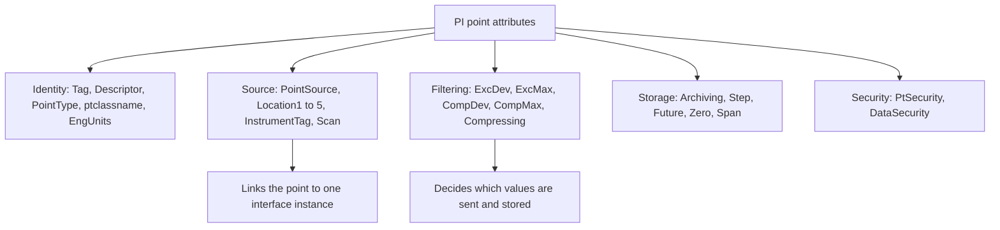

## Plain English

Every PI point carries a list of **attributes**: settings that describe it and control how its data
is collected, filtered and stored. Think of them as the point's configuration card.

Some attributes **describe** the point (Tag, Descriptor, EngUnits). Some say **where data comes
from** (PointSource, Location1-5, InstrumentTag, Scan). Some say **how data is filtered and stored**
(ExcDev, CompDev, Compressing, Archiving, Step). Others record **who changed it** and **who may see
it** (Creator, Changer, PtSecurity, DataSecurity).

You edit them in SMT Point Builder, PI Builder or piconfig.

## Deep Dive

**Identity and description.**

| Attribute | Meaning |
|---|---|
| Tag | The point name; unique within the Data Archive |
| Descriptor | Optional free text, often used as a search criterion |
| ExDesc | Extended descriptor; some interfaces use it for configuration, such as trigger expressions |
| PointType | Data type (Float32, Digital, String ...) |
| ptclassname | Point class, usually base or classic |
| EngUnits | Engineering units string |
| DigitalSet | Digital state set name, used only when PointType is Digital |
| DisplayDigits | Display precision |
| CreationDate, Creator, ChangeDate, Changer | Who created and last changed the point, and when |

**Range.** **Zero** is the lowest possible value (default 0). **Span** is the range, so Zero + Span is
the highest value (default 100). **TypicalValue** is a reasonable value between Zero and Zero + Span.
The *Percent* deviations are calculated from Span.

**Data source.** **PointSource** usually identifies the interface that collects the point.
PointSource plus the interface ID in **Location1** links the point to one interface instance.
**Location4** is typically the scan class number. For the OPC DA interface, **Location3** is 0 for
polled or event, 1 for advise and 2 for output. **InstrumentTag** is the address in the source, for
example the OPC ItemID; it must match exactly and is often case-sensitive. **Scan** switches scanning
on or off and should always be on. **SourceTag** names another point whose data feeds this one, for
example for output points. Connectors ignore PointSource.

**Filtering and storage.**

| Attribute | Meaning | Default (sourced) |
|---|---|---|
| ExcDev / ExcDevPercent | Exception deadband (units / % of span) | ExcDevPercent 0.1 |
| ExcMin / ExcMax | Min / max seconds between reported values | 0 / 600 |
| Compressing | 1 = compression on, 0 = archive every snapshot event | not sourced |
| CompDev / CompDevPercent | Compression deviation (units / % of span) | CompDevPercent 0.2 |
| CompMin / CompMax | Min / max seconds between archived events | 0 / 28800 |
| Archiving | 0 or 1: archiving on or off | not sourced |
| Step | Off = linear interpolation; on = hold value | not sourced |
| Future | Marks a future-data point, stored in future archives | not sourced |
| Shutdown | Writes a Shutdown event when the server shuts down | not sourced |

CompDev = CompDevPercent x Span / 100, and setting one recalculates the other. If both are sent in the
same edit, CompDevPercent wins. The Percent variants are ignored (shown as zero) for digital, string
and BLOB tags.

**Security.** **PtSecurity** controls viewing and editing the point's configuration. **DataSecurity**
controls reading and writing its values. Each is an access-control string such as
`pi_users:A(r,w) | bob:A(r,w) | PIWorld:A(r)`. ptowner, ptgroup, ptaccess, dataowner, datagroup and
dataaccess are legacy owner/group/world attributes.

## Worked Example

A temperature RTD accurate to ±1 °C on OPC interface instance 1, scan class 2 (10 s):

| Attribute | Value |
|---|---|
| Tag | TANK01.TEMP |
| PointType | Float32 |
| PointSource | OPC |
| Location1 | 1 |
| Location4 | 2 |
| InstrumentTag | Channel1.Device1.Temp (exact case) |
| Zero / Span | 0 / 200 (so the range is 0 to 200 °C) |
| CompDev / CompMax | 1 / 28800 |
| ExcDev / ExcMax | 0.5 / 600 |

The deviation settings follow AVEVA's 2023 RTD example. With Span 200, CompDev 1 equals CompDevPercent
0.5 (1 x 100 / 200).

## Diagram

## Common Mistakes

- **InstrumentTag case mismatch.** A wrong case can mean the point gets no data.
- **"Fixing" a wrong DigitalSet.** The set ID is stored in archive record headers, so old values keep
  the old meaning until archives are reprocessed offline (an option delivered in PI Server 2018 SP3
  Patch 3).
- **Renumbering digital states.** Only append new states; never reassign an existing integer.
- **Treating Compressing = 0 and CompDev = 0 as the same.** They are not: CompDev = 0 still drops
  repeated identical values.
- **Expecting connectors to read PointSource or Location attributes.** They ignore them.

## Real-World Scenario

An OPC UA connector manages only Tagname, Description and EngUnit and overwrites manual edits to
Description and EngUnit. An engineer who keeps "fixing" descriptions on connector points sees them
revert. The fix is to change descriptions at the source, and edit other attributes, such as CompDev,
freely in PI.

> [!NOTE]
> Defaults for TypicalValue, Shutdown, Step, Archiving, Compressing, Scan, DisplayDigits, PointSource
> and Location1-5, and the meanings of legacy classic attributes (Convers, FilterCode, SquareRoot,
> TotalCode, SrcPtID, UserInt/UserReal), were not found in readable sources.
