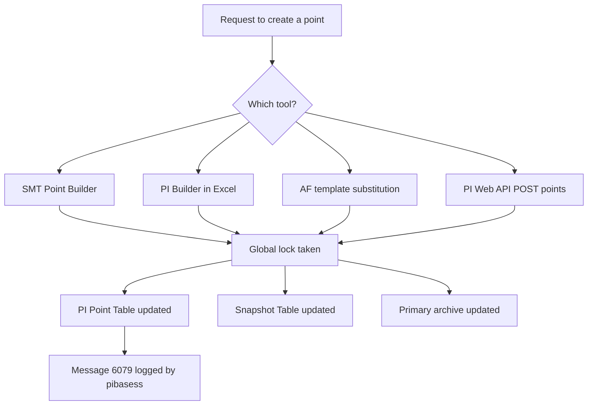

## Plain English

A **PI point** (also called a **PI tag**) is one named stream of time-series data in the Data
Archive, for example `TANK01.LEVEL`. Each point name must be unique within its Data Archive.

Every point has a **point type**, which says what kind of value it stores (a decimal number, a whole
number, a digital state, text and so on), and a **point class**, which says which set of attributes
it has. The two common classes are **base** and **classic**.

Inside the server, each point also has a numeric **PointID**. Archive files store PointIDs, not tag
names.

## Deep Dive

**Point types.** OSIsoft training lists int16, int32, float16, float32, float64, digital, string,
BLOB and timestamp.

| Type | When to use it |
|---|---|
| Float32 | Easiest to administer; general analogue values |
| Float16 | Large systems (over 50,000 points), sub-second or high-density data; needs a well-defined Zero and a positive Span |
| Float64 | High precision, but heavy use slows out-of-order inserts |
| Digital | Discrete states such as OPEN/CLOSED; preferred over string tags |
| String, BLOB | Text and binary; avoid excessive use for archive performance |

Float32 has no under/over-range check unless the interface supports one, and roughly doubles archive
I/O compared with Float16 (2003 guidance).

**Point classes.** The **base** class holds the core attributes, and connector-created points use it.
The **classic** class adds interface attributes such as Location1-5, InstrumentTag and
UserInt/UserReal. Older admin guides said class could not be changed, but a PI Square thread shows
ptclassname can be edited with piconfig, and connector points can move from Base to Classic without
affecting the connector.

**Ways to create points.**

- **SMT**: Points > Point Builder, one at a time.
- **PI Builder** (Excel add-in): bulk creation and editing; its ObjectType for tags is `PIPoint`.
- **PI OPC Client Tool**: generates a CSV for bulk creation, at most 500 OPC items per bulk addition.
- **AF templates**: create points by substitution. The default pattern is
  `%Element%.%Attribute%.%ID%`; `%Element%LI.PV` on element Tank02 gives `Tank02LI.PV`.
- **PI Web API**: `POST {server}/piwebapi/dataservers/{webId}/points`.

**What creation costs.** Creating or deleting a point updates three files: the PI Point Table, the
Snapshot Table and the primary archive file. That needs a global lock, so run bulk creation or
deletion off-hours. Creation is logged under pibasess with message ID 6079.

**Keep the point list healthy.** Stale tags slow interpolated queries and snapshot deletion because
the system must search many archives. 2010 tuning guidance said to avoid points with more than about
10 index records.

## Worked Example

Create a point through PI Web API (2017 R2). The body may only contain Name, Descriptor, PointClass,
PointType, EngineeringUnits, Step and Future:

```json
POST https://piwebapi.example/piwebapi/dataservers/{webId}/points
{"Name":"TANK02.TEMP","Descriptor":"Tank 2 temperature","PointClass":"classic",
 "PointType":"Float32","EngineeringUnits":"degC","Step":false,"Future":false}
```

Attributes such as exdesc, pointsource, archiving or location1 are rejected at creation ("not
allowed") and must be set afterwards. Note the naming difference: GET returns `ptclassname` and
`pointtype`, while POST uses `PointClass` and `PointType`.

To see which PointID belongs to which tag:

```
piconfig
@tabl pipoint
@ostr tag,pointid
@ends
```

## Diagram



## Common Mistakes

- **Bulk deleting points during production hours.** The global lock delays other work.
- **Setting pointsource or location1 in the PI Web API create call.** Create first, then edit.
- **Using string tags for discrete states.** Use a digital point with a digital state set.
- **Choosing Float16 without a proper Zero and Span.** Float16 depends on a well-defined range.
- **Expecting connectors to use PointSource.** Connectors ignore it and create base-class points
  without instrument tags.

## Real-World Scenario

An OPC UA connector creates points named `<PIPointPrefix>.<DataSourceName>.<NameSpaceIndex>.<Identifier>`.
The site later wants interface-style attributes on them. Per PI Square, connector points can be
changed from Base to Classic without affecting the connector, and only Tagname, Description and
EngUnit are managed (and overwritten) by the connector. The team schedules the change off-hours and
documents it.

> [!NOTE]
> The exact numeric ranges of Int16 and Int32 and the size limits of String and BLOB were not
> confirmed in a readable source.
