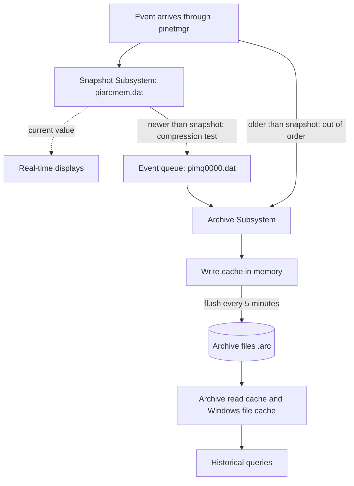

## Plain English

When a value reaches the Data Archive, it lands first in the **snapshot**: one slot per point
holding its newest value. Displays that ask for "current value" read the snapshot.

The Snapshot Subsystem then runs the **compression** test. Values worth keeping go into the **event
queue**, which OSIsoft calls a "tank" between the snapshot and the archive. The **Archive Subsystem**
drains the tank into a memory **write cache**, which is flushed to the **archive files** on disk
every 5 minutes by default.

If the archive falls behind, the tank fills up, but the data is not lost while it waits.

## Deep Dive

**Files.**

| Item | File |
|---|---|
| Snapshot table | `piarcmem.dat` |
| Event queue | `pimq0000.dat` |
| Archives | `.arc` files (with `.ann` annotation files) |

**Snapshot before compression.** Clients that ask for snapshot data read the snapshot table before
compression is applied, so a real-time display can show a value that is later not archived.

**Write cache.** Incoming archive data is written first to memory and flushed to disk every
`Archive_SecondsBetweenFlush` (default 5 minutes).

**Read caches.** The Archive Subsystem has its own **read cache**, separate from the Windows file
system cache. It helps most for repeated summary calculations on the same point. The Windows file
system cache holds 256 KB sections of archive files after they are read from disk.

**Out-of-order (OOO) data.** An event older than the point's snapshot goes straight into the archive
and bypasses compression. Main causes are analysis recalculation and history recovery (PI to PI,
RDBMS, UFL). Symptoms are high CPU or memory and slow archive operations; the telltale message is ID
2016, "Inserting overflow record". Mitigations: reduce OOO writes, shorten archive duration and order
OOO writes within each archive file. Avoid excessive string and BLOB tags, Float64, sub-second
timestamps and annotations. PI Server 2024 is reported to make OOO inserts up to 40% faster for
numeric types and up to 90% faster for strings and blobs.

**Watching the flow.**

| Tool | Shows |
|---|---|
| `piartool -ss` | Snapshot statistics (refresh every 5 s) |
| `piartool -qs` | Event-queue statistics |
| `piartool -as` | Archive statistics |
| SMT Operation > Snapshot and Archive Statistics | Same, with a snapshot-only or archive-only option |

Performance counters include Snapshots/sec, OutOfOrderSnapshots/sec, Queued Events/sec, Events in
Overflow Queues, Archived Events/sec, Total Unflushed Events and Events Read/sec.

**The Archiving flag.** In `piartool -as` output: 0 = not archiving, 1 = historic only, 2 = future
only, 3 = historic and future. Healthy is 1 on Data Archive 2012 and earlier, and 3 on 2015 and later.

## Worked Example

An admin runs `piartool -qs` during a PI to PI history recovery and sees the queue count climbing.

1. The archive is not keeping up, or no primary archive covers the incoming time range.
2. `piartool -as` shows Archiving = 3 on a 2018 server, so archiving is healthy.
3. The message log shows many 2016 "Inserting overflow record" messages: heavy OOO inserts.
4. The admin slows the recovery and orders it by time within each archive. The queue drains; no data
   was lost while queued.

## Diagram

## Common Mistakes

- **Panicking at a growing queue.** Queued data is safe; find out why the archive is slow or which
  time range has no archive.
- **Expecting a value seen on a live display to be in history.** The display read the snapshot before
  compression.
- **Running large recalculations with no thought for OOO cost.** They create overflow records and
  slow the archive.

## Real-World Scenario

In Dell's 2012 benchmark, the event queue used the default file size of 64 MB and page size of
64 KB. After a simulated outage, buffered data recovery pushed rates more than 32% above nominal, with
a snapshot peak of 799K events/s (reported by Dell and OSIsoft). Sizing the queue and archive storage
for recovery bursts, not just normal load, keeps a site safe after network outages.
