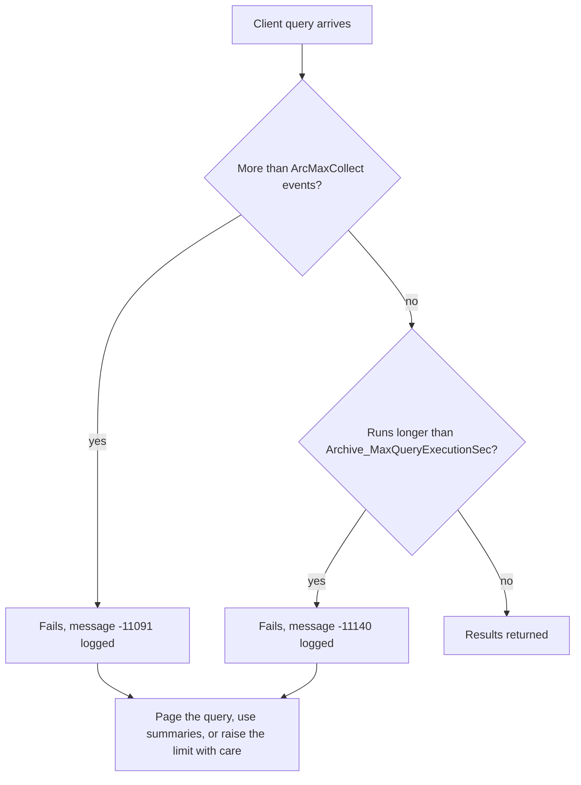

## Plain English

**Tuning parameters** are named settings that control how the Data Archive subsystems behave: how big
a query may be, how long it may run, how often data is flushed to disk, where new archives go. You see
and change them in SMT under **Operation > Tuning Parameters**, which has an Archive tab.

Most defaults are sensible. The ones you are most likely to meet are the **query limits**, because
they stop one huge request from slowing everybody down. When a user's query hits a limit, the message
log records it.

## Deep Dive

**Parameters with sourced defaults.**

| Parameter | Purpose | Default |
|---|---|---|
| ArcMaxCollect | Max compressed events one query can return; hitting it logs [-11091] | 1.5 million |
| Archive_MaxQueryExecutionSec | Max archive query run time; exceeding it logs [-11140] | 260 s |
| Archive_SecondsBetweenFlush | Archive write-cache flush interval | 5 minutes |
| MessageLog_DayLimit | Message-log retention | 35 days |

**Other parameters named in the sources.**

| Parameter | Purpose |
|---|---|
| piarchss_ThreadCount | Concurrent archive RPC threads (cores - 1 standard; 2x cores for large-query systems with no real-time users) |
| Archive_ReprocessThreadCount | Set to 1 for 2018 SP2 and later |
| Archive_CacheRecordsPerPoint, Archive_CacheRecordPool | Archive read cache |
| Archive_AutoArchiveFileRoot, Archive_FutureAutoArchiveFileRoot, Archive_AutoArchiveFileSize, Archive_AutoArchiveFileExt, Archive_AutoArchiveFileFormat | Automatic archive creation |
| Archive_LowDiskSpaceMB | Low-disk threshold |
| Snapshot_EventQueuePath, Snapshot_EventQueueSize (MB) | Event queue location and size |
| MaxUpdateQueue, TotalUpdateQueue | Update Manager queue limits; 2010 guidance said not to change them |
| EnableAudit | Turns on auditing |
| Server_AuthenticationPolicy, AutoTrustConfig (recommended 0), MaxConnIdleTime (seconds) | Basic server settings |

**Hardware sizing rules of thumb.** A 2012 OSIsoft architecture deck gave:

| | Minimum | Recommended |
|---|---|---|
| RAM | 15 KB per PI point | Enough to fit 2 full archives in RAM |
| Disk IO/s | Rate of archived events / 50 | Rate of archived events / 10 + read workload |
| Network | 100 Mbps LAN | 1-10 Gbps LAN |
| CPU cores | 4 + active client connections / 5 | 4 + active client connections / 2 |

2010 guidance: 2 GB minimum memory, up to 8 KB per point, and 5-20 bytes per event of storage. The
same 2012 deck said "Treat virtual machines as if they were physical machines" and "Do not mix virtual
and physical on the same host". Small systems (under 10,000 assets and 25,000 tags) could put PI, AF
and SQL on one node; larger ones need at least two nodes with PI and SQL separate. SQL Express is
limited to one physical CPU and 1 GB of RAM.

**Good compression is tuning too.** Sensible exception and compression mean faster archive queries,
better cache use, less Update Manager load, and fewer ArcMaxCollect hits.

## Worked Example

A user's year-long raw-data query of a 1-second flow tag fails.

1. Check the message log: `pigetmsg -sw -st *-2h -et * -msg *[-11091]*` shows [-11091] Event
   collection exceeded the maximum allowed.
2. The query asked for more than ArcMaxCollect (1.5 million) compressed events.
3. Options: page the query (for example month by month), use summaries or interpolated values
   instead of raw events, review the tag's compression, or raise ArcMaxCollect **with care**, because
   the limit protects the server.

Sizing check for the same server using the 2012 minimums: 200,000 points x 15 KB = about 3 GB RAM
minimum; with 40 active client connections, recommended cores = 4 + 40 / 2 = 24.

## Diagram

## Common Mistakes

- **Raising piarchss_ThreadCount with no clients able to use the threads.**
- **Raising ArcMaxCollect as the first response.** Paging the query or fixing compression usually
  helps more, and the limit protects other users.
- **Changing MaxUpdateQueue or TotalUpdateQueue** without a clear reason; 2010 guidance said leave
  them.
- **Leaving AutoTrustConfig on.** The recommended value is 0.

## Real-World Scenario

In Dell's 2012 benchmark, the PI Buffer Subsystem was tuned with BUF1SIZE and BUF2SIZE of 2,000,000
bytes, MAXTRANSFEROBJS 10,000 and SENDRATE 10 ms, and the archive and snapshot thread counts were set
to 64 and 16 (reported by Dell and OSIsoft). These were settings for an extreme throughput test, not
general recommendations: change tuning values one at a time and measure.

> [!NOTE]
> Current defaults for Snapshot_EventQueueSize and the event-queue page size, and whether tuning
> parameters live in the PITimeout table, were not confirmed in a readable source.
