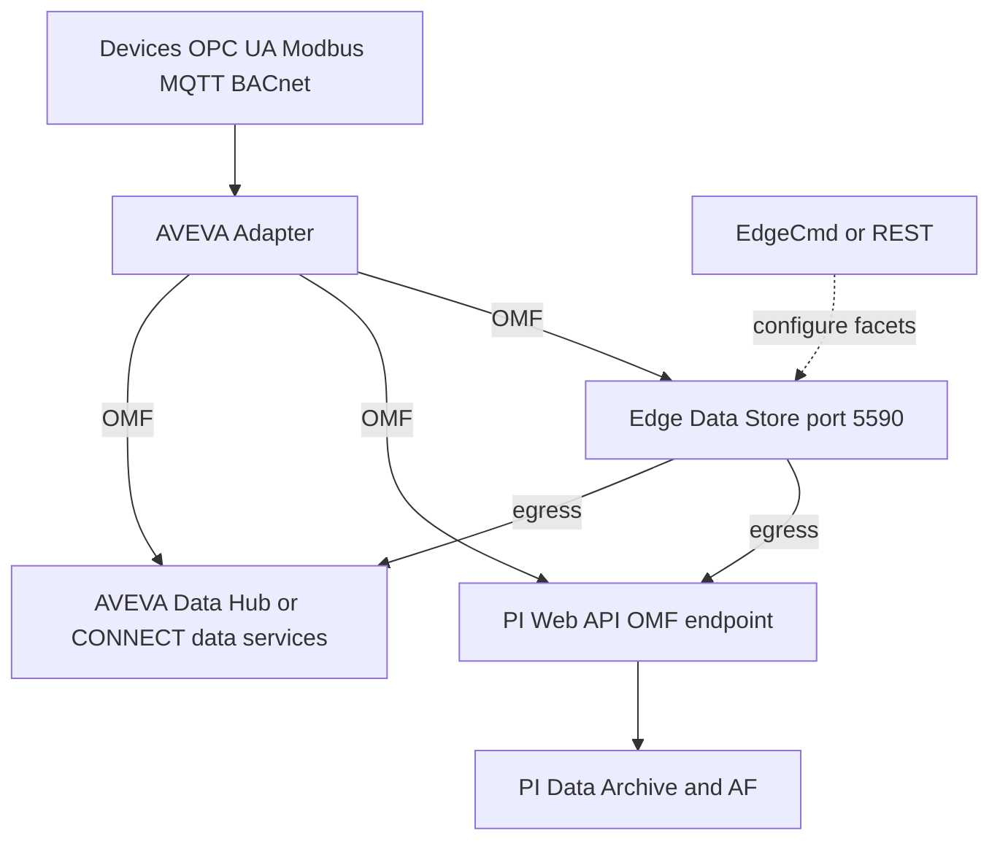

## Plain English

**AVEVA Adapters** are the newest PI data collectors. AVEVA describes them as "ready off-the-shelf,
lightweight footprint, flexible end-points". An adapter collects time-series data and metadata from
a device and sends it to an **OMF endpoint** such as PI Web API, AVEVA Data Hub (now CONNECT data
services) or Edge Data Store.

**Edge Data Store (EDS)** is "a lightweight data collection and storage application" for the edge.
It runs on Linux or Windows, even on single-board computers such as a Raspberry Pi. It stores data
locally and forwards it to the PI Server or the cloud. It *complements* the PI System and is **not**
a replacement for the PI Data Archive.

**OMF** (OSIsoft Message Format) is the language they all speak: JSON messages that first describe
the *shape* of the data, then name a *stream*, then send the *values*.

## Deep Dive

**Adapter protocols (2023):** Azure Event Hubs, BACnet, DNP3, Modbus TCP, MQTT, OPC UA, RDBMS and
Structured Data Files. The OPC UA and MQTT adapters support failover (Hot, Warm and Cold modes).
Destinations include AVEVA PI Servers, AVEVA Data Hub and Edge Data Store.

**EDS components:** Modbus TCP adapter, OPC UA adapter, Data Storage, Data egress (to PI Server or the
cloud) and Health. Locally it offers OMF REST and SDS REST APIs. EDS uses a proprietary sequential
data store.

**Ports and tools.** The EDS REST API listens on **port 5590** by default (configurable). In the
AVEVA World 2023 workshop, an MQTT adapter component ran on 5591. **EdgeCmd** is a command-line tool
that turns commands into REST calls; it is a separate install for Linux or Windows. On Linux you
install with `sudo apt install`, check with `edgecmd get system`, and see streams at
`/api/v1/tenants/default/namespaces/default/streams/`.

**Facets.** An adapter's configuration is split into named sections called facets:

| Configurable | Read-only |
|---|---|
| Components, Logging, Buffering, HealthEndpoints, DataSource, DataEndpoints, DataFilters, DataSelection | Version, General, Diagnostics, Application, FailoverState, ClientSettings |

**OMF message types:**

1. **Type**: the schema, written in JSON Schema (for example a timestamp property marked `isindex`
   plus a number).
2. **Container**: a stream of readings of one Type, identified by `id` and pointing at a `typeid`.
   In PI it becomes a PI point; in SDS it becomes a stream.
3. **Data**: the readings, each naming its `containerid`.

You must send them in that order: a container cannot reference a type that does not exist yet.

**OMF headers:** `messagetype` (type, container or data), `messageformat` (JSON), `omfversion`
(1.0, 1.1 or 1.2 on Data Hub), `action` (create by default, update or delete) and optional
`compression` (gzip). Every object in one message must be of the same message type. OMF is not tied
to one transport; AVEVA recommends bulking and compression.

**Endpoint differences** (from AVEVA's OMF samples): PI accepts only a DateTime index and only one
index. Data Hub accepts only the dynamic classification and does not accept Link type data.

**For PI.** The PI Web API OMF endpoint needs the OMF option selected when PI Server is installed. It
is recommended for all new deployments.

## Worked Example

AVEVA's OMF basic sample (v2.2.0, OMF 1.2) sends three files in order: `OMF-Types.json`,
`OMF-Containers.json` and `OMF-Data.json`. To target a local EDS, its configuration is:

```json
{"Selected": true, "EndpointType": "EDS", "Resource": "http://localhost:5590", "ApiVersion": "v1", "UseCompression": false}
```

1. A Type message defines `SensorReading` with an index property `Time` (date-time) and a number
   `Reading`.
2. A Container message creates stream `Sensor1Readings` with `typeid` `SensorReading`.
3. A Data message sends values for `containerid` `Sensor1Readings`.
4. `GET http://localhost:5590/api/v1/tenants/default/namespaces/default/streams/` now lists the stream.
5. Switching `EndpointType` to PI (with a PI Web API URL and DataArchiveName) sends the same messages
   to the PI Server, where the container becomes a PI point.

## Diagram



## Common Mistakes

- **Treating EDS as a small PI Data Archive.** AVEVA says it is not a replacement; it buffers and forwards.
- **Sending data before its type and container.** OMF order is Type, then Container, then Data.
- **Mixing message types in one message.** All objects in a message must share the same type.
- **Expecting PI to accept any index.** PI takes one DateTime index only.
- **Forgetting the OMF option at PI Server install.** Without it, PI Web API has no OMF endpoint.
- **Pointing new OMF apps at the PI Connector Relay.** Use the PI Web API OMF endpoint.

## Real-World Scenario

In the AVEVA World 2023 hands-on workshop, students installed EDS on Linux with `apt`, added the
AVEVA Adapter for MQTT to consume Sparkplug B messages, and checked the system with `edgecmd get
system`. EDS ran on port 5590 and the adapter component on 5591. They then configured egress so that
stored data flowed to AVEVA Data Hub, where it could be viewed in the Data Hub trend tool, while the
same data sent to PI could be viewed in PI Vision.
