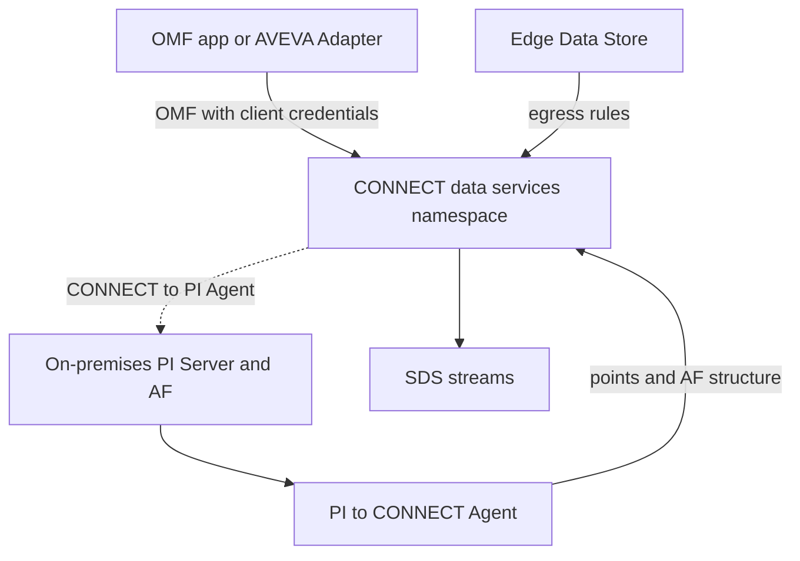

## Plain English

AVEVA's cloud data service has had three names:

1. **OSIsoft Cloud Services (OCS)**, OSIsoft's original cloud service. In 2022 AVEVA said "OCS
   customers will have a migration path to AVEVA Data Hub".
2. **AVEVA Data Hub**.
3. **CONNECT data services**, the name announced on 11 July 2024. It is "the foundation of our
   industrial intelligence platform, CONNECT", which AVEVA unveiled in April 2024 and runs on
   Microsoft Azure.

There are three main ways to get data into it:

- **OMF directly** from an application or AVEVA Adapter.
- **Edge Data Store egress**: EDS stores data at the edge and "transferred to OCS using configurable
  egress rules".
- **The PI to CONNECT Agent**, which copies PI points and AF data from an on-premises PI Server.

## Deep Dive

**Tenants and namespaces.** A *tenant* is your organisation's account. A *namespace* "provides
isolation within a tenant"; OMF ingress and streams are scoped to a namespace. In the cloud, an OMF
container creates an **SDS stream** (Sequential Data Store).

**OMF ingress endpoint:**

```
POST /api/v1/tenants/{tenantId}/namespaces/{namespaceId}/omf
```

Regional base URLs in AVEVA's samples are `https://uswe.datahub.connect.aveva.com` (North America)
and `https://euno.datahub.connect.aveva.com` (EMEA).

**Authentication.** OMF clients use a **client-credentials** client ID and secret scoped to the
tenant and namespace. In Data Hub you create an **OMF connection** with a Name, Description and
ClientIds, and wait for its State to become "Active" before sending. "ClientIds may be mapped to at
most one connection per namespace." In client configuration, the resource URL is "the base address,
NOT the OMF endpoint".

**Responses.** A successful send returns **202** with an `Operation-Id`. Errors include 400, 401,
403, 404, 408, 413 (payload too large), 415, 500, 503 and 504. Error bodies carry OperationId,
Error, Reason, Resolution and Parameters. To remove types and containers, send the same messages
with `action: delete`.

**PI to CONNECT Agent.** First shipped as the PI to Data Hub agent ("PI to Data Hub 2.0" in 2022),
it is now the **PI to CONNECT Agent**, which "enables the transfer of data from on-premises PI
Server to CONNECT data services". It runs on-premises, authenticates to the PI Server with Windows
accounts, and transfers PI points plus AF elements, attributes, PI point references and constant
values. It shows warnings and errors per transfer, and **replicates deletions only if you opt in**.
It also reports tag usage for the aggregate tag licence model; each PI Server in that model needs
the agent installed. A **CONNECT to PI Agent** writes cloud stream data back to PI tags.

AVEVA's 2023 roadmap listed "PI to Data Hub" as available and "Data Hub to PI" as in development.

## Worked Example

A developer sends sensor data from a gateway into CONNECT data services in North America.

1. In the portal she creates a client-credentials client and notes the tenant ID, namespace, client
   ID and secret.
2. She creates an OMF connection with that client ID mapped to her namespace and waits for State
   "Active".
3. Her app sets the resource to `https://uswe.datahub.connect.aveva.com` (the base address, not the
   OMF path).
4. It posts Type, Container and Data messages to
   `/api/v1/tenants/{tenantId}/namespaces/{namespaceId}/omf`. Each returns 202 with an
   Operation-Id.
5. A large batch returns 413: the payload is too large, so she splits it and enables gzip.
6. The container now appears as an SDS stream in the namespace.

## Diagram



## Common Mistakes

- **Using the OMF path as the resource URL.** The resource is the base address only.
- **Sending before the OMF connection is Active.**
- **Mapping one client ID to two connections** in the same namespace; only one is allowed.
- **Assuming PI deletions are mirrored.** Replicating deletions with the agent is opt-in.
- **Looking for "OCS" or "Data Hub" in new docs.** The current name is CONNECT data services.

## Real-World Scenario

AVEVA's 2022 session on the PI to Data Hub agent showed the hybrid pattern many sites now use: the
agent runs on-premises, authenticates to local PI Servers with Windows accounts, and pushes selected
PI points and AF structure to the cloud. Analysts and partners then work from the cloud copy, while
operations keeps using the on-premises PI System. Under the aggregate tag licence model, AVEVA's
service description requires the PI to CONNECT Agent on every PI Server in the model, so the agent
is often installed even when little data is sent.
